# GraphQL BFF and Facade APIs on Azure: Security, Performance and Concurrency Design Guide

**Stack:** .NET 8/9 (LTS), C#, Hot Chocolate (GraphQL.NET as an alternative), Azure App Service, Managed Identity, Azure API Management (external and internal)
**Audience:** solution architects, backend engineers, platform/cloud engineers, security reviewers
**Companion document:** *Okta Authentication and Authorization for a Next.js and .NET Solution*. That guide's Okta access token is the user token used here.

---

## 0. How to read this document

The document runs in build order. Sections 1–4 cover architecture and the trust model. Section 5 builds the network and infrastructure, and Section 6 wires up Managed Identity. Sections 7–8 implement the Facade and the BFF, and Section 9 hardens GraphQL. Sections 10–11 cover concurrency and resilience: idempotency, race conditions, rate limiting, timeouts and circuit breakers. Sections 12–16 cover performance, the error contract, observability, testing and checklists. Section 17 lists all sources.

All diagrams are Mermaid. They render natively in GitHub, GitLab, Azure DevOps wikis, VS Code and Notion, and you can export them to PNG/SVG at mermaid.live. Names such as `contoso`, IP ranges and IDs are placeholders.

Decisions that come from my own engineering judgement rather than a cited source are labelled **"Design decision"**.

---

## 1. Goals and design principles

| Principle | What it means here |
|---|---|
| Safety first / zero trust | Every hop authenticates and authorizes. Network isolation is added on top of identity checks and never replaces them. |
| Least privilege | Each workload has its own managed identity with only the roles it needs. No secrets, connection-string passwords or access keys. |
| Private by default | Only the external gateway (or its WAF) has a public IP. BFF, internal APIM, Facade and the data services are reachable only through private IPs. |
| Bounded work | Every request has limits on size, depth, cost, time, concurrency and rate, at several layers. |
| Exactly-once effects | Retries are expected. Mutations are idempotent, writes are conflict-safe, and side effects use an outbox. |
| Fail fast, degrade gracefully | Timeouts shrink at each hop, circuit breakers protect dependencies, and partial GraphQL results are allowed where safe. |
| Observable | One correlation ID from the edge to the database. Metrics, logs and traces all go to Application Insights. |

**Non-goals:** UI concerns, Okta tenant configuration (see the companion doc), and multi-region active-active. Section 12 has notes on multi-region.

---

## 2. Architecture overview

### 2.1 Logical context

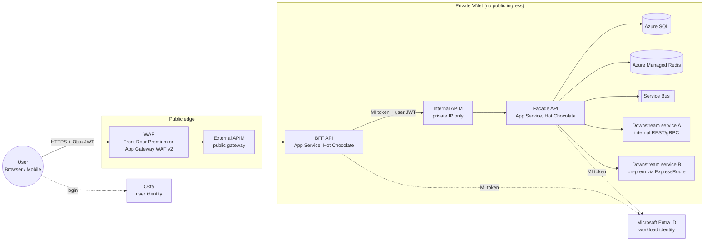

### 2.2 Responsibilities: BFF vs Facade

| Concern | BFF API (experience layer) | Facade API (domain/integration layer) |
|---|---|---|
| Consumers | One frontend (web or mobile). One BFF per experience is fine. | BFF(s) only. Never the internet. |
| Schema | UI-shaped: view models, screen-level queries, aggregated fields | Domain-shaped: stable, versioned entities and commands |
| Auth inbound | Okta user JWT (validated at external APIM and again in the BFF) | Entra MI token from the BFF (service authz) plus the forwarded user JWT (user authz) |
| Auth outbound | Managed Identity → Entra token for the Facade | Managed Identity → SQL, Redis, Service Bus, Key Vault, downstream APIs |
| State | Stateless. Optional short-lived response cache. | Owns transactions, idempotency store, optimistic concurrency, outbox |
| GraphQL exposure | Trusted documents only (persisted operations from the frontend build) | Trusted documents only (persisted operations from the BFF build) |
| Rate limiting | Per user / per client, cost-aware | Per calling service, concurrency limits / bulkheads per dependency |
| Must not | Contain business rules, hold DB connections, call data stores directly | Contain UI formatting logic, be reachable from the internet |

### 2.3 End-to-end request path (happy-path query)

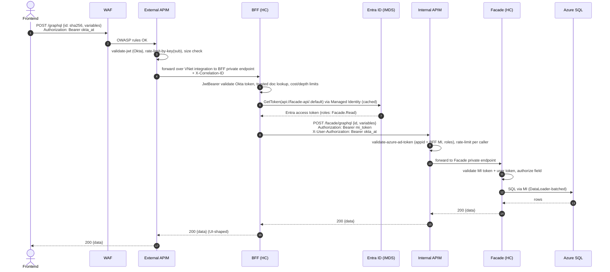

---

## 3. Technology choices

| Choice | Recommendation | Why |
|---|---|---|
| GraphQL server | **Hot Chocolate** (pin all `HotChocolate.*` packages to the same version) | Built-in cost analysis (IBM spec), trusted documents, DataLoader source generator, request limits, ASP.NET Core auth integration. GraphQL.NET works too but needs more hand-built hardening. |
| BFF → Facade client | Strawberry Shake (typed client, persisted operations) or typed `HttpClient` | Build-time operations make the Facade a closed, allow-listed API |
| Runtime | .NET 8/9 on **Linux** App Service, Premium v3/v4 plan, zone redundant | Private endpoints and VNet integration require Basic tier or higher. Premium is needed for zone redundancy and scale. |
| Cache / locks | **Azure Managed Redis** with Entra auth | Azure Cache for Redis Basic/Standard/Premium retire on September 30, 2028, and Microsoft recommends upgrading to Azure Managed Redis now ([Source](https://learn.microsoft.com/en-us/azure/azure-cache-for-redis/retirement-faq)) |
| Database | Azure SQL with Entra-only auth | MI auth, `rowversion` optimistic concurrency, unique constraints for idempotency |
| Messaging | Azure Service Bus (Premium for private endpoints) | Outbox relay, duplicate detection, sessions for ordering |
| Resilience | `Microsoft.Extensions.Http.Resilience` (Polly v8) | Standard pipeline: rate limiter, total timeout, retry, circuit breaker, attempt timeout |
| Secrets/config | Key Vault + App Configuration (RBAC, private endpoints) | No secrets in app settings |

---

## 4. Identity and trust model

### 4.1 Trust chain

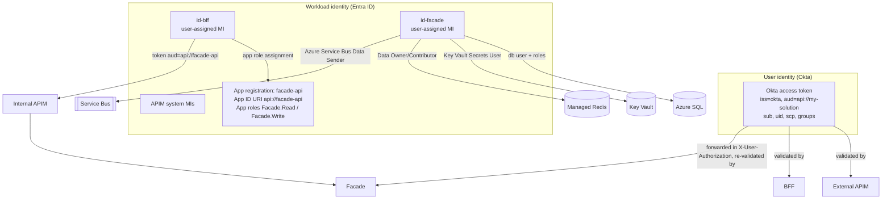

### 4.2 Tokens and headers per hop

| Hop | `Authorization` header | Other security headers | Validated by |
|---|---|---|---|
| Frontend → External APIM → BFF | `Bearer <Okta access token>` | `X-Correlation-ID` (APIM sets it if missing) | External APIM `validate-jwt`, BFF JwtBearer |
| External APIM → BFF (optional extra) | unchanged | `X-Gateway-Token: <APIM MI token for api://bff-api>` | BFF (proves the call came through *this* APIM) |
| BFF → Internal APIM → Facade | `Bearer <Entra MI token, aud api://facade-api, roles Facade.*>` | `X-User-Authorization: Bearer <Okta token>`, `X-Correlation-ID`, `Idempotency-Key` | Internal APIM `validate-azure-ad-token`, Facade (both tokens) |
| Facade → SQL / Redis / SB / KV | Entra MI token (SDK-managed) | n/a | Azure service RBAC |
| Facade → downstream service | `Bearer <Entra MI token for that service>` | `X-User-Context` (signed claims) or the forwarded user token | Downstream service |

**Design decision: why forward the user token instead of using On-Behalf-Of?** Users authenticate with Okta and workloads with Entra. Entra OBO can't exchange an Okta token. Forwarding the original, short-lived Okta token in a separate header lets the Facade make its own user-level authorization decisions (zero trust), without trusting claims the BFF asserts. The service identity stays in `Authorization`, where APIM and Microsoft.Identity.Web expect it. If you later adopt Okta's token exchange, you can swap in a downscoped token without changing the architecture.

---

## 5. Network and infrastructure, step by step

### 5.1 Choose APIM tiers and topology

The two APIM roles have different network requirements:

| Option | Tier support | Inbound | Outbound to private backends | Fit |
|---|---|---|---|---|
| Classic VNet injection, **external** mode | Developer, Premium | Internet | Yes | External APIM |
| Classic VNet injection, **internal** mode | Developer, Premium | VNet / peered / ExpressRoute only | Yes | **Internal APIM** |
| **Premium v2 VNet injection** | Premium v2 | Private IP in delegated subnet | Yes | **Internal APIM** (new builds) |
| **v2 VNet integration** (outbound only) | Standard v2, Premium v2 | Public | Yes, into one VNet (and peered VNets) | **External APIM** |
| Inbound private endpoint | Developer, Basic, Standard, Std v2, Premium, Premium v2 | Private only | (combine with VNet integration) | Internal APIM alternative |

These options come from Microsoft's APIM networking matrix. That page also notes that Premium v2 VNet injection settings can currently be configured only when the instance is created ([Source](https://learn.microsoft.com/en-us/azure/api-management/virtual-network-concepts)).

**Recommended reference topology (Design decision)**

| Component | Choice |
|---|---|
| Edge | Azure Front Door Premium with WAF (global, DDoS, bot rules), **or** Application Gateway WAF v2 in the VNet |
| External APIM | Standard v2 / Premium v2 with **outbound VNet integration** to reach the BFF private endpoint. Inbound restricted to the edge. Or classic Premium in internal mode behind Application Gateway, as in Microsoft's documented pattern ([Source](https://learn.microsoft.com/en-us/azure/api-management/api-management-howto-integrate-internal-vnet-appgateway)). |
| Internal APIM | Premium v2 with VNet injection, or classic Premium/Developer in **internal** mode |
| BFF and Facade | App Service (Linux, Premium v3), **private endpoint inbound**, **VNet integration outbound**, public network access **disabled** |

If cost matters more than isolation between the two gateways, a single classic Premium APIM in internal mode behind Application Gateway also works. Application Gateway then publishes only the `/bff/*` APIs, and the `/facade/*` APIs stay VNet-only. The rest of this guide assumes two instances, as specified.

### 5.2 Network topology

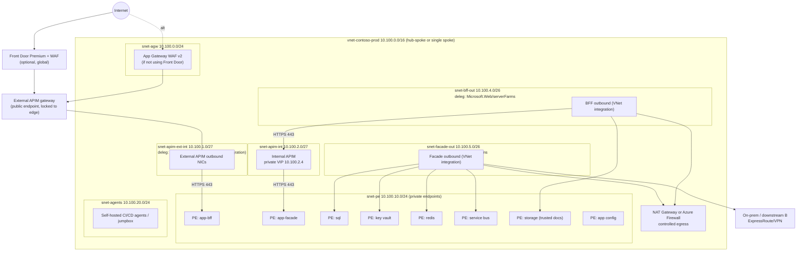

### 5.3 Address plan

| Subnet | CIDR | Delegation | NSG | Purpose |
|---|---|---|---|---|
| `snet-agw` | 10.100.0.0/24 | none | AGW rules (65200-65535 from GatewayManager) | Application Gateway WAF v2 (optional) |
| `snet-apim-ext-int` | 10.100.1.0/27 | `Microsoft.Web/serverFarms` | outbound only | External APIM v2 outbound VNet integration |
| `snet-apim-int` | 10.100.2.0/27 | none (classic) / `Microsoft.Web/hostingEnvironments` (Premium v2 injection; check the current docs) | **required** | Internal APIM |
| `snet-bff-out` | 10.100.4.0/26 | `Microsoft.Web/serverFarms` | outbound rules | BFF VNet integration |
| `snet-facade-out` | 10.100.5.0/26 | `Microsoft.Web/serverFarms` | outbound rules | Facade VNet integration |
| `snet-pe` | 10.100.10.0/24 | none | optional | All private endpoints |
| `snet-agents` | 10.100.20.0/24 | none | restrictive | Build agents, jumpbox, Bastion target |

Why these sizes:

- **VNet integration subnets.** Each App Service plan instance uses one IP, scale operations temporarily double usage, and the subnet size can't change after assignment. Microsoft recommends allocating twice your planned maximum scale and notes that a `/26` covers the maximum scale of a single multitenant plan ([Source](https://learn.microsoft.com/en-us/azure/app-service/overview-vnet-integration)).
- **Why 10.100.0.0/16 and not 10.20.x.x.** Windows App Service workers can't reach destinations that overlap their infrastructure ranges. For example, P1v2 uses `10.20.0.0/19` and `10.21.0.0/19`, so destination subnets should avoid the listed ranges ([Source](https://learn.microsoft.com/en-us/azure/app-service/overview-vnet-integration)). Linux plans aren't affected, but choosing a non-overlapping space keeps your options open.
- **Internal APIM subnet.** It must be in the same region and subscription, have no delegation (classic), and have an NSG attached, because APIM's internal load balancer rejects all inbound traffic by default ([Source](https://learn.microsoft.com/en-us/azure/api-management/api-management-using-with-internal-vnet)).

### 5.4 Step 1: Resource group, VNet, subnets, NSGs

```bash
# ---------- variables ----------
LOC=australiaeast
RG=rg-contoso-api-prod
VNET=vnet-contoso-prod
az group create -n $RG -l $LOC

az network vnet create -g $RG -n $VNET -l $LOC --address-prefixes 10.100.0.0/16

# Subnets
az network vnet subnet create -g $RG --vnet-name $VNET -n snet-agw          --address-prefixes 10.100.0.0/24
az network vnet subnet create -g $RG --vnet-name $VNET -n snet-apim-ext-int --address-prefixes 10.100.1.0/27 \
   --delegations Microsoft.Web/serverFarms
az network vnet subnet create -g $RG --vnet-name $VNET -n snet-apim-int     --address-prefixes 10.100.2.0/27
az network vnet subnet create -g $RG --vnet-name $VNET -n snet-bff-out      --address-prefixes 10.100.4.0/26 \
   --delegations Microsoft.Web/serverFarms
az network vnet subnet create -g $RG --vnet-name $VNET -n snet-facade-out   --address-prefixes 10.100.5.0/26 \
   --delegations Microsoft.Web/serverFarms
az network vnet subnet create -g $RG --vnet-name $VNET -n snet-pe           --address-prefixes 10.100.10.0/24
az network vnet subnet create -g $RG --vnet-name $VNET -n snet-agents       --address-prefixes 10.100.20.0/24
```

**NSG for the internal APIM subnet (classic internal mode minimum rules)**

```bash
NSG=nsg-apim-int
az network nsg create -g $RG -n $NSG

# Inbound
az network nsg rule create -g $RG --nsg-name $NSG -n AllowApimMgmt --priority 100 --direction Inbound \
  --source-address-prefixes ApiManagement --destination-address-prefixes VirtualNetwork \
  --destination-port-ranges 3443 --protocol Tcp --access Allow
az network nsg rule create -g $RG --nsg-name $NSG -n AllowAzureLB --priority 110 --direction Inbound \
  --source-address-prefixes AzureLoadBalancer --destination-address-prefixes VirtualNetwork \
  --destination-port-ranges 6390 --protocol Tcp --access Allow
az network nsg rule create -g $RG --nsg-name $NSG -n AllowBffToApim --priority 120 --direction Inbound \
  --source-address-prefixes 10.100.4.0/26 --destination-address-prefixes VirtualNetwork \
  --destination-port-ranges 443 --protocol Tcp --access Allow
az network nsg rule create -g $RG --nsg-name $NSG -n DenyOtherInbound --priority 4000 --direction Inbound \
  --source-address-prefixes '*' --destination-address-prefixes '*' --destination-port-ranges '*' \
  --protocol '*' --access Deny

# Outbound (platform dependencies)
for r in "Storage 443 200" "Sql 1433 210" "AzureKeyVault 443 220" "AzureMonitor 1886,443 230"; do
  set -- $r
  az network nsg rule create -g $RG --nsg-name $NSG -n Out-$1 --priority $3 --direction Outbound \
    --source-address-prefixes VirtualNetwork --destination-address-prefixes $1 \
    --destination-port-ranges ${2//,/ } --protocol Tcp --access Allow
done
az network nsg rule create -g $RG --nsg-name $NSG -n Out-FacadePE --priority 240 --direction Outbound \
  --source-address-prefixes VirtualNetwork --destination-address-prefixes 10.100.10.0/24 \
  --destination-port-ranges 443 --protocol Tcp --access Allow

az network vnet subnet update -g $RG --vnet-name $VNET -n snet-apim-int --network-security-group $NSG
```

The required rules are: management on 3443 from the `ApiManagement` tag, the Azure Load Balancer on 6390, and outbound to Storage 443, SQL 1433, Key Vault 443 and Azure Monitor 1886/443. Microsoft also says to use service tags and to give these rules higher priority than the default rules ([Source](https://learn.microsoft.com/en-us/azure/api-management/api-management-using-with-internal-vnet)). Premium v2 VNet injection manages most dependency connectivity automatically, so check its own NSG guidance ([Source](https://learn.microsoft.com/en-us/azure/api-management/virtual-network-concepts)).

**NSGs for the App Service integration subnets (outbound allow-list)**

| Subnet | Allow outbound to | Port | Then |
|---|---|---|---|
| `snet-bff-out` | `10.100.2.0/27` (internal APIM) | 443 | |
| `snet-bff-out` | `10.100.10.0/24` (Storage PE for trusted docs, KV, App Config) | 443 | |
| `snet-bff-out` | `AzureActiveDirectory`, `AzureMonitor` service tags | 443 | Deny all other |
| `snet-facade-out` | `10.100.10.0/24` (SQL 1433, Redis 10000, SB 443/5671, KV 443) | as listed | |
| `snet-facade-out` | Downstream subnets / on-prem ranges | service ports | |
| `snet-facade-out` | `AzureActiveDirectory`, `AzureMonitor` | 443 | Deny all other |

NSGs on an integration subnet only affect traffic that's actually routed into the VNet, and inbound NSG rules don't apply to the app. Your allow-list must also include dependencies such as Entra ID and CRL endpoints ([Source](https://learn.microsoft.com/en-us/azure/app-service/overview-vnet-integration)). Azure SQL Database's default redirect connection policy over a private endpoint also uses ports 11000–11999, so allow that range or set the server to Proxy.

### 5.5 Step 2: Private DNS zones

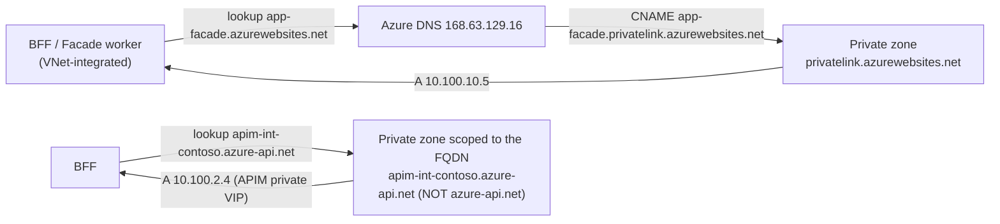

| Private DNS zone | Records | Linked VNets |
|---|---|---|
| `privatelink.azurewebsites.net` | `app-bff`, `app-bff.scm`, `app-facade`, `app-facade.scm` (auto via zone group) | spoke + hub |
| `privatelink.database.windows.net` | `sql-contoso-prod` | spoke |
| `privatelink.vaultcore.azure.net` | `kv-contoso-prod` | spoke |
| `privatelink.blob.core.windows.net` | `stcontosodocs` | spoke |
| `privatelink.servicebus.windows.net` | `sb-contoso-prod` | spoke |
| `privatelink.redis.azure.net` (Azure Managed Redis) | `redis-contoso-prod` | spoke |
| `privatelink.azconfig.io` | `appcs-contoso-prod` | spoke |
| `apim-int-contoso.azure-api.net` (FQDN-scoped) **or** your custom zone (e.g. `api.contoso.internal`) | `@ A 10.100.2.4` | spoke + hub + on-prem forwarders |

Two rules matter most here:

- **App Service private endpoints.** Once a private endpoint exists, the public name CNAMEs to `*.privatelink.azurewebsites.net`. Without a private zone or DNS server answering with the private IP, clients resolve the public IP and get a 403. Deployments through Kudu need the `scm` record too ([Source](https://learn.microsoft.com/en-us/azure/app-service/overview-private-endpoint)).
- **Internal APIM.** Microsoft explicitly warns against creating a Private DNS zone for the apex `azure-api.net`, because that breaks resolution for other Azure services. Create records only for the exact FQDNs, pointing to the private VIP ([Source](https://learn.microsoft.com/en-us/azure/api-management/api-management-using-with-internal-vnet)).

```bash
for z in privatelink.azurewebsites.net privatelink.database.windows.net privatelink.vaultcore.azure.net \
         privatelink.blob.core.windows.net privatelink.servicebus.windows.net privatelink.redis.azure.net \
         privatelink.azconfig.io; do
  az network private-dns zone create -g $RG -n $z
  az network private-dns link vnet create -g $RG -z $z -n link-$VNET -v $VNET -e false
done
```

### 5.6 Step 3: Data and platform services (private, Entra-only)

| Service | Key settings |
|---|---|
| **Azure SQL** | Entra-only authentication. Entra admin = a platform group. Public network access **Disabled**. Private endpoint in `snet-pe`. TDE on. Auditing to Log Analytics. Zone redundant (Business Critical / Hyperscale). |
| **Key Vault** | RBAC permission model, purge protection, public access disabled, private endpoint |
| **Azure Managed Redis** | Entra auth on, access keys **disabled**, private endpoint, clustered (default) |
| **Storage** (trusted-documents container) | Shared key disabled, public access disabled, private endpoint (blob) |
| **Service Bus** Premium | Local auth disabled, private endpoint, duplicate detection on queues/topics used by the outbox relay |
| **App Configuration** | Local auth disabled, private endpoint |
| **Application Insights + Log Analytics** | Workspace-based. Use Azure Monitor Private Link Scope (AMPLS) if ingestion must be private. |

```bash
# Example: SQL server with Entra-only auth and private endpoint
az sql server create -g $RG -n sql-contoso-prod -l $LOC --enable-ad-only-auth \
  --external-admin-principal-type Group --external-admin-name "grp-sql-admins" \
  --external-admin-sid <group-object-id>
az sql server update -g $RG -n sql-contoso-prod --set publicNetworkAccess=Disabled
az sql db create -g $RG -s sql-contoso-prod -n contoso --service-objective GP_Gen5_4 --zone-redundant true

SQLID=$(az sql server show -g $RG -n sql-contoso-prod --query id -o tsv)
az network private-endpoint create -g $RG -n pe-sql --vnet-name $VNET --subnet snet-pe \
  --private-connection-resource-id $SQLID --group-id sqlServer --connection-name sql
az network private-endpoint dns-zone-group create -g $RG --endpoint-name pe-sql -n default \
  --private-dns-zone privatelink.database.windows.net --zone-name sql
```

### 5.7 Step 4: App Service plans, apps, identity, VNet integration, private endpoints

**Design decision:** use separate App Service plans for the BFF and the Facade. They have different scaling profiles, a noisy neighbour can't starve the other, and each plan gets its own VNet integration subnet.

```bash
# Identities (user-assigned so they survive app re-creation and can be pre-authorized)
az identity create -g $RG -n id-bff
az identity create -g $RG -n id-facade
BFF_MI_ID=$(az identity show -g $RG -n id-bff --query id -o tsv)
FAC_MI_ID=$(az identity show -g $RG -n id-facade --query id -o tsv)

# Plans (Linux, Premium v3, zone redundant needs >= 3 instances)
az appservice plan create -g $RG -n asp-bff    --is-linux --sku P1v3 --number-of-workers 3 --zone-redundant
az appservice plan create -g $RG -n asp-facade --is-linux --sku P2v3 --number-of-workers 3 --zone-redundant

# Apps
az webapp create -g $RG -p asp-bff    -n app-contoso-bff    --runtime "DOTNETCORE:8.0" --assign-identity $BFF_MI_ID
az webapp create -g $RG -p asp-facade -n app-contoso-facade --runtime "DOTNETCORE:8.0" --assign-identity $FAC_MI_ID

for APP in app-contoso-bff app-contoso-facade; do
  # Hardening
  az webapp update -g $RG -n $APP --https-only true
  az webapp config set -g $RG -n $APP --min-tls-version 1.2 --ftps-state Disabled --http20-enabled true \
     --always-on true --health-check-path /health/ready
  az resource update -g $RG -n scm --namespace Microsoft.Web --resource-type basicPublishingCredentialsPolicies \
     --parent sites/$APP --set properties.allow=false     # disable basic auth for SCM
  az resource update -g $RG -n ftp --namespace Microsoft.Web --resource-type basicPublishingCredentialsPolicies \
     --parent sites/$APP --set properties.allow=false
done

# Outbound: VNet integration + route all traffic
az webapp vnet-integration add -g $RG -n app-contoso-bff    --vnet $VNET --subnet snet-bff-out
az webapp vnet-integration add -g $RG -n app-contoso-facade --vnet $VNET --subnet snet-facade-out
az resource update -g $RG -n app-contoso-bff    --resource-type Microsoft.Web/sites --set properties.vnetRouteAllEnabled=true
az resource update -g $RG -n app-contoso-facade --resource-type Microsoft.Web/sites --set properties.vnetRouteAllEnabled=true

# Inbound: private endpoints, then disable public access
for APP in app-contoso-bff app-contoso-facade; do
  ID=$(az webapp show -g $RG -n $APP --query id -o tsv)
  az network private-endpoint create -g $RG -n pe-$APP --vnet-name $VNET --subnet snet-pe \
     --private-connection-resource-id $ID --group-id sites --connection-name $APP
  az network private-endpoint dns-zone-group create -g $RG --endpoint-name pe-$APP -n default \
     --private-dns-zone privatelink.azurewebsites.net --zone-name web
  az resource update -g $RG -n $APP --resource-type Microsoft.Web/sites --set properties.publicNetworkAccess=Disabled
done
```

Facts behind these steps:

- **Inbound vs outbound.** A private endpoint carries only *inbound* traffic. Outbound uses VNet integration, which must be on a different subnet ([Source](https://learn.microsoft.com/en-us/azure/app-service/overview-private-endpoint)).
- **Disable public access.** For isolation, disable public network access once the private endpoint exists. Access-restriction rules aren't evaluated for private-endpoint traffic ([Source](https://learn.microsoft.com/en-us/azure/app-service/overview-private-endpoint)).
- **Route all.** With route-all enabled, all outbound traffic enters the VNet. Otherwise only RFC1918 traffic does. Microsoft recommends site properties over the legacy `WEBSITE_VNET_ROUTE_ALL` app setting ([Source](https://learn.microsoft.com/en-us/azure/app-service/overview-vnet-integration)).
- **Managed identity routing.** MI token acquisition goes over the public route by default. It can be routed through VNet integration, and Key Vault references fall back to VNet integration when the vault blocks public traffic ([Source](https://learn.microsoft.com/en-us/azure/app-service/overview-vnet-integration)).

**Facade-only extra lock (defense in depth):** the Facade should accept traffic only from the internal APIM. With public access disabled, only private-endpoint traffic arrives. Add the internal APIM's managed identity check (Section 6.4) and an NSG on `snet-pe` that allows 443 to the Facade PE only from `10.100.2.0/27` and `snet-agents`. This needs private endpoint network policies enabled on `snet-pe`.

```bash
az network vnet subnet update -g $RG --vnet-name $VNET -n snet-pe --private-endpoint-network-policies Enabled
```

### 5.8 Step 5: Internal APIM (Facade gateway)

1. **Create** a Premium v2 instance with VNet injection into `snet-apim-int` (this must be set at creation), or create a classic Premium/Developer instance.
2. **Classic only:** go to *Network > Virtual network*, select **Internal**, choose the VNet and subnet, then **Save**. After deployment, the Overview page shows the private VIP ([Source](https://learn.microsoft.com/en-us/azure/api-management/api-management-using-with-internal-vnet)).
3. **DNS:** add `A` records for the gateway FQDN (and the developer portal/management endpoints if used) pointing to the private VIP. Link them to every VNet that calls the gateway, including on-prem forwarders.
4. **Custom domain (recommended):** for example `facade-gw.contoso.internal`, with a certificate from Key Vault (APIM system MI → *Key Vault Secrets User*).
5. **Backend entity:** URL `https://app-contoso-facade.azurewebsites.net` (resolves privately), *Validate certificate chain/name* = on. Add a circuit breaker rule on the backend if your tier supports it.
6. **API:** import the Facade as an **HTTP (pass-through)** API at `/facade/graphql`, `POST` only (plus `GET` if you allow persisted GET). Set *Subscription required* = off. Identity is enforced by token instead.
7. **Policies:** see Section 6.4.
8. **Verify:** *Network > Network status* must show every *Required* dependency as OK ([Source](https://learn.microsoft.com/en-us/azure/api-management/api-management-using-with-internal-vnet)).

Note that the portal test console doesn't work for internal-mode instances, because the gateway isn't in public DNS ([Source](https://learn.microsoft.com/en-us/azure/api-management/api-management-using-with-internal-vnet)). Test from a VM in `snet-agents` instead.

### 5.9 Step 6: External APIM (BFF gateway) and the edge

1. **Create** a Standard v2 or Premium v2 instance. Configure **outbound VNet integration** to `snet-apim-ext-int` (delegated to `Microsoft.Web/serverFarms`). The gateway stays publicly reachable and can now call the BFF's private endpoint ([Source](https://learn.microsoft.com/en-us/azure/api-management/virtual-network-concepts)).
2. **Edge in front:**
   - *Front Door Premium:* origin = APIM gateway hostname. Enable the WAF policy (Microsoft Default Rule Set + Bot Manager + custom rate rules). In APIM, accept only requests carrying your Front Door ID header (`X-Azure-FDID`). Optionally filter source IPs to the `AzureFrontDoor.Backend` ranges.
   - *Or Application Gateway WAF v2:* if you choose classic Premium internal mode for the external APIM, use Microsoft's App Gateway + internal APIM pattern, with the custom probe `/status-0123456789abcdef`.
3. **Backend:** `https://app-contoso-bff.azurewebsites.net`.
4. **API:** HTTP pass-through API `/bff/graphql`. **Design decision:** use the APIM *GraphQL* API type with `validate-graphql-request` only if you send full query text. With trusted documents (recommended), the body carries only `{ "id": "...", "variables": {...} }`, so APIM can't parse the operation. Enforce GraphQL limits in Hot Chocolate instead (Section 9) and use APIM for size, auth and rate limiting.
5. **Policies:** below.

```xml
<!-- External APIM: API-level policy for /bff/graphql -->
<policies>
  <inbound>
    <base />
    <!-- 1. Only accept traffic from our Front Door profile -->
    <check-header name="X-Azure-FDID" failed-check-httpcode="403" failed-check-error-message="Forbidden" ignore-case="true">
      <value>{{frontdoor-id}}</value>
    </check-header>

    <!-- 2. CORS for the SPA origin (if the browser calls APIM directly) -->
    <cors allow-credentials="false">
      <allowed-origins><origin>https://app.contoso.com</origin></allowed-origins>
      <allowed-methods><method>POST</method><method>GET</method></allowed-methods>
      <allowed-headers><header>Authorization</header><header>Content-Type</header>
        <header>Idempotency-Key</header><header>X-Correlation-ID</header></allowed-headers>
    </cors>

    <!-- 3. Body size guard (GraphQL bodies with trusted docs are tiny) -->
    <choose>
      <when condition="@(context.Request.Headers.GetValueOrDefault("Content-Length","0").AsInteger() > 65536)">
        <return-response><set-status code="413" reason="Payload Too Large" /></return-response>
      </when>
    </choose>

    <!-- 4. Validate the Okta user token -->
    <validate-jwt header-name="Authorization" require-scheme="Bearer" failed-validation-httpcode="401"
                  failed-validation-error-message="Unauthorized" output-token-variable-name="jwt">
      <openid-config url="https://contoso.okta.com/oauth2/default/.well-known/openid-configuration" />
      <audiences><audience>api://my-solution</audience></audiences>
      <issuers><issuer>https://contoso.okta.com/oauth2/default</issuer></issuers>
      <required-claims>
        <claim name="scp" match="any"><value>api.read</value><value>api.write</value></claim>
      </required-claims>
    </validate-jwt>

    <!-- 5. Rate limit + quota per user (sub), burst-protect per IP -->
    <rate-limit-by-key calls="120" renewal-period="60"
        counter-key="@("bff-user-" + ((Jwt)context.Variables["jwt"]).Subject)"
        remaining-calls-header-name="X-RateLimit-Remaining" total-calls-header-name="X-RateLimit-Limit" />
    <rate-limit-by-key calls="600" renewal-period="60" counter-key="@("bff-ip-" + context.Request.IpAddress)" />
    <quota-by-key calls="20000" renewal-period="86400"
        counter-key="@("bff-user-" + ((Jwt)context.Variables["jwt"]).Subject)" />

    <!-- 6. Correlation -->
    <set-header name="X-Correlation-ID" exists-action="skip"><value>@(context.RequestId.ToString())</value></set-header>

    <!-- 7. Optional: prove the hop came via this gateway (BFF validates) -->
    <authentication-managed-identity resource="api://bff-api" output-token-variable-name="gwToken" />
    <set-header name="X-Gateway-Token" exists-action="override">
      <value>@("Bearer " + (string)context.Variables["gwToken"])</value>
    </set-header>

    <!-- 8. Strip spoofable internal headers -->
    <set-header name="X-User-Authorization" exists-action="delete" />
    <set-backend-service backend-id="bff-backend" />
  </inbound>
  <backend>
    <forward-request timeout="25" buffer-request-body="true" />
  </backend>
  <outbound>
    <base />
    <set-header name="Server" exists-action="delete" />
    <set-header name="X-Powered-By" exists-action="delete" />
    <set-header name="Strict-Transport-Security" exists-action="override"><value>max-age=31536000; includeSubDomains</value></set-header>
  </outbound>
  <on-error>
    <base />
    <set-header name="X-Correlation-ID" exists-action="override"><value>@(context.RequestId.ToString())</value></set-header>
  </on-error>
</policies>
```

Notes on these policies:

- **`validate-jwt`** enforces a valid JWT from the configured identity provider ([Source](https://learn.microsoft.com/en-us/azure/api-management/validate-jwt-policy)).
- **`rate-limit-by-key`** returns 429 when exceeded and supports `remaining-calls-header-name`. It's never perfectly accurate because throttling is distributed. Counters are per gateway (not aggregated across regions), and the v2 tiers use a token bucket rather than a sliding window ([Source](https://learn.microsoft.com/en-us/azure/api-management/rate-limit-by-key-policy)).
- **`authentication-managed-identity`** can write the token to a variable for a custom header. Anyone who can edit APIM policies can use the MI's tokens, so restrict policy-edit RBAC ([Source](https://learn.microsoft.com/en-us/azure/api-management/authentication-managed-identity-policy)).

### 5.10 Step 7: Egress control

**Design decision:** BFF and Facade outbound traffic goes through VNet integration with route-all. Then:

- Attach a **NAT Gateway** to the integration subnets for a fixed egress IP and more SNAT ports. Microsoft lists NAT gateway for a dedicated outbound IP and for mitigating SNAT port exhaustion ([Source](https://learn.microsoft.com/en-us/azure/app-service/overview-vnet-integration)).
- Or add a UDR `0.0.0.0/0 → Azure Firewall` for FQDN-based egress allow-lists: `login.microsoftonline.com`, `*.okta.com` (JWKS), `*.in.applicationinsights.azure.com`, and so on.
- Keep traffic to private endpoints off the firewall unless you have an inspection requirement.

### 5.11 Step 8: Observability infrastructure

Create a Log Analytics workspace and workspace-based Application Insights (one per environment). Send diagnostic settings from both APIMs, both App Services, SQL, Redis, Service Bus and Key Vault to the same workspace. Configure APIM's Application Insights logger with sampling (for example 25%) and **do not log request/response bodies or the `Authorization`/`X-User-Authorization` headers**. Section 14 covers the telemetry design.

### 5.12 Step 9: CI/CD into a private estate

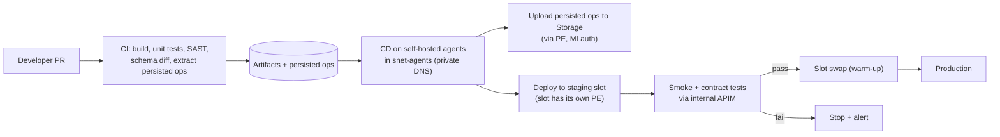

- **Private endpoints and deployment.** Once public access is disabled, Kudu/zip deploy works only over the private endpoint, so use agents inside the VNet. Each slot needs its own private endpoint (sub-resource `sites-<slot>`) ([Source](https://learn.microsoft.com/en-us/azure/app-service/overview-private-endpoint)).
- **Deploy order.** Upload persisted operations before swapping. Otherwise new clients send hashes the server doesn't know.
- **Schema changes.** Make them additive. Deprecate fields with `@deprecated`, remove them only after the operation registry shows no clients use them, and deploy the Facade before the BFF.

### 5.13 Provisioning order and verification

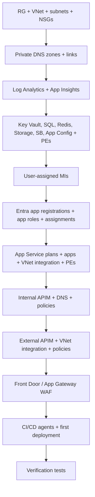

| # | Verification | Expected |
|---|---|---|
| 1 | `curl https://app-contoso-facade.azurewebsites.net` from the internet | 403 / not reachable |
| 2 | `nslookup app-contoso-facade.azurewebsites.net` from `snet-agents` VM | 10.100.10.x |
| 3 | `curl https://facade-gw.contoso.internal/facade/graphql` from the agents VM without a token | 401 from internal APIM |
| 4 | Call Facade PE directly from the agents VM with a valid BFF MI token (bypassing APIM) | Blocked by `snet-pe` NSG / 401 (missing APIM gateway token) |
| 5 | Call the external endpoint with no Okta token | 401 |
| 6 | 200 requests/min from one user | 429 with `Retry-After` |
| 7 | Non-persisted GraphQL query in prod | Rejected (persisted operation required) |
| 8 | APIM *Network status* | All Required = OK |
| 9 | SQL login with SQL auth | Fails (Entra-only) |

---

## 6. Managed Identity configuration, step by step

### 6.1 Token acquisition flow

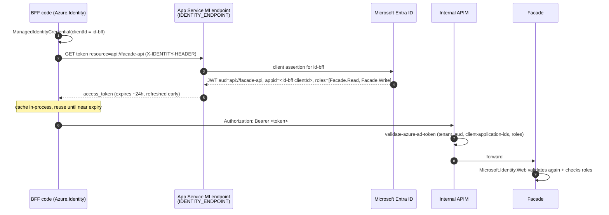

### 6.2 Step 1: Register the Facade as a protected API in Entra ID

1. Go to **Entra admin center > App registrations > New registration**. Name it `facade-api` (single tenant).
2. Under **Expose an API**, set the Application ID URI to `api://facade-api`.
3. Under **App roles > Create app role**, create these (allowed member types: **Applications**):

| Display name | Value | Purpose |
|---|---|---|
| Facade Reader | `Facade.Read` | Queries |
| Facade Writer | `Facade.Write` | Mutations |
| Gateway | `Facade.Gateway` | Assigned to the internal APIM MI (gateway-hop proof) |

4. Go to **Enterprise applications > facade-api > Properties** and set **Assignment required = Yes**. Without this, any identity in the tenant can get a token for the API.
5. Repeat for `bff-api` (role `Bff.Gateway`) if you use the external APIM gateway token.

### 6.3 Step 2: Assign app roles to managed identities

```bash
TENANT=$(az account show --query tenantId -o tsv)
FACADE_SP=$(az ad sp show --id api://facade-api --query id -o tsv)
BFF_MI_PRINCIPAL=$(az identity show -g $RG -n id-bff --query principalId -o tsv)
READ_ROLE=$(az ad sp show --id api://facade-api --query "appRoles[?value=='Facade.Read'].id" -o tsv)
WRITE_ROLE=$(az ad sp show --id api://facade-api --query "appRoles[?value=='Facade.Write'].id" -o tsv)

for ROLE in $READ_ROLE $WRITE_ROLE; do
az rest --method POST \
  --uri "https://graph.microsoft.com/v1.0/servicePrincipals/$BFF_MI_PRINCIPAL/appRoleAssignments" \
  --body "{\"principalId\":\"$BFF_MI_PRINCIPAL\",\"resourceId\":\"$FACADE_SP\",\"appRoleId\":\"$ROLE\"}"
done
```

### 6.4 Step 3: Internal APIM policy (service-to-service)

```xml
<policies>
  <inbound>
    <base />
    <validate-azure-ad-token tenant-id="{{tenant-id}}" header-name="Authorization"
        failed-validation-httpcode="401" failed-validation-error-message="Unauthorized"
        output-token-variable-name="svc">
      <client-application-ids>
        <application-id>{{bff-mi-client-id}}</application-id>
      </client-application-ids>
      <audiences><audience>api://facade-api</audience></audiences>
      <required-claims>
        <claim name="roles" match="any"><value>Facade.Read</value><value>Facade.Write</value></claim>
      </required-claims>
    </validate-azure-ad-token>

    <!-- Require user context on every call (zero trust), Facade validates it -->
    <check-header name="X-User-Authorization" failed-check-httpcode="401" failed-check-error-message="Missing user context" ignore-case="false" />

    <!-- Per calling workload limit protects Facade from a runaway BFF -->
    <rate-limit-by-key calls="6000" renewal-period="60"
        counter-key="@("facade-caller-" + ((Jwt)context.Variables["svc"]).Claims.GetValueOrDefault("appid", "unknown"))" />

    <!-- Concurrency cap toward the backend -->
    <limit-concurrency key="facade-backend" max-count="400">
      <!-- forward happens in backend section; limit-concurrency wraps child policies -->
    </limit-concurrency>

    <!-- Gateway proof: APIM's own MI token for the Facade -->
    <authentication-managed-identity resource="api://facade-api" output-token-variable-name="gw" />
    <set-header name="X-Gateway-Token" exists-action="override">
      <value>@("Bearer " + (string)context.Variables["gw"])</value>
    </set-header>
    <set-backend-service backend-id="facade-backend" />
  </inbound>
  <backend><forward-request timeout="15" buffer-request-body="true" /></backend>
  <outbound><base /><set-header name="Server" exists-action="delete" /></outbound>
  <on-error><base /></on-error>
</policies>
```

`validate-azure-ad-token` is Microsoft's recommended policy for protecting APIs with Entra identities ([Source](https://learn.microsoft.com/en-us/azure/api-management/validate-azure-ad-token-policy)). `limit-concurrency` wraps child policies, so in production place `forward-request` inside it in the `backend` section. The snippet is illustrative.

### 6.5 Step 4: Data-plane RBAC for the Facade identity

| Resource | Role / grant | Scope |
|---|---|---|
| Azure SQL | `CREATE USER [id-facade] FROM EXTERNAL PROVIDER;` then `ALTER ROLE db_datareader ADD MEMBER [id-facade]; ALTER ROLE db_datawriter ADD MEMBER [id-facade]; GRANT EXECUTE ON SCHEMA::app TO [id-facade];` | Database |
| Key Vault | Key Vault Secrets User | Vault |
| App Configuration | App Configuration Data Reader | Store |
| Service Bus | Azure Service Bus Data Sender (Facade), Data Receiver (relay/worker) | Namespace or entity |
| Azure Managed Redis | Data access policy assignment for `id-facade` (and `id-bff` if the BFF caches) | Cache |
| Storage (trusted docs) | Storage Blob Data Reader for `id-bff` / `id-facade`. Contributor for the CI identity only. | Container |

SQL connection string (no secret):
```
Server=tcp:sql-contoso-prod.database.windows.net,1433;Database=contoso;
Authentication=Active Directory Managed Identity;User Id=<id-facade-client-id>;
Encrypt=True;Connect Timeout=15;Command Timeout=15;Max Pool Size=200;
```
Microsoft's App Service tutorial walks through connecting .NET apps to Azure SQL with managed identity ([Source](https://learn.microsoft.com/en-us/azure/app-service/tutorial-connect-msi-sql-database)). `Microsoft.Data.SqlClient` also supports `Active Directory Default` through the Azure Identity credential chain ([Source](https://learn.microsoft.com/en-us/sql/connect/ado-net/sql/azure-active-directory-authentication?view=sql-server-ver17)). In production, pin the specific user-assigned identity.

### 6.6 App settings (no secrets)

| Setting | BFF | Facade |
|---|---|---|
| `AZURE_CLIENT_ID` | id-bff client ID | id-facade client ID |
| `Okta__Issuer` / `Okta__Audience` | ✓ | ✓ |
| `Facade__BaseUrl` / `Facade__Scope` | `https://facade-gw.contoso.internal/facade/graphql` / `api://facade-api/.default` | — |
| `EntraService__TenantId` / `ClientId` / `Audience` | (`api://bff-api` if gateway token used) | `api://facade-api` |
| `Gateway__AllowedAppIds` | external APIM MI app ID | internal APIM MI app ID |
| `ConnectionStrings__Sql` | — | as above |
| `Redis__Endpoint` | optional | `redis-contoso-prod.<region>.redis.azure.net:10000` |
| `PersistedOps__BlobUri` | ✓ | ✓ |
| `APPLICATIONINSIGHTS_CONNECTION_STRING` | ✓ (KV reference) | ✓ (KV reference) |

---

## 7. Facade API implementation (Hot Chocolate)

### 7.1 Solution structure

```
src/
  Contoso.Facade.Api/            # Program.cs, GraphQL types, auth, middleware
    Types/ Query/ Mutations/ Nodes/ DataLoaders/
    Infrastructure/ Idempotency/ Outbox/ Errors/
  Contoso.Facade.Domain/         # entities, domain services (no infra deps)
  Contoso.Facade.Data/           # EF Core DbContext, configurations, migrations
  Contoso.Facade.Integrations/   # typed clients to downstream services
  Contoso.Facade.Worker/         # outbox relay (WebJob / separate App Service / Function)
tests/
  *.UnitTests  *.IntegrationTests (Testcontainers SQL/Redis)  *.ContractTests (schema snapshot)
```

### 7.2 Program.cs (Facade)

```csharp
using Azure.Identity;
using HotChocolate.AspNetCore;
using Microsoft.AspNetCore.Authorization;
using Microsoft.Identity.Web;

var builder = WebApplication.CreateBuilder(args);
var cfg = builder.Configuration;
var credential = new ManagedIdentityCredential(cfg["AZURE_CLIENT_ID"]);   // singleton; caches tokens
builder.Services.AddSingleton<Azure.Core.TokenCredential>(credential);

// ---------- Configuration & secrets ----------
builder.Configuration.AddAzureAppConfiguration(o => o
    .Connect(new Uri(cfg["AppConfig:Endpoint"]!), credential)
    .ConfigureKeyVault(kv => kv.SetCredential(credential)));

// ---------- AuthN: two schemes ----------
builder.Services.AddAuthentication()
    // 1) Service identity (Entra MI token from BFF) in Authorization
    .AddMicrosoftIdentityWebApi(cfg.GetSection("EntraService"), jwtBearerScheme: "Service")
    .EnableTokenAcquisitionToCallDownstreamApi(_ => { }) // optional
    .AddInMemoryTokenCaches();

builder.Services.AddAuthentication()
    // 2) End-user identity (Okta) in X-User-Authorization
    .AddJwtBearer("User", o =>
    {
        o.Authority = cfg["Okta:Issuer"];
        o.Audience = cfg["Okta:Audience"];
        o.MapInboundClaims = false;
        o.TokenValidationParameters.NameClaimType = "sub";
        o.TokenValidationParameters.RoleClaimType = "groups";
        o.TokenValidationParameters.ClockSkew = TimeSpan.FromMinutes(1);
        o.Events = new()
        {
            OnMessageReceived = ctx =>
            {
                var h = ctx.Request.Headers["X-User-Authorization"].ToString();
                ctx.Token = h.StartsWith("Bearer ", StringComparison.Ordinal) ? h[7..] : null;
                return Task.CompletedTask;
            }
        };
    });

// ---------- AuthZ policies ----------
builder.Services.AddAuthorizationBuilder()
    .SetFallbackPolicy(new AuthorizationPolicyBuilder("Service", "User")
        .RequireAuthenticatedUser().Build())
    .AddPolicy(Policies.Read, p => p.AddAuthenticationSchemes("Service", "User")
        .RequireAssertion(c => c.User.IsInRole("Facade.Read") && c.User.HasClaim(x => x.Type == "uid")))
    .AddPolicy(Policies.Write, p => p.AddAuthenticationSchemes("Service", "User")
        .RequireAssertion(c => c.User.IsInRole("Facade.Write")
                            && c.User.HasClaim("scp", "api.write")));

// ---------- Data ----------
builder.Services.AddPooledDbContextFactory<FacadeDbContext>(o => o
    .UseSqlServer(cfg.GetConnectionString("Sql"), sql =>
    {
        sql.EnableRetryOnFailure(maxRetryCount: 3, maxRetryDelay: TimeSpan.FromSeconds(2), errorNumbersToAdd: null);
        sql.CommandTimeout(15);
    })
    .UseQueryTrackingBehavior(QueryTrackingBehavior.NoTracking));
builder.Services.AddScoped(sp => sp.GetRequiredService<IDbContextFactory<FacadeDbContext>>().CreateDbContext());

// ---------- Cache (L1 memory + L2 Redis, stampede protection) ----------
builder.Services.AddStackExchangeRedisCache(o => o.ConfigurationOptions =
    RedisEntra.CreateOptions(cfg["Redis:Endpoint"]!, credential));  // Entra auth helper
builder.Services.AddHybridCache(o =>
{
    o.DefaultEntryOptions = new() { Expiration = TimeSpan.FromMinutes(5), LocalCacheExpiration = TimeSpan.FromSeconds(30) };
    o.MaximumPayloadBytes = 1 << 20;
});

// ---------- Downstream clients (resilient, MI-authenticated) ----------
builder.Services.AddTransient<MiTokenHandler>();
builder.Services.AddHttpClient<InventoryClient>(c => c.BaseAddress = new(cfg["Downstream:Inventory"]!))
    .AddHttpMessageHandler(sp => sp.GetRequiredService<MiTokenHandler>().For("api://inventory/.default"))
    .AddStandardResilienceHandler(o =>
    {
        o.Retry.DisableForUnsafeHttpMethods();      // never blindly retry POST/PUT/PATCH/DELETE
        o.AttemptTimeout.Timeout = TimeSpan.FromSeconds(3);
        o.TotalRequestTimeout.Timeout = TimeSpan.FromSeconds(8);
        o.CircuitBreaker.SamplingDuration = TimeSpan.FromSeconds(30);
    });

// ---------- Application services ----------
builder.Services.AddScoped<IIdempotencyStore, SqlIdempotencyStore>();
builder.Services.AddFacadeDataLoaders();   // source-generated module
builder.Services.AddHealthChecks()
    .AddSqlServer(cfg.GetConnectionString("Sql")!, name: "sql", tags: ["ready"])
    .AddRedis(/* ... */ name: "redis", tags: ["ready"]);

// ---------- GraphQL ----------
builder.Services
    .AddGraphQLServer()
    .AddAuthorization()
    .AddTypes()                                   // source-generated type registration
    .AddMutationConventions(applyToAllMutations: true)
    .AddGlobalObjectIdentification()
    .AddFiltering().AddSorting().AddProjections()
    .AddErrorFilter<FacadeErrorFilter>()
    .AddHttpRequestInterceptor<CorrelationInterceptor>()
    // ---- limits ----
    .AddMaxExecutionDepthRule(12, skipIntrospectionFields: true)
    .ModifyParserOptions(o => { o.MaxAllowedFields = 1024; })
    .ModifyCostOptions(o => { o.MaxFieldCost = 5_000; o.MaxTypeCost = 10_000; })
    .ModifyPagingOptions(o => { o.DefaultPageSize = 20; o.MaxPageSize = 100; o.RequirePagingBoundaries = true; })
    .ModifyRequestOptions(o =>
    {
        o.ExecutionTimeout = TimeSpan.FromSeconds(10);
        o.IncludeExceptionDetails = builder.Environment.IsDevelopment();
        o.PersistedOperations.OnlyAllowPersistedDocuments = !builder.Environment.IsDevelopment();
    })
    // ---- trusted documents (published by BFF CI) ----
    .AddSha256DocumentHashProvider()
    .UsePersistedOperationPipeline()
    .AddAzureBlobStorageOperationDocumentStorage(sp =>
        new BlobContainerClient(new Uri(cfg["PersistedOps:BlobUri"]!), credential));

var app = builder.Build();

app.UseMiddleware<GatewayProofMiddleware>();      // validates X-Gateway-Token from internal APIM MI
app.UseAuthentication();
app.UseAuthorization();
app.MapHealthChecks("/health/live", new() { Predicate = _ => false }).AllowAnonymous();
app.MapHealthChecks("/health/ready", new() { Predicate = r => r.Tags.Contains("ready") }).AllowAnonymous();
app.MapGraphQL("/facade/graphql")
   .WithOptions(new GraphQLServerOptions
   {
       Tool = { Enable = app.Environment.IsDevelopment() },   // no Nitro IDE in prod
       EnableSchemaRequests = app.Environment.IsDevelopment(),
       EnableGetRequests = false
   });
app.Run();
```

Notes:

- **Introspection.** Hot Chocolate lets you restrict or disable introspection in production. The exact API differs between major versions, so follow the Introspection page for your version ([Source](https://chillicream.com/docs/hotchocolate/security)).
- **Trusted documents.** With `OnlyAllowPersistedDocuments = true`, any operation without a registered `id` is blocked. Azure Blob Storage is a supported document store ([Source](https://chillicream.com/docs/hotchocolate/performance/trusted-documents)).
- **Hash algorithm.** Hot Chocolate hashes documents with MD5 by default. Switch to SHA-256 for FIPS compliance ([Source](https://chillicream.com/docs/hotchocolate/security)).

### 7.3 Schema design (Facade)

```graphql
type Query {
  order(id: ID!): Order @authorize(policy: "Facade.Read")
  orders(first: Int, after: String, where: OrderFilterInput): OrdersConnection @authorize(policy: "Facade.Read")
  node(id: ID!): Node
}

type Mutation {
  placeOrder(input: PlaceOrderInput!): PlaceOrderPayload! @authorize(policy: "Facade.Write")
  updateOrderAddress(input: UpdateOrderAddressInput!): UpdateOrderAddressPayload! @authorize(policy: "Facade.Write")
}

input PlaceOrderInput {
  idempotencyKey: UUID!          # client-generated, required for every non-idempotent mutation
  customerId: ID!
  lines: [OrderLineInput!]!      # validated: 1..50 lines
}

input UpdateOrderAddressInput {
  orderId: ID!
  expectedVersion: String!       # base64 rowversion -> optimistic concurrency
  address: AddressInput!
}

type Order implements Node {
  id: ID!
  version: String!               # exposed concurrency token
  status: OrderStatus!
  lines: [OrderLine!]!
  customer: Customer!            # resolved via DataLoader
}

union PlaceOrderError = ValidationError | InsufficientStockError | IdempotencyConflictError
union UpdateOrderAddressError = ValidationError | ConcurrencyConflictError | NotFoundError
```

**Design rules:**

- Every non-idempotent mutation takes an `idempotencyKey`.
- Every update takes an `expectedVersion`.
- Errors are typed (mutation conventions) rather than exception strings.
- Lists are paginated with bounded `first`, and object fields that hit another data source use DataLoaders.

### 7.4 DataLoaders (N+1 prevention)

```csharp
[assembly: DataLoaderModule("FacadeDataLoaders")]

internal static class CustomerDataLoaders
{
    [DataLoader(MaxBatchSize = 500)]
    public static async Task<Dictionary<Guid, Customer>> GetCustomerByIdAsync(
        IReadOnlyList<Guid> ids, FacadeDbContext db, CancellationToken ct)
        => await db.Customers.AsNoTracking()
              .Where(c => ids.Contains(c.Id))
              .ToDictionaryAsync(c => c.Id, ct);
}

[ObjectType<Order>]
public static partial class OrderNode
{
    public static Task<Customer> GetCustomerAsync(
        [Parent] Order order, ICustomerByIdDataLoader loader, CancellationToken ct)
        => loader.LoadRequiredAsync(order.CustomerId, ct);
}
```

DataLoaders gather the keys requested by concurrently running resolvers, deduplicate them, and dispatch a single batch call. `MaxBatchSize` (default 1,024) protects SQL parameter limits. The cache lasts exactly one request, so no data leaks between users ([Source](https://chillicream.com/docs/hotchocolate/fetching-data/batching/dataloader)). The generator creates a dedicated service scope per fetch by default, which avoids sharing a `DbContext` between parallel resolvers ([Source](https://chillicream.com/docs/hotchocolate/fetching-data/batching/dataloader)).

**DbContext thread safety (important):** `DbContext` isn't thread-safe, and GraphQL resolves sibling query fields in parallel. Use a `DbContextFactory`/pooled context and DataLoaders (own scope per batch) for reads. Mutations run serially at the root level per the GraphQL spec, so a request-scoped context is safe there. Confirm the dependency-injection scope defaults for your Hot Chocolate version in its Entity Framework integration docs.

---

## 8. BFF API implementation

### 8.1 Program.cs (BFF)

```csharp
var builder = WebApplication.CreateBuilder(args);
var cfg = builder.Configuration;
var credential = new ManagedIdentityCredential(cfg["AZURE_CLIENT_ID"]);
builder.Services.AddSingleton<Azure.Core.TokenCredential>(credential);
builder.Services.AddHttpContextAccessor();

// ---------- AuthN: Okta user token ----------
builder.Services.AddAuthentication(JwtBearerDefaults.AuthenticationScheme)
    .AddJwtBearer(o =>
    {
        o.Authority = cfg["Okta:Issuer"];
        o.Audience = cfg["Okta:Audience"];
        o.MapInboundClaims = false;
        o.TokenValidationParameters.ValidAlgorithms = ["RS256"];
        o.TokenValidationParameters.NameClaimType = "sub";
        o.TokenValidationParameters.RoleClaimType = "groups";
    });
builder.Services.AddAuthorizationBuilder()
    .SetFallbackPolicy(new AuthorizationPolicyBuilder().RequireAuthenticatedUser().Build())
    .AddPolicy("ApiRead",  p => p.RequireClaim("scp", "api.read"))
    .AddPolicy("ApiWrite", p => p.RequireClaim("scp", "api.write"));

// ---------- Local rate limiting (2nd layer after APIM) ----------
builder.Services.AddRateLimiter(o =>
{
    o.RejectionStatusCode = StatusCodes.Status429TooManyRequests;
    o.OnRejected = (ctx, _) =>
    {
        ctx.HttpContext.Response.Headers.RetryAfter = "5";
        return ValueTask.CompletedTask;
    };
    o.GlobalLimiter = PartitionedRateLimiter.Create<HttpContext, string>(http =>
        RateLimitPartition.GetTokenBucketLimiter(
            partitionKey: http.User.FindFirst("sub")?.Value ?? http.Connection.RemoteIpAddress?.ToString() ?? "anon",
            factory: _ => new TokenBucketRateLimiterOptions
            {
                TokenLimit = 40, TokensPerPeriod = 20, ReplenishmentPeriod = TimeSpan.FromSeconds(10),
                QueueLimit = 0, AutoReplenishment = true
            }));
    o.AddConcurrencyLimiter("mutations", c => { c.PermitLimit = 200; c.QueueLimit = 50; });
});

// ---------- Facade client ----------
builder.Services.AddTransient<FacadeAuthHandler>();
builder.Services.AddHttpClient("facade", c =>
    {
        c.BaseAddress = new Uri(cfg["Facade:BaseUrl"]!);
        c.DefaultRequestVersion = HttpVersion.Version20;
        c.DefaultVersionPolicy = HttpVersionPolicy.RequestVersionOrLower;
    })
    .AddHttpMessageHandler<FacadeAuthHandler>()
    .AddStandardResilienceHandler(o =>
    {
        o.Retry.MaxRetryAttempts = 2;
        o.Retry.ShouldHandle = FacadeRetry.OnlyIdempotentOrKeyed;   // see section 11.2
        o.AttemptTimeout.Timeout = TimeSpan.FromSeconds(5);
        o.TotalRequestTimeout.Timeout = TimeSpan.FromSeconds(12);
    });
// Or: builder.Services.AddFacadeClient().ConfigureHttpClient(...)  // Strawberry Shake typed client

// ---------- GraphQL (UI-shaped schema) ----------
builder.Services
    .AddGraphQLServer()
    .AddAuthorization()
    .AddTypes()
    .AddMutationConventions(applyToAllMutations: true)
    .AddErrorFilter<BffErrorFilter>()
    .AddMaxExecutionDepthRule(8, skipIntrospectionFields: true)
    .AddMaxAllowedFieldCycleDepthRule(defaultCycleLimit: 2)
    .ModifyParserOptions(o => { o.MaxAllowedFields = 256; o.MaxAllowedDirectives = 4; })
    .ModifyCostOptions(o => { o.MaxFieldCost = 1_500; o.MaxTypeCost = 3_000; o.MaxResponseSize = 20_000; })
    .ModifyPagingOptions(o => { o.DefaultPageSize = 20; o.MaxPageSize = 50; o.RequirePagingBoundaries = true; })
    .ModifyRequestOptions(o =>
    {
        o.ExecutionTimeout = TimeSpan.FromSeconds(15);
        o.IncludeExceptionDetails = builder.Environment.IsDevelopment();
        o.PersistedOperations.OnlyAllowPersistedDocuments = !builder.Environment.IsDevelopment();
    })
    .AddSha256DocumentHashProvider()
    .UsePersistedOperationPipeline()
    .AddAzureBlobStorageOperationDocumentStorage(sp =>
        new BlobContainerClient(new Uri(cfg["PersistedOps:BlobUri"]!), credential));

var app = builder.Build();
app.UseMiddleware<GatewayProofMiddleware>();   // optional: validates external APIM X-Gateway-Token
app.UseAuthentication();
app.UseAuthorization();
app.UseRateLimiter();
app.MapGraphQL("/bff/graphql").WithOptions(new GraphQLServerOptions
{
    Tool = { Enable = app.Environment.IsDevelopment() },
    EnableSchemaRequests = app.Environment.IsDevelopment()
});
app.MapHealthChecks("/health/ready").AllowAnonymous();
app.Run();
```

The built-in ASP.NET Core rate limiter partitions traffic into buckets with separate counters ([Source](https://learn.microsoft.com/en-us/aspnet/core/performance/rate-limit?view=aspnetcore-10.0)). Its state is in memory and per instance, so behind a load balancer the effective limit is the configured limit times the instance count ([Source](https://codewithmukesh.com/blog/rate-limiting-aspnet-core/)). That's why the authoritative per-user limit lives in APIM (Section 10.3).

### 8.2 Facade auth handler (MI token + user context + idempotency propagation)

```csharp
public sealed class FacadeAuthHandler(
    TokenCredential credential, IConfiguration cfg, IHttpContextAccessor http) : DelegatingHandler
{
    private readonly string[] _scopes = [cfg["Facade:Scope"]!];   // "api://facade-api/.default"

    protected override async Task<HttpResponseMessage> SendAsync(HttpRequestMessage req, CancellationToken ct)
    {
        var token = await credential.GetTokenAsync(new TokenRequestContext(_scopes), ct);   // cached by Azure.Identity
        req.Headers.Authorization = new AuthenticationHeaderValue("Bearer", token.Token);

        var ctx = http.HttpContext;
        if (ctx is not null)
        {
            // Forward the already-validated Okta token for user-level authz at the Facade
            if (ctx.Request.Headers.Authorization.ToString() is { Length: > 7 } user)
                req.Headers.TryAddWithoutValidation("X-User-Authorization", user);

            req.Headers.TryAddWithoutValidation("X-Correlation-ID",
                ctx.Request.Headers["X-Correlation-ID"].FirstOrDefault() ?? ctx.TraceIdentifier);

            // Deadline propagation: remaining budget for downstream
            if (ctx.Items["deadline"] is DateTimeOffset deadline)
                req.Headers.TryAddWithoutValidation("X-Request-Deadline", deadline.ToUnixTimeMilliseconds().ToString());
        }
        return await base.SendAsync(req, ct);
    }
}
```

### 8.3 BFF resolver composing Facade calls

```csharp
[QueryType]
public static class DashboardQueries
{
    [Authorize(Policy = "ApiRead")]
    [Cost(30)]                                         // reflects 2 downstream calls
    public static async Task<DashboardView> GetDashboardAsync(
        ClaimsPrincipal user, IFacadeClient facade, HybridCache cache, CancellationToken ct)
    {
        var uid = user.FindFirstValue("uid")!;
        // Fan-out in parallel, each call bounded by the client's resilience pipeline
        var ordersTask  = facade.GetRecentOrders.ExecuteAsync(uid, first: 5, ct);
        var profileTask = cache.GetOrCreateAsync($"profile:{uid}",
                              async t => (await facade.GetProfile.ExecuteAsync(uid, t)).Data!,
                              new() { Expiration = TimeSpan.FromSeconds(60) }, cancellationToken: ct);
        await Task.WhenAll(ordersTask, profileTask.AsTask());
        return DashboardView.From(ordersTask.Result, await profileTask);
    }
}
```

**Design decision:** BFF-level caching is per user only (keys include `uid`), and only for data whose staleness you've signed off. Never cache an authorization decision across users.

---

## 9. GraphQL security hardening

### 9.1 Request pipeline and where each control fires

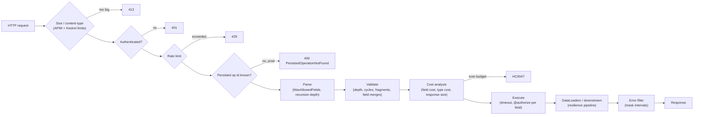

### 9.2 Controls and recommended values

| Control | Hot Chocolate setting | BFF | Facade | Source / note |
|---|---|---|---|---|
| Trusted documents only | `OnlyAllowPersistedDocuments` | ✓ prod | ✓ prod | Removes arbitrary queries entirely ([Source](https://chillicream.com/docs/hotchocolate/performance/trusted-documents)) |
| Parser field limit | `MaxAllowedFields` (default 2048) | 256 | 1024 | ([Source](https://chillicream.com/docs/hotchocolate/security/request-limits)) |
| Execution depth | `AddMaxExecutionDepthRule` | 8 | 12 | |
| Field cycle depth | `AddMaxAllowedFieldCycleDepthRule` | 2 | 3 | On by default outside Development ([Source](https://chillicream.com/docs/hotchocolate/security/request-limits)) |
| Execution timeout | `ExecutionTimeout` (default 30 s) | 15 s | 10 s | Keep below the APIM `forward-request` timeout |
| Cost limits | `MaxFieldCost` (1,000) / `MaxTypeCost` (10,000) | 1,500 / 3,000 | 5,000 / 10,000 | Rejected with `HC0047` before any resolver runs ([Source](https://chillicream.com/docs/hotchocolate/security/cost-analysis)) |
| Paging | `MaxPageSize`, `RequirePagingBoundaries` | 50, true | 100, true | Nested list sizes multiply cost ([Source](https://chillicream.com/docs/hotchocolate/security/cost-analysis)) |
| Node batch | `MaxAllowedNodeBatchSize` (50) | 25 | 50 | |
| Introspection | disabled in prod | ✓ | ✓ | |
| IDE (Nitro) | `Tool.Enable=false` in prod | ✓ | ✓ | |
| Exception details | `IncludeExceptionDetails=false` | ✓ | ✓ | |
| GET requests | disabled, or persisted-only | persisted GET OK for CDN | disabled | |
| Batching (array of operations) | disabled | ✓ | ✓ | Cost limits apply per request in a batch, not summed across it ([Source](https://chillicream.com/docs/hotchocolate/security/cost-analysis)) |

Even with trusted documents, keep cost analysis on. It catches regressions when a frontend developer registers an expensive operation, and you can tune limits with the `GraphQL-Cost: report` header in non-production environments ([Source](https://chillicream.com/docs/hotchocolate/security/cost-analysis)).

### 9.3 HTTP status semantics

Use the `application/graphql-response+json` media type. With it, a cost rejection returns HTTP 400. With `application/json` it returns 200 ([Source](https://chillicream.com/docs/hotchocolate/security/cost-analysis)). The GraphQL-over-HTTP specification defines 4xx/5xx codes for this media type when a request fails before execution ([Source](https://graphql.org/learn/serving-over-http/)). This makes APIM metrics, retries and alerts meaningful.

---

## 10. Concurrency: idempotency, race conditions, rate limiting

### 10.1 Where concurrency problems come from

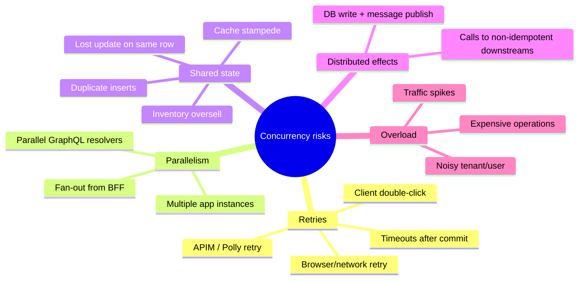

### 10.2 Idempotency (exactly-once effect for mutations)

**Contract:**

1. The client generates a UUID per *user intent* (for example per "Place order" click) and sends it as `input.idempotencyKey`. For REST-style calls, use the `Idempotency-Key` header.
2. The BFF passes it unchanged to the Facade, in the header *and* the mutation input.
3. The Facade scopes the key by caller (`uid` + operation name) and stores a fingerprint (SHA-256 of the canonicalised input).
4. The same key with the same fingerprint returns the **original result**. The same key with a different fingerprint returns an error. A key whose first request is still running returns a retryable "in progress" error.
5. Keys expire after 24 hours (configurable).

The IETF HTTPAPI working group's draft defines the `Idempotency-Key` request header for making POST and PATCH fault-tolerant, and requires keys to be unique and not reused for different payloads ([Source](https://datatracker.ietf.org/doc/draft-ietf-httpapi-idempotency-key-header/)).

**State machine**

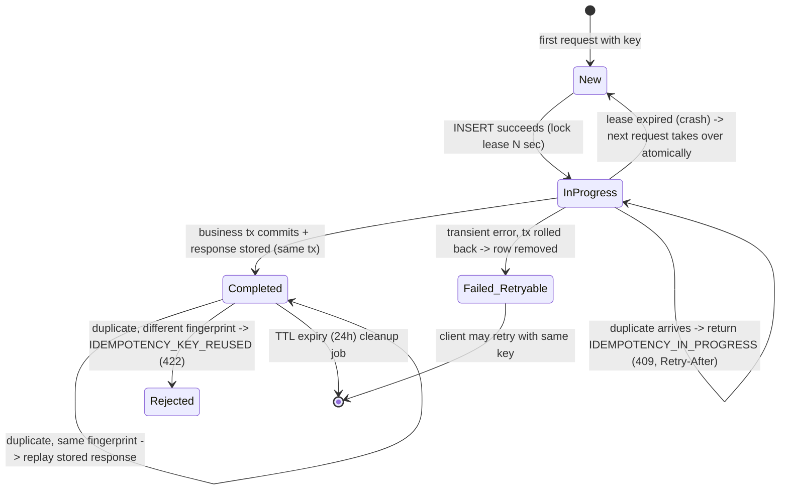

**Sequence: retry after timeout (the dangerous case)**

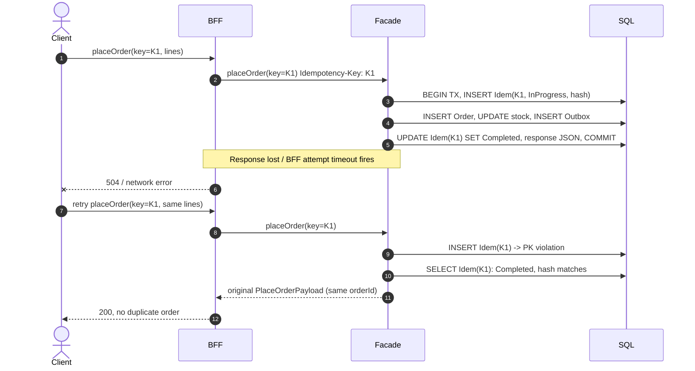

**Schema (SQL)**

```sql
CREATE TABLE app.IdempotencyRecord (
    Scope          nvarchar(200)  NOT NULL,  -- e.g. 'placeOrder:00u123'
    IdemKey        uniqueidentifier NOT NULL,
    RequestHash    binary(32)     NOT NULL,
    Status         tinyint        NOT NULL,  -- 1=InProgress, 2=Completed
    ResponseJson   nvarchar(max)  NULL,
    LeaseUntilUtc  datetime2(3)   NOT NULL,
    CreatedUtc     datetime2(3)   NOT NULL CONSTRAINT DF_Idem_Created DEFAULT sysutcdatetime(),
    CONSTRAINT PK_IdempotencyRecord PRIMARY KEY (Scope, IdemKey)
);
CREATE INDEX IX_Idem_Created ON app.IdempotencyRecord(CreatedUtc);  -- TTL cleanup job
```

**Implementation (Facade)**

```csharp
public sealed class SqlIdempotencyStore(FacadeDbContext db, TimeProvider clock) : IIdempotencyStore
{
    public async Task<IdempotencyResult<T>> ExecuteAsync<T>(
        string scope, Guid key, object input, Func<CancellationToken, Task<T>> action, CancellationToken ct)
    {
        var hash = SHA256.HashData(JsonSerializer.SerializeToUtf8Bytes(input, CanonicalJson.Options));
        var strategy = db.Database.CreateExecutionStrategy();   // compatible with EnableRetryOnFailure

        return await strategy.ExecuteAsync(async () =>
        {
            await using var tx = await db.Database.BeginTransactionAsync(IsolationLevel.ReadCommitted, ct);
            var now = clock.GetUtcNow().UtcDateTime;

            // 1) Try to claim the key atomically
            var claimed = await db.Database.ExecuteSqlInterpolatedAsync($@"
                INSERT INTO app.IdempotencyRecord (Scope, IdemKey, RequestHash, Status, LeaseUntilUtc)
                SELECT {scope}, {key}, {hash}, 1, {now.AddSeconds(30)}
                WHERE NOT EXISTS (SELECT 1 FROM app.IdempotencyRecord WITH (UPDLOCK, HOLDLOCK)
                                  WHERE Scope = {scope} AND IdemKey = {key});", ct) == 1;

            if (!claimed)
            {
                var existing = await db.IdempotencyRecords.AsNoTracking()
                    .SingleAsync(r => r.Scope == scope && r.IdemKey == key, ct);
                await tx.RollbackAsync(ct);

                if (!existing.RequestHash.SequenceEqual(hash))
                    return IdempotencyResult<T>.KeyReused();                       // 422
                if (existing.Status == 2)
                    return IdempotencyResult<T>.Replay(JsonSerializer.Deserialize<T>(existing.ResponseJson!)!);
                return IdempotencyResult<T>.InProgress(existing.LeaseUntilUtc);   // 409 + Retry-After
            }

            // 2) Run business logic in the SAME transaction
            var result = await action(ct);

            // 3) Persist response + mark completed, then commit atomically
            await db.Database.ExecuteSqlInterpolatedAsync($@"
                UPDATE app.IdempotencyRecord SET Status = 2, ResponseJson = {JsonSerializer.Serialize(result)}
                WHERE Scope = {scope} AND IdemKey = {key};", ct);
            await tx.CommitAsync(ct);
            return IdempotencyResult<T>.Fresh(result);
        });
    }
}
```

`UPDLOCK, HOLDLOCK` makes the check-and-insert atomic. The primary key is a second guard, and a 2627/2601 PK violation is treated as "already claimed". Because the claim, the business write and the stored response commit together, a crash leaves either nothing or a completed record. A stale `InProgress` row can only exist if the response write is moved outside the transaction (for example, when the business action calls an external non-transactional system). In that case, take over expired leases with `UPDATE ... WHERE LeaseUntilUtc < now`.

**When the business action calls a non-transactional downstream:** pass the idempotency key on to that downstream (as `Idempotency-Key`). If it doesn't support idempotency, model the call as an outbox message processed by a worker that records completion (Section 10.5).

### 10.3 Rate limiting and load shedding, in layers

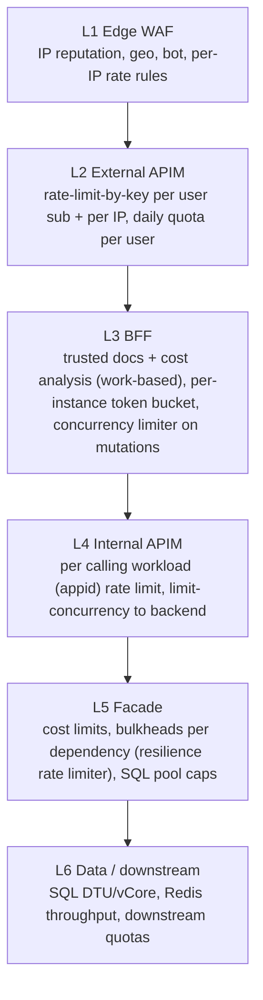

| Layer | Key | Algorithm | Limit (starting point) | Response |
|---|---|---|---|---|
| WAF | Client IP | Rate rule | 2,000 / 5 min | 429 / block |
| External APIM | `sub` | v2: token bucket; classic: sliding window | 120 / min, 20k / day | 429 + `Retry-After` |
| External APIM | IP | as above | 600 / min | 429 |
| BFF | `sub` | Token bucket (per instance) | 40 burst, 2 / s | 429 |
| BFF | operation cost | Hot Chocolate cost analysis | Field cost 1,500 | 400 `HC0047` |
| Internal APIM | caller `appid` | as above | 6,000 / min | 429 |
| Internal APIM | backend | `limit-concurrency` | 400 in flight | 429 |
| Facade | per downstream | Resilience rate limiter (concurrency) | e.g. 100 in flight for Inventory | Fail fast → typed GraphQL error |

**Cost-weighted rate limiting (advanced, Design decision).** A GraphQL call isn't a fixed unit of work, so per-request limits are coarse. One option is for the BFF to return the evaluated cost in a response header (read it with `context.GetCostMetrics()` ([Source](https://chillicream.com/docs/hotchocolate/security/cost-analysis))). APIM can then use it as `increment-count` on a second `rate-limit-by-key` (for example 50,000 cost units per minute per user). APIM postpones expression-based increments to the end of the outbound pipeline, so the 429 lands one call late ([Source](https://learn.microsoft.com/en-us/azure/api-management/rate-limit-by-key-policy)).

**Client contract:** every 429 carries `Retry-After`. Clients and the BFF back off with jitter, and the BFF never retries a 429 coming from the Facade instantly.

### 10.4 Race conditions and conflicting writes

#### 10.4.1 Optimistic concurrency (default for updates)

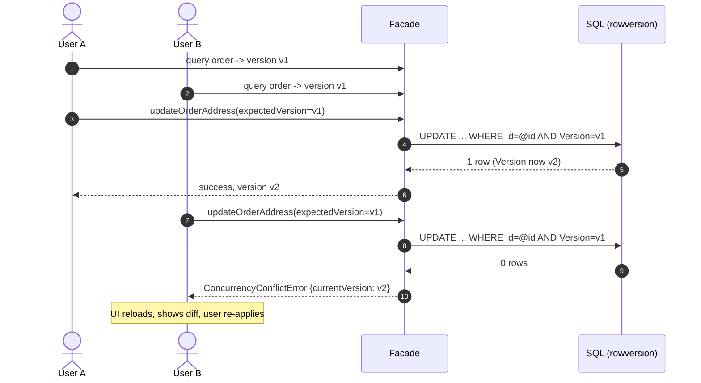

```csharp
public class Order
{
    public Guid Id { get; set; }
    [Timestamp] public byte[] Version { get; set; } = default!;   // SQL Server rowversion
    // ...
}

[MutationType]
public static class OrderMutations
{
    [Authorize(Policy = Policies.Write)]
    [Error<ConcurrencyConflictError>, Error<NotFoundError>]
    public static async Task<Order> UpdateOrderAddressAsync(
        UpdateOrderAddressInput input, FacadeDbContext db, CancellationToken ct)
    {
        var order = await db.Orders.AsTracking().SingleOrDefaultAsync(o => o.Id == input.OrderId, ct)
                    ?? throw new NotFoundException(input.OrderId);

        // Tell EF which version the client saw -> used in the UPDATE's WHERE clause
        db.Entry(order).Property(o => o.Version).OriginalValue = Convert.FromBase64String(input.ExpectedVersion);
        order.ChangeAddress(input.Address);

        try { await db.SaveChangesAsync(ct); }
        catch (DbUpdateConcurrencyException)
        {
            throw new ConcurrencyConflictException(input.OrderId);   // -> typed GraphQL error
        }
        return order;
    }
}
```

`rowversion` changes automatically on every update, which makes it a minimal-effort concurrency token for the whole row. EF Core adds it to the `UPDATE`'s `WHERE` clause and throws `DbUpdateConcurrencyException` when no row matches ([Source](https://learn.microsoft.com/en-us/ef/core/saving/concurrency)). **Don't retry concurrency conflicts automatically on the server** unless the operation is commutative. Return them to the user.

#### 10.4.2 Atomic conditional updates (counters, stock, balances)

Read-modify-write in C# races between instances. Push the invariant into one statement:

```sql
UPDATE app.Stock
SET    Available = Available - @qty
WHERE  Sku = @sku AND Available >= @qty;     -- 0 rows => InsufficientStockError
```

#### 10.4.3 Uniqueness invariants

Enforce them with **unique indexes**, not "check then insert". Examples: one active cart per user, unique order number, one membership per (user, group). Map SQL errors 2601/2627 to a typed `AlreadyExistsError`.

#### 10.4.4 Pessimistic or serialised sections (rare)

| Need | Mechanism |
|---|---|
| Short critical section on one row | `SELECT ... WITH (UPDLOCK, ROWLOCK)` inside the transaction |
| Serialise a business process across instances (for example a nightly allocation for tenant X) | `sp_getapplock` (SQL app lock, released with the transaction) |
| Cross-resource coordination without SQL | Redis lock with a **lease + fencing token**. Redis's own documentation describes the Redlock algorithm and its trade-offs ([Source](https://redis.io/docs/latest/develop/clients/patterns/distributed-locks/)). |
| Ordered processing per aggregate | Service Bus **sessions** (session ID = aggregate ID) |

**Design decision:** avoid distributed locks for correctness where you can. Prefer database constraints and conditional writes, which stay correct through GC pauses, lease expiry and network partitions. If you do use a Redis lock, the protected resource must reject stale writers through a fencing token (a monotonically increasing version checked on write).

#### 10.4.5 Cache stampede and stale cache

- Use `HybridCache.GetOrCreateAsync`, which collapses concurrent misses for the same key into a single factory call (stampede protection).
- Invalidate on write: the Facade removes `order:{id}` *after* the transaction commits (or the outbox relay does).
- Add a short local L1 TTL (30 s) to bound staleness across instances.
- Never cache responses that contain per-user authorization decisions under shared keys.

### 10.5 Transactional outbox (DB write + event publish)

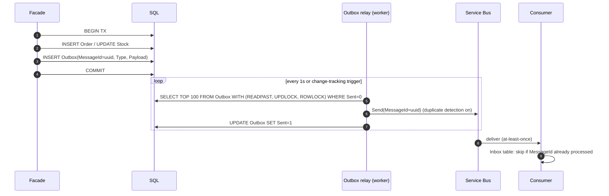

`READPAST, UPDLOCK` lets several relay instances work in parallel without double-sending the same rows. The message ID makes Service Bus duplicate detection and the consumer's inbox both effective. Together these give an effectively-once outcome over at-least-once delivery.

### 10.6 Concurrency checklist per mutation

| Question | If yes → |
|---|---|
| Can it be retried (client, BFF, APIM)? | Require `idempotencyKey`. Store and replay. |
| Does it update an existing row users can edit concurrently? | Require `expectedVersion` (rowversion). |
| Does it change a counter, quantity or balance? | Atomic conditional `UPDATE`. |
| Does it create something that must be unique? | Unique index + map 2601/2627. |
| Does it publish an event or call another system? | Outbox, plus the idempotency key passed downstream. |
| Is it expensive? | `[Cost(n)]`, concurrency limiter, lower rate limit. |
| Is it run by background jobs on many instances? | `sp_getapplock` / Service Bus sessions / leader election. |

---

## 11. Resilience: timeouts, retries, circuit breakers, bulkheads

### 11.1 Timeout budget (each hop shorter than its caller)

```mermaid
gantt
    title Timeout budget per hop (seconds)
    dateFormat X
    axisFormat %s
    section Edge
    Front Door origin timeout 30s      :0, 30
    section External APIM
    forward-request timeout 25s        :0, 25
    section BFF
    HC ExecutionTimeout 15s            :0, 15
    Facade total timeout 12s           :0, 12
    section Internal APIM
    forward-request timeout 15s (cap)  :0, 15
    section Facade
    HC ExecutionTimeout 10s            :0, 10
    Downstream total 8s                :0, 8
    SQL command timeout 5-15s          :0, 8
```

**Rule:** inner timeout < outer timeout, so the inner layer fails first with a meaningful error instead of the outer layer cutting the connection. Pass `CancellationToken` everywhere so abandoned work stops: resolvers, EF Core, `HttpClient` and Redis. The BFF propagates `X-Request-Deadline`, and the Facade shortens its own budget to fit.

### 11.2 Retry policy matrix

| Call | Retry? | Conditions |
|---|---|---|
| BFF → Facade **query** | Yes, max 2, exponential + jitter | 5xx, 408, 429 (honour `Retry-After`), timeouts |
| BFF → Facade **mutation with idempotency key** | Yes, max 2 | Same as queries. Safe because the Facade de-duplicates. |
| BFF → Facade **mutation without key** | **No** | Schema validation should make keyless mutations impossible |
| Facade → SQL | EF `EnableRetryOnFailure` (transient error numbers only) | Use the execution strategy around explicit transactions |
| Facade → downstream POST | Only if the downstream honours `Idempotency-Key` | Otherwise use the outbox |
| Any 4xx (except 408/429) | Never | |

The standard resilience handler retries all HTTP methods by default. Microsoft warns this can duplicate data on POST, and provides `DisableFor(...)` / `DisableForUnsafeHttpMethods()` ([Source](https://learn.microsoft.com/en-us/dotnet/core/resilience/http-resilience)). GraphQL sends queries and mutations alike as POST, so the BFF needs a custom `ShouldHandle` that inspects the operation type or the presence of an idempotency key:

```csharp
public static class FacadeRetry
{
    public static readonly Func<RetryPredicateArguments<HttpResponseMessage>, ValueTask<bool>> OnlyIdempotentOrKeyed =
        args =>
        {
            var req = args.Outcome.Result?.RequestMessage ?? args.Context.GetRequestMessage();
            var safe = req is not null &&
                       (req.Options.TryGetValue(GqlOptions.IsQuery, out var isQuery) && isQuery
                        || req.Headers.Contains("Idempotency-Key"));
            return ValueTask.FromResult(safe && HttpClientResiliencePredicates.IsTransient(args.Outcome));
        };
}
```

### 11.3 Standard resilience pipeline

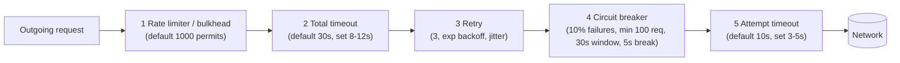

These are the five strategies in their default order, and both retry and circuit breaker react to 5xx, 408 and 429, `HttpRequestException` and `TimeoutRejectedException` ([Source](https://learn.microsoft.com/en-us/dotnet/core/resilience/http-resilience)). Add only one resilience handler per client and don't stack them ([Source](https://learn.microsoft.com/en-us/dotnet/core/resilience/http-resilience)).

### 11.4 Circuit breaker states

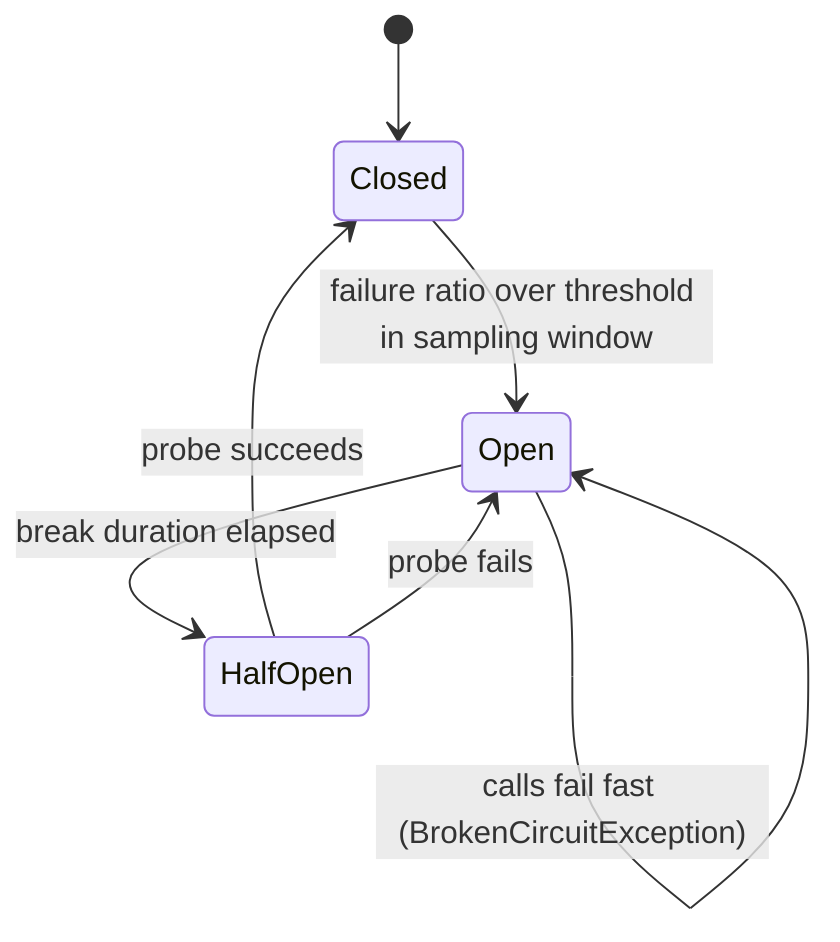

When the circuit is open, the BFF returns **partial data**: the field resolves to `null` with a typed error such as `SERVICE_UNAVAILABLE`, and the rest of the page still renders. Only make fields nullable where the UI can actually cope with that.

### 11.5 Bulkheads

Give each downstream its own named `HttpClient` and resilience pipeline with its own concurrency limit, so a slow Inventory service can't use up the threads and sockets that Orders needs. Cap the SQL pool (`Max Pool Size`) per instance, and size it as instances × pool < database worker limit.

---

## 12. Performance engineering

| Area | Practice |
|---|---|
| N+1 | DataLoaders for every relationship field. Enforced in code review and checked with SQL query count tests. |
| Projections | `[UseProjection]` or a selector builder so EF selects only the requested columns. Combine with paging. |
| Paging | Cursor-based (keyset) on indexed columns. Avoid `totalCount` on large tables, or make it expensive in cost. |
| Persisted operations | Smaller payloads and pre-validated documents. Hot Chocolate can optimise known operations ([Source](https://chillicream.com/docs/hotchocolate/performance/trusted-documents)). |
| HTTP | HTTP/2 between BFF and internal APIM. `IHttpClientFactory` (pooled handlers, no socket exhaustion). Keep-alive. |
| SNAT | NAT Gateway on integration subnets. Reuse connections. |
| Serialization | System.Text.Json source generation for DTOs. Response compression (Brotli) at APIM/BFF for large payloads. |
| Caching | HybridCache (L1 + Redis L2) at the Facade for reference data. Per-user short TTL at the BFF. HTTP caching for persisted GET queries through Front Door, public data only. |
| Database | Read Committed Snapshot Isolation (default in Azure SQL) to cut reader/writer blocking. Covering indexes for hot queries. Query Store on. Read replicas (`ApplicationIntent=ReadOnly`) for heavy reads. |
| App Service | Always On, ARR affinity **off** (stateless), health check path, autoscale on CPU plus HTTP queue length, at least 3 instances for zone redundancy |
| Startup | Warm-up via `applicationInitialization` / slot swap warm-up. Initialise the GraphQL schema eagerly (`InitializeOnStartup`) so the first request doesn't pay for it. |
| Multi-region (future) | APIM multi-region gateways or Front Door with per-region stamps. Rate-limit counters are per gateway ([Source](https://learn.microsoft.com/en-us/azure/api-management/rate-limit-by-key-policy)). Idempotency keys must live in a store reachable by all regions, or requests must be pinned per user. |

### 12.1 Performance targets (example SLOs)

| Metric | BFF | Facade |
|---|---|---|
| p95 latency (query) | < 300 ms | < 150 ms |
| p99 latency (mutation) | < 800 ms | < 500 ms |
| Error rate (5xx) | < 0.1% | < 0.1% |
| Availability | 99.95% | 99.95% |

---

## 13. Error handling contract

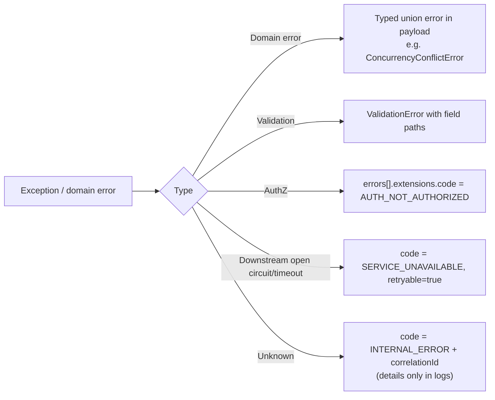

```csharp
public sealed class FacadeErrorFilter(ILogger<FacadeErrorFilter> log) : IErrorFilter
{
    public IError OnError(IError error)
    {
        var correlationId = Activity.Current?.TraceId.ToString();
        return error.Exception switch
        {
            BrokenCircuitException or TimeoutRejectedException =>
                error.WithMessage("A dependency is temporarily unavailable.")
                     .WithCode("SERVICE_UNAVAILABLE").SetExtension("retryable", true)
                     .SetExtension("correlationId", correlationId).RemoveException(),
            IdempotencyInProgressException e =>
                error.WithMessage("Request with this idempotency key is still processing.")
                     .WithCode("IDEMPOTENCY_IN_PROGRESS").SetExtension("retryAfterSeconds", e.RetryAfter)
                     .RemoveException(),
            null => error,
            _ => LogAndMask(error, correlationId)
        };
    }
    private IError LogAndMask(IError e, string? cid)
    {
        log.LogError(e.Exception, "Unhandled GraphQL error {CorrelationId}", cid);
        return ErrorBuilder.New().SetMessage("An unexpected error occurred.")
            .SetCode("INTERNAL_ERROR").SetExtension("correlationId", cid).SetPath(e.Path).Build();
    }
}
```

| Code | Retryable | HTTP (graphql-response+json) | Client action |
|---|---|---|---|
| `AUTH_NOT_AUTHENTICATED` | no | 401 | Re-login |
| `AUTH_NOT_AUTHORIZED` | no | 200 with error (field-level) | Hide feature |
| `VALIDATION_ERROR` | no | 200 (typed payload error) | Fix input |
| `CONCURRENCY_CONFLICT` | no (user decision) | 200 (typed) | Reload + merge |
| `IDEMPOTENCY_IN_PROGRESS` | yes (same key) | 200/409 | Wait `retryAfterSeconds` |
| `IDEMPOTENCY_KEY_REUSED` | no | 200/422 | Bug: new key per intent |
| `RATE_LIMITED` | yes | 429 | Honour `Retry-After` |
| `HC0047` (cost) | no | 400 | Reduce selection/page size |
| `SERVICE_UNAVAILABLE` | yes | 200 partial / 503 | Retry with backoff |
| `INTERNAL_ERROR` | maybe | 500 | Report correlation ID |

---

## 14. Observability

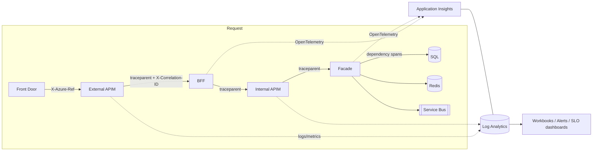

- **Tracing.** Use the Azure Monitor OpenTelemetry Distro (`UseAzureMonitor()`) in both APIs, with W3C `traceparent` propagated across APIM. Add Hot Chocolate instrumentation (`AddInstrumentation()`) to emit spans per operation, plus resolver spans for slow fields only.
- **Log fields:** operation name and hash, cost metrics, `uid` (pseudonymous), caller `appid`, idempotency key, outcome code, duration.
- **Never log:** tokens, PII payloads, full variables (allow-list safe variables instead).
- **Key alerts:** 5xx rate, p95 latency, 429 rate per user (abuse), `HC0047` spikes (client regression), circuit breaker open events, idempotency conflicts, `DbUpdateConcurrencyException` rate, SQL DTU/CPU > 80%, SNAT port usage, APIM capacity > 70%.

---

## 15. Testing strategy

| Test type | What | Tooling |
|---|---|---|
| Unit | Resolvers, domain rules, idempotency store logic | xUnit, NSubstitute |
| Integration | Real SQL/Redis in containers: concurrency conflicts, unique violations, outbox | Testcontainers, `WebApplicationFactory` |
| Concurrency | 50 parallel `placeOrder` calls with the **same** key: exactly 1 order created. 50 parallel `updateAddress` calls with the same version: 1 success, 49 conflicts. | xUnit + `Parallel.ForEachAsync` |
| Contract | Schema snapshot diff in CI (breaking-change gate). Persisted operations validated against the schema. | Hot Chocolate schema export, Nitro client registry |
| Security | No token → 401. Wrong audience → 401. Non-persisted query → rejected. Depth/cost attacks → rejected. Header spoofing (`X-User-Authorization` from the internet) → stripped. | k6/scripts, OWASP ZAP (staging) |
| Load | Steady state + spike + soak. Verify that the 429s, circuit breakers and autoscale behave as designed. | Azure Load Testing (private VNet injection), k6 |
| Chaos | Kill a Facade instance, inject SQL latency, block Redis | Azure Chaos Studio |

---

## 16. Go-live checklists

**Network**

| ☐ | Item |
|---|---|
| ☐ | BFF and Facade public network access disabled. Private endpoints + DNS verified. |
| ☐ | VNet integration with route-all. Egress through NAT or Firewall. NSGs least-privilege. |
| ☐ | Internal APIM resolvable only privately. No `azure-api.net` apex zone. |
| ☐ | External APIM accepts traffic only from the WAF/edge. WAF in Prevention mode. |
| ☐ | Data services: public access off, private endpoints, local auth/keys disabled. |

**Identity**

| ☐ | Item |
|---|---|
| ☐ | User-assigned MIs. App roles created. Assignment required = Yes. |
| ☐ | Internal APIM validates `appid` + `roles`. Facade validates both the service and user tokens. |
| ☐ | No secrets in app settings. Key Vault references only. SQL is Entra-only. |
| ☐ | APIM policy edit rights restricted (MI token exfiltration risk). |

**GraphQL**

| ☐ | Item |
|---|---|
| ☐ | Trusted documents enforced in prod. Operation upload happens before slot swap. |
| ☐ | Introspection/IDE/exception details disabled in prod. |
| ☐ | Depth, cost, paging, timeout and field limits set and load tested. |
| ☐ | DataLoaders on all relationship fields. No shared `DbContext` across parallel resolvers. |

**Concurrency and resilience**

| ☐ | Item |
|---|---|
| ☐ | All non-idempotent mutations require an idempotency key. Replay is tested. |
| ☐ | All updates use `rowversion`. Conflicts are surfaced as typed errors. |
| ☐ | Counters and stock use atomic conditional updates. Uniqueness uses indexes. |
| ☐ | Outbox for events. Consumers de-duplicate. |
| ☐ | Timeout budgets shrink inward. Retries only for safe or keyed calls. Circuit breakers and bulkheads per dependency. |
| ☐ | Rate limits at APIM (authoritative) and in the app (defense). `Retry-After` is returned. |

---

## 17. References

**Hot Chocolate**
1. Securing your API (overview, public vs private APIs): https://chillicream.com/docs/hotchocolate/security
2. Cost analysis (IBM cost spec, limits, `HC0047`, tuning): https://chillicream.com/docs/hotchocolate/security/cost-analysis
3. Request limits (parser, depth, cycles, timeout): https://chillicream.com/docs/hotchocolate/security/request-limits
4. Trusted documents / persisted operations: https://chillicream.com/docs/hotchocolate/performance/trusted-documents
5. DataLoader: https://chillicream.com/docs/hotchocolate/fetching-data/batching/dataloader
6. IBM GraphQL Cost Directives spec: https://ibm.github.io/graphql-specs/
7. GraphQL over HTTP: https://graphql.org/learn/serving-over-http/ and https://github.com/graphql/graphql-over-http/blob/main/spec/GraphQLOverHTTP.md

**Azure API Management**
8. Networking options: https://learn.microsoft.com/en-us/azure/api-management/virtual-network-concepts
9. Internal VNet mode (NSGs, DNS, routing): https://learn.microsoft.com/en-us/azure/api-management/api-management-using-with-internal-vnet
10. Internal APIM with Application Gateway: https://learn.microsoft.com/en-us/azure/api-management/api-management-howto-integrate-internal-vnet-appgateway
11. v2 tiers overview: https://learn.microsoft.com/en-us/azure/api-management/v2-service-tiers-overview
12. `authentication-managed-identity`: https://learn.microsoft.com/en-us/azure/api-management/authentication-managed-identity-policy
13. `validate-jwt`: https://learn.microsoft.com/en-us/azure/api-management/validate-jwt-policy
14. `validate-azure-ad-token`: https://learn.microsoft.com/en-us/azure/api-management/validate-azure-ad-token-policy
15. `rate-limit-by-key`: https://learn.microsoft.com/en-us/azure/api-management/rate-limit-by-key-policy
16. Advanced throttling: https://learn.microsoft.com/en-us/azure/api-management/api-management-sample-flexible-throttling
17. `validate-graphql-request`: https://learn.microsoft.com/en-us/azure/api-management/validate-graphql-request-policy

**App Service and networking**
18. Private endpoints for App Service: https://learn.microsoft.com/en-us/azure/app-service/overview-private-endpoint
19. VNet integration (subnets, routing, NAT, limits): https://learn.microsoft.com/en-us/azure/app-service/overview-vnet-integration
20. Enable VNet integration: https://learn.microsoft.com/en-us/azure/app-service/configure-vnet-integration-enable
21. Managed identities in App Service: https://learn.microsoft.com/en-us/azure/app-service/overview-managed-identity
22. Connect to Azure SQL with managed identity: https://learn.microsoft.com/en-us/azure/app-service/tutorial-connect-msi-sql-database
23. Entra auth with Microsoft.Data.SqlClient: https://learn.microsoft.com/en-us/sql/connect/ado-net/sql/azure-active-directory-authentication?view=sql-server-ver17
24. Azure Cache for Redis retirement / Azure Managed Redis: https://learn.microsoft.com/en-us/azure/azure-cache-for-redis/retirement-faq

**.NET resilience, concurrency, rate limiting**
25. HTTP resilience (`Microsoft.Extensions.Http.Resilience`): https://learn.microsoft.com/en-us/dotnet/core/resilience/http-resilience
26. ASP.NET Core rate limiting middleware: https://learn.microsoft.com/en-us/aspnet/core/performance/rate-limit?view=aspnetcore-10.0
27. EF Core concurrency conflicts: https://learn.microsoft.com/en-us/ef/core/saving/concurrency
28. IETF Idempotency-Key header draft: https://datatracker.ietf.org/doc/draft-ietf-httpapi-idempotency-key-header/
29. Redis distributed locks (Redlock): https://redis.io/docs/latest/develop/clients/patterns/distributed-locks/
30. Per-instance rate-limiter caveat: https://codewithmukesh.com/blog/rate-limiting-aspnet-core/

---

**Notes on this document:**

- **Version-sensitive APIs.** Hot Chocolate APIs change between major versions (14 → 15 → 16). Check the introspection, dependency-injection scope and option names against the docs for the version you pin, and keep all `HotChocolate.*` packages on the same version.
- **Region and tier availability.** APIM Premium v2 VNet injection, Azure Managed Redis private endpoints and App Service SKUs vary by region. Confirm them during design.
- **Starting values.** All limits shown (rates, costs, timeouts, pool sizes) are starting points. Calibrate them with load tests (Section 15) before go-live.