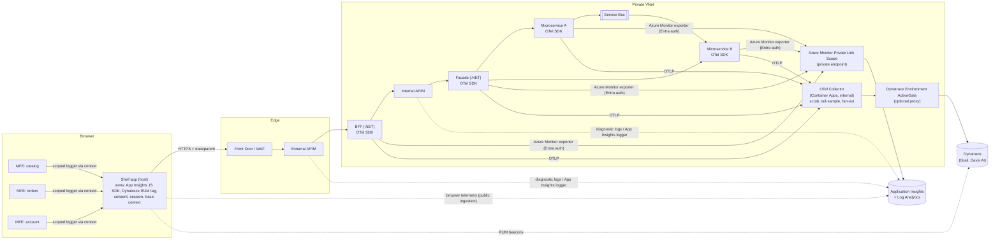
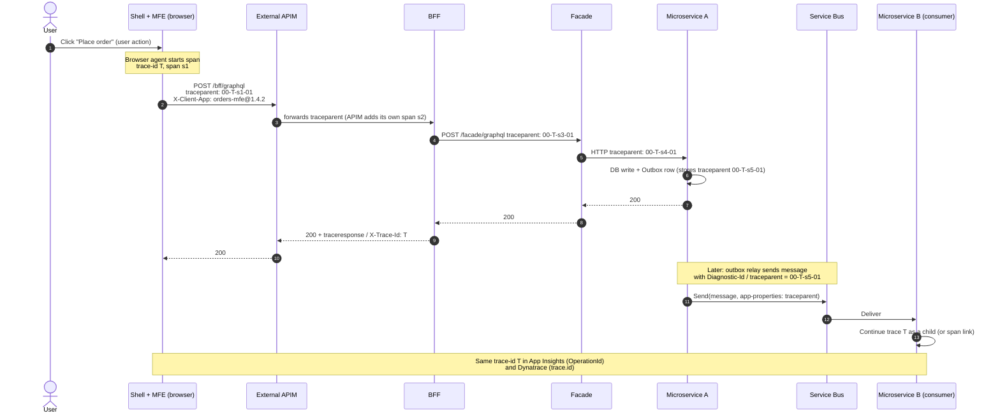
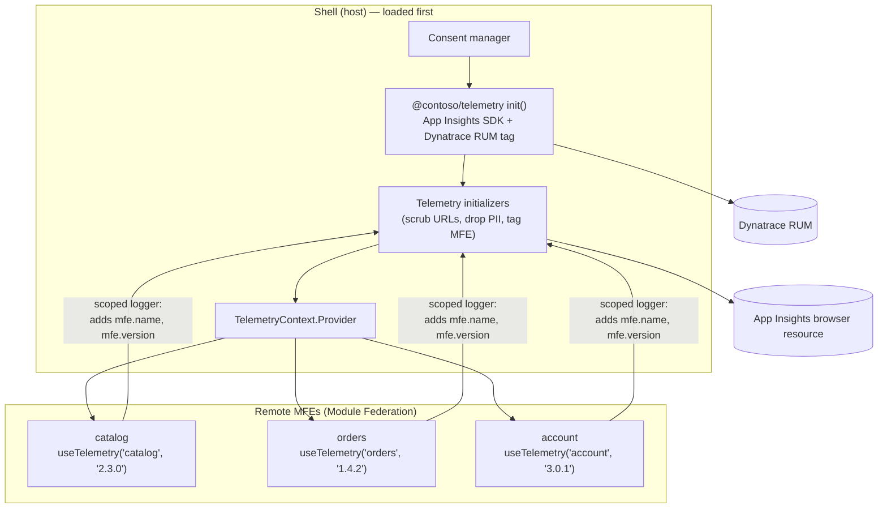
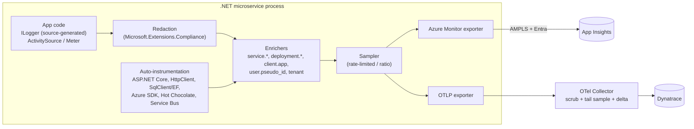
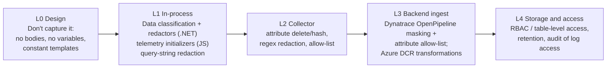
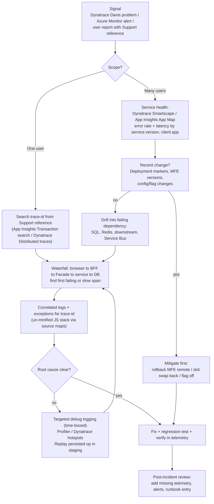
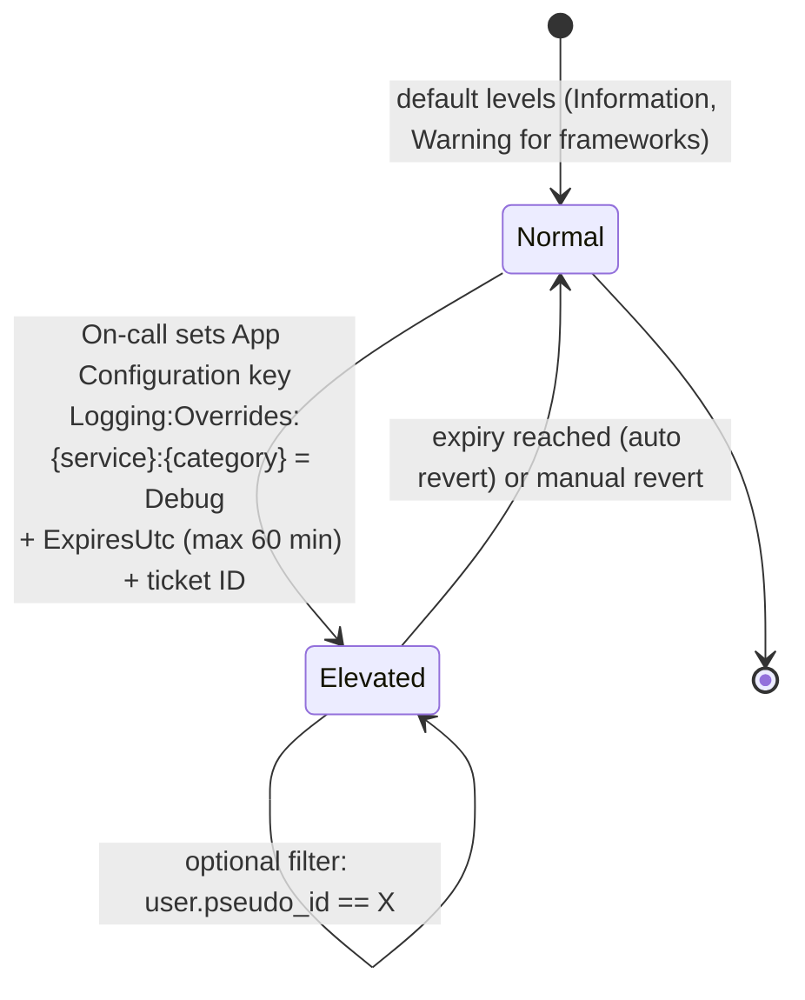

# Section 18: Logging and Tracing with Application Insights and Dynatrace

**Applies to:** a microfrontend (React) frontend and .NET microservices, including the BFF and Facade from Sections 1–17
**Extends:** Section 14 (Observability). Where the two differ, this section takes precedence.

---

## 18.0 Summary of key decisions

| # | Decision | Why |
|---|---|---|
| D1 | **OpenTelemetry (OTel) is the instrumentation layer in all backend code.** Application Insights and Dynatrace are only *destinations*. | Code stays vendor-neutral, and one instrumentation feeds both tools without duplicate work. |
| D2 | **W3C Trace Context (`traceparent`) is the single correlation standard.** The `trace-id` *is* the correlation ID. | Both App Insights and Dynatrace understand it natively, from the browser to the database. |
| D3 | **Exactly one agent owns each concern.** For example, only one browser agent injects `traceparent`, and only one backend instrumentation creates spans. | Two agents instrumenting the same calls produce duplicate spans, conflicting headers, or broken telemetry. |
| D4 | **Logs are structured, classified and redacted at the source**, and masked again at ingestion (defense in depth). | Most leaks happen at the source. Ingest-time masking is the safety net. |
| D5 | **Metrics drive alerts, traces drive diagnosis, logs add detail.** | Metrics are never sampled. Traces and logs are sampled to control cost. |
| D6 | **The shell owns the frontend telemetry SDKs.** Each microfrontend (MFE) gets a scoped logger and never initialises its own SDK. | One session, one trace context, one consent decision, and no duplicate page views. |

> **Version note:** Microsoft's current docs recommend the **Microsoft OpenTelemetry Distro** (`Microsoft.OpenTelemetry`, `UseMicrosoftOpenTelemetry()`) for .NET, and warn against initialising it together with the older Azure Monitor OpenTelemetry Distro ([Source](https://learn.microsoft.com/en-us/azure/azure-monitor/app/opentelemetry-configuration)). Section 14 mentioned `UseAzureMonitor()` from `Azure.Monitor.OpenTelemetry.AspNetCore`. Pick **one** distro per service. This section uses the newer one.

---

## 18.1 Reference architecture



### 18.1.1 Backend integration options

| Option | How it works | Pros | Cons / cautions |
|---|---|---|---|
| **A. OTel SDK, dual export (recommended)** | Microsoft OTel Distro exports to Azure Monitor directly. Its OTLP exporter sends to the Collector, which forwards to Dynatrace. | One instrumentation. Each tool sees the same spans and IDs. The Collector scrubs and tail-samples. | Microsoft provides the OTLP exporter for convenience but doesn't officially support it or anything downstream of it ([Source](https://learn.microsoft.com/en-us/azure/azure-monitor/app/opentelemetry-configuration)). Dynatrace needs **delta** metric temporality ([Source](https://docs.dynatrace.com/docs/ingest-from/opentelemetry/walkthroughs/dotnet)). |
| **B. Dynatrace OneAgent + OTel → App Insights** | OneAgent instruments the process for Dynatrace. The OTel distro exports only to Azure Monitor. | Deepest Dynatrace features (code-level hotspots, auto-detected topology). | OneAgent can conflict with **Application Insights agents** that already instrument the app ([Source](https://docs.dynatrace.com/docs/ingest-from/microsoft-azure-services/integrations/azure-appservice/integrate-oneagent-on-web-app-for-containers)), so disable App Insights codeless auto-instrumentation. If OneAgent's OTel span capture is enabled while you also export OTLP, you get duplicate spans ([Source](https://docs.dynatrace.com/docs/ingest-from/dynatrace-oneagent/oneagent-and-opentelemetry/oneagent-otel)). |
| **C. OTLP only → Collector → both** | Apps export OTLP only. The Collector exports to Azure Monitor and Dynatrace. | One egress path, central control. | Loses distro-specific features such as Live Metrics. The Azure Monitor exporter for the Collector is a contrib component. |

**Design decision:** use Option A by default. Use Option B for services where the SRE team specifically needs OneAgent's deep code-level diagnostics, and then turn off OTLP export to Dynatrace for those services.

### 18.1.2 Network path for telemetry (fits the private architecture in Section 5)

| Flow | Path | Controls |
|---|---|---|
| Backend → Application Insights | Private endpoint through **AMPLS**. Managed identity (Entra) auth. | Disable local auth so only Entra-authenticated telemetry is accepted ([Source](https://learn.microsoft.com/en-us/azure/azure-monitor/app/azure-ad-authentication)). |
| Backend → Collector | OTLP/gRPC 4317 or HTTP 4318 to the internal Container Apps environment | NSG allows only the integration subnets. mTLS or private ingress. |
| Collector → Dynatrace SaaS | Through an Environment ActiveGate in the VNet, or Azure Firewall with an FQDN allow-list | Platform token with the ingest scopes (`openpipeline:traces:ingest`, `:logs:ingest`, `:metrics:ingest`) ([Source](https://docs.dynatrace.com/docs/ingest-from/opentelemetry/walkthroughs/dotnet)), stored in Key Vault |
| Browser → App Insights / Dynatrace | Public ingestion endpoints | Separate App Insights resource for browser telemetry (see 18.3.6). Dynatrace IP masking. |

---

## 18.2 The correlation model

### 18.2.1 Identifiers and how they map

| Concept | W3C | Application Insights | Dynatrace | Shown to users? |
|---|---|---|---|---|
| End-to-end operation | `trace-id` (32 hex) | `operation_Id` / `OperationId` | `trace.id` | **Yes**, as the "Support reference" |
| One unit of work | `parent-id` / span ID | Request/dependency `Id` | `span.id` | No |
| Parent link | parent span ID | `operation_ParentId` | `span.parent_id` | No |
| Session | n/a | `session_Id` | RUM session | No |
| User | n/a | `user_AuthenticatedId` (pseudonymous) | RUM user tag (pseudonymous) | No |

App Insights maps W3C `trace-id` to `Operation_Id` and `parent-id` to the request/dependency `Id` ([Source](https://learn.microsoft.com/en-us/azure/azure-monitor/app/javascript-sdk-configuration)). Searching one trace ID in either tool returns the same transaction.

**Design decision:** drop the custom `X-Correlation-ID` from Section 5.9 as the *primary* key. Keep it only as an alias that is always set to the `trace-id`. A second ID scheme just creates a second thing to search on.

### 18.2.2 End-to-end propagation (sync and async)



There are two rules that matter here.

- **Outbox trace continuity.** Persist `traceparent` in the outbox row (Section 10.5). When the relay publishes later, the consumer's spans then join the original user trace instead of starting an orphan trace. Add a `TraceParent varchar(55)` column to `Outbox`.
- **Return the trace ID.** The BFF returns the trace ID in a response header (`X-Trace-Id`) and in the GraphQL `errors[].extensions.correlationId` (already in Section 13). The UI shows it on error screens, so users can quote it to support.

---

## 18.3 Frontend logging (microfrontends)

### 18.3.1 Telemetry composition in a microfrontend shell



**Rules:**

1. `@contoso/telemetry` is a **shared singleton** in Module Federation, so all remotes use the shell's instance.
2. Remotes never import `@microsoft/applicationinsights-web` directly. Add an ESLint `no-restricted-imports` rule to enforce this.
3. Every telemetry item carries `mfe.name`, `mfe.version` and `build.sha`. Without them you can't tell which team's deployment broke production.
4. Each MFE has its own error boundary, so one failing remote doesn't blank the whole page, and the exception is attributed to that MFE.

```js
// shell/webpack.config.js (Module Federation)
new ModuleFederationPlugin({
  name: "shell",
  remotes: { orders: "orders@https://cdn.contoso.com/orders/remoteEntry.js" },
  shared: {
    react: { singleton: true, requiredVersion: "^18.3.0" },
    "react-dom": { singleton: true, requiredVersion: "^18.3.0" },
    "@contoso/telemetry": { singleton: true, strictVersion: true, requiredVersion: "^2.0.0" },
  },
});
```

### 18.3.2 Choosing which browser agent owns `traceparent`

Both the App Insights JS SDK and the Dynatrace RUM JavaScript can auto-instrument `fetch`/XHR and add trace headers. App Insights generates `traceparent`/`tracestate` in `W3C` or `AI_AND_W3C` mode ([Source](https://learn.microsoft.com/en-us/azure/azure-monitor/app/javascript-sdk-configuration)). Dynatrace RUM adds the W3C trace context to same-origin XHR and Fetch requests by default ([Source](https://docs.dynatrace.com/docs/observe/digital-experience/rum/web-frontends/additional-configuration/configure-frontend-backend-linking-web)).

**Design decision: pick one owner.**

| | **Mode 1: Dynatrace owns RUM (Dynatrace is primary APM)** | **Mode 2: App Insights owns RUM (Azure-first)** |
|---|---|---|
| Dynatrace RUM | W3C linking **on**, cross-origin pattern set to the API host | W3C linking **off**. Linking can fall back to the Server-Timing header when backends run OneAgent ([Source](https://docs.dynatrace.com/docs/observe/digital-experience/rum/web-frontends/additional-configuration/configure-frontend-backend-linking-web)). |
| App Insights JS | `disableAjaxTracking: true`, `disableFetchTracking: true`, `disableCorrelationHeaders: true`. Keep exceptions, page views and custom events. | `distributedTracingMode: W3C`, `enableCorsCorrelation: true`, `correlationHeaderDomains: ["api.contoso.com"]` |
| Result | Browser-to-backend waterfall in Dynatrace. App Insights has frontend errors and events, joined by session and user. | Browser-to-backend waterfall in App Insights. Dynatrace has UX metrics and session replay. |

**CORS prerequisite (both modes).** Adding trace headers to cross-origin calls triggers a preflight. The API must allow `traceparent` and `tracestate` in `Access-Control-Allow-Headers`, or requests fail with CORS errors ([Source](https://docs.dynatrace.com/docs/observe/digital-experience/rum/web-frontends/additional-configuration/configure-frontend-backend-linking-web)). Update the external APIM `<cors>` policy from Section 5.9:

```xml
<allowed-headers>
  <header>Authorization</header><header>Content-Type</header>
  <header>Idempotency-Key</header><header>X-Client-App</header>
  <header>traceparent</header><header>tracestate</header>
</allowed-headers>
<expose-headers><header>X-Trace-Id</header><header>Retry-After</header></expose-headers>
```

Exclude the identity provider from header injection so Okta calls aren't affected. Microsoft documents `correlationHeaderExcludedDomains` for exactly this case ([Source](https://learn.microsoft.com/en-us/azure/azure-monitor/app/javascript-sdk-configuration)).

### 18.3.3 Shell telemetry package (`@contoso/telemetry`)

```ts
// packages/telemetry/src/init.ts
import { ApplicationInsights, DistributedTracingModes, ITelemetryItem } from "@microsoft/applicationinsights-web";
import { ReactPlugin } from "@microsoft/applicationinsights-react-js";
import { scrubUrl, scrubObject } from "./scrub";

export const reactPlugin = new ReactPlugin();
let ai: ApplicationInsights | undefined;

export function initTelemetry(opts: {
  connectionString: string;     // browser-only App Insights resource
  env: "dev" | "test" | "prod";
  shellVersion: string;
  buildSha: string;
  mode: "dynatrace-owns-rum" | "appinsights-owns-rum";
  consentAnalytics: boolean;
}) {
  const aiOwnsRum = opts.mode === "appinsights-owns-rum";

  ai = new ApplicationInsights({
    config: {
      connectionString: opts.connectionString,
      extensions: [reactPlugin],
      enableAutoRouteTracking: true,                 // SPA route changes -> page views
      // --- correlation ---
      distributedTracingMode: DistributedTracingModes.W3C,
      disableAjaxTracking: !aiOwnsRum,
      disableFetchTracking: !aiOwnsRum,
      disableCorrelationHeaders: !aiOwnsRum,
      enableCorsCorrelation: aiOwnsRum,
      correlationHeaderDomains: ["api.contoso.com"],
      correlationHeaderExcludedDomains: ["*.okta.com", "*.oktacdn.com"],
      // --- safety ---
      enableRequestHeaderTracking: false,
      enableResponseHeaderTracking: false,
      ignoreHeaders: ["Authorization", "X-API-Key", "WWW-Authenticate", "Cookie", "Set-Cookie"],
      // --- errors ---
      enableUnhandledPromiseRejectionTracking: true,
      // --- volume ---
      samplingPercentage: opts.env === "prod" ? 50 : 100,
      maxAjaxCallsPerView: 200,
      // --- privacy / consent ---
      disableCookiesUsage: !opts.consentAnalytics,
      isStorageUseDisabled: !opts.consentAnalytics,
    },
  });
  ai.loadAppInsights();

  ai.addTelemetryInitializer((item: ITelemetryItem) => {
    item.tags = item.tags ?? {};
    item.tags["ai.cloud.role"] = (item.data?.["mfe.name"] as string) ?? "shell";
    item.tags["ai.application.ver"] = (item.data?.["mfe.version"] as string) ?? opts.shellVersion;
    item.data = { ...scrubObject(item.data), "build.sha": opts.buildSha, env: opts.env };

    const bd: any = item.baseData;
    if (bd?.uri) bd.uri = scrubUrl(bd.uri);
    if (bd?.refUri) bd.refUri = scrubUrl(bd.refUri);
    if (bd?.target) bd.target = scrubUrl(bd.target);
    if (bd?.name && typeof bd.name === "string") bd.name = scrubUrl(bd.name);
    if (bd?.properties) bd.properties = scrubObject(bd.properties);
    return true;                                     // return false to drop
  });
  return ai;
}

export function setUser(pseudonymousId: string) {
  // Pseudonymous ID derived server-side (HMAC of Okta uid), never email / name
  ai?.setAuthenticatedUserContext(pseudonymousId, undefined, true);
}
export function clearUser() { ai?.clearAuthenticatedUserContext(); }
export const getAI = () => ai;
```

Notes on this code:

- **Default header filtering.** `ignoreHeaders` defaults to excluding `Authorization`, `X-API-Key` and `WWW-Authenticate`, and header tracking is off by default ([Source](https://learn.microsoft.com/en-us/azure/azure-monitor/app/javascript-sdk-configuration)).
- **Initializers.** A telemetry initializer can enrich or drop items before they are sent. The cloud role tag is what names a node in the Application Map ([Source](https://learn.microsoft.com/en-us/azure/azure-monitor/app/javascript-sdk-configuration)).
- **Route tracking.** Enable either `enableAutoRouteTracking` or the React plugin `history` option, not both, or page views are double counted ([Source](https://learn.microsoft.com/en-us/azure/azure-monitor/app/javascript-framework-extensions)).

```ts
// packages/telemetry/src/scrub.ts
const SENSITIVE_QUERY = /^(code|state|id_token|access_token|token|session|sig|signature|password|email|phone|ssn|card)$/i;
const PATTERNS: [RegExp, string][] = [
  [/eyJ[A-Za-z0-9_-]{10,}\.[A-Za-z0-9_-]{10,}\.[A-Za-z0-9_-]{10,}/g, "[JWT]"],   // JWTs
  [/[A-Z0-9._%+-]+@[A-Z0-9.-]+\.[A-Z]{2,}/gi, "[EMAIL]"],
  [/\b(?:\d[ -]*?){13,19}\b/g, "[PAN]"],                                       // card-like numbers
  [/\b[0-9a-f]{8}-[0-9a-f]{4}-[0-9a-f]{4}-[0-9a-f]{4}-[0-9a-f]{12}\b/gi, ":id"], // GUIDs in paths
];

export function scrubUrl(raw: string): string {
  try {
    const u = new URL(raw, window.location.origin);
    u.hash = "";                                            // OAuth implicit fragments, etc.
    for (const k of [...u.searchParams.keys()])
      if (SENSITIVE_QUERY.test(k)) u.searchParams.set(k, "[REDACTED]");
    return scrubString(u.toString());
  } catch { return scrubString(raw); }
}
export function scrubString(s: string): string {
  return PATTERNS.reduce((acc, [re, rep]) => acc.replace(re, rep), s).slice(0, 2048);
}
export function scrubObject<T>(o: T): T {
  if (!o || typeof o !== "object") return o;
  const out: any = Array.isArray(o) ? [] : {};
  for (const [k, v] of Object.entries(o as any)) {
    if (/pass|secret|token|authorization|cookie|email|phone|address|dob/i.test(k)) { out[k] = "[REDACTED]"; continue; }
    out[k] = typeof v === "string" ? scrubString(v) : typeof v === "object" ? scrubObject(v) : v;
  }
  return out;
}
```

### 18.3.4 Scoped logger for MFEs

```ts
// packages/telemetry/src/useTelemetry.ts
import { SeverityLevel } from "@microsoft/applicationinsights-web";
import { getAI } from "./init";

type Level = "debug" | "info" | "warn" | "error";
const LEVEL: Record<Level, SeverityLevel> = {
  debug: SeverityLevel.Verbose, info: SeverityLevel.Information,
  warn: SeverityLevel.Warning, error: SeverityLevel.Error,
};
const minLevel: Level = (window as any).__TELEMETRY_MIN_LEVEL__ ?? "info";   // from remote config
const order: Level[] = ["debug", "info", "warn", "error"];

// Per-session budget: protects ingestion cost and stops error loops flooding telemetry
const budget = { count: 0, max: 300 };
const seen = new Map<string, number>();   // de-duplicate identical messages within 60s

export function useTelemetry(mfeName: string, mfeVersion: string) {
  const base = { "mfe.name": mfeName, "mfe.version": mfeVersion };
  const allowed = (lvl: Level, key: string) => {
    if (order.indexOf(lvl) < order.indexOf(minLevel)) return false;
    if (++budget.count > budget.max && lvl !== "error") return false;
    const last = seen.get(key) ?? 0, now = Date.now();
    if (now - last < 60_000) return false;
    seen.set(key, now); return true;
  };

  return {
    /** Message must be a constant template; put variable data in `props` (structured). */
    log(level: Level, template: string, props: Record<string, unknown> = {}) {
      if (!allowed(level, `${mfeName}|${template}`)) return;
      getAI()?.trackTrace({ message: template, severityLevel: LEVEL[level] }, { ...base, ...props });
    },
    event(name: string, props: Record<string, unknown> = {}) {
      getAI()?.trackEvent({ name: `${mfeName}.${name}` }, { ...base, ...props });
    },
    error(err: unknown, props: Record<string, unknown> = {}) {
      const e = err instanceof Error ? err : new Error(String(err));
      getAI()?.trackException({ exception: e, severityLevel: SeverityLevel.Error }, { ...base, ...props });
    },
  };
}
```

**MFE error boundary, plus the trace ID shown to the user:**

```tsx
// packages/telemetry/src/MfeBoundary.tsx
import { AppInsightsErrorBoundary } from "@microsoft/applicationinsights-react-js";
import { reactPlugin } from "./init";

export function MfeBoundary({ name, children }: { name: string; children: React.ReactNode }) {
  return (
    <AppInsightsErrorBoundary appInsights={reactPlugin}
      onError={() => <MfeFallback name={name} />}>
      {children}
    </AppInsightsErrorBoundary>
  );
}
function MfeFallback({ name }: { name: string }) {
  const ref = (window as any).__lastTraceId ?? "n/a";     // set by the API client from X-Trace-Id
  return <div role="alert">This section is temporarily unavailable. Support reference: <code>{ref}</code></div>;
}
```

The React plugin's `AppInsightsErrorBoundary` calls `trackException` when a render error occurs and shows the fallback component ([Source](https://learn.microsoft.com/en-us/azure/azure-monitor/app/javascript-framework-extensions)).

**API client (shared):** it adds `X-Client-App: <mfe>@<version>` and captures `X-Trace-Id` from responses. The backend logs `X-Client-App`, which lets you attribute backend errors to the MFE release that triggered them.

### 18.3.5 Dynatrace RUM configuration (browser)

| Setting | Where | Value |
|---|---|---|
| Injection | Agentless RUM JS tag in the shell's `index.html` (static hosting/CDN) | Load once, in the shell only |
| W3C frontend-backend linking | Frontend > Settings > Frontend-backend linking | On (Mode 1). Cross-origin URL pattern such as `^https://api\.contoso\.com/` ([Source](https://docs.dynatrace.com/docs/observe/digital-experience/rum/web-frontends/additional-configuration/configure-frontend-backend-linking-web)) |
| IP masking | Data privacy > IP masking | On, which is the default for web frontends ([Source](https://docs.dynatrace.com/docs/observe/digital-experience/rum/web-frontends/additional-configuration/data-privacy-web)) |
| Session Replay | Data privacy > Session Replay > Content masking | "Mask all" in prod, allow-list specific safe elements ([Source](https://docs.dynatrace.com/docs/observe/digital-experience/session-replay-latest/configure-session-replay-web/configure-session-replay/url-exclusion-and-masking)) |
| User tagging | `dtrum.identifyUser(pseudonymousId)` | Never an email or name |
| User action naming | Naming rules | Use route templates (`/orders/:id`), not raw URLs containing IDs |
| Consent | `dtrum.enable()` / `disable()` from the consent manager | Respect opt-out |

### 18.3.6 Frontend security notes

- **The browser connection string is public.** Microsoft states the App Insights connection string isn't a security token ([Source](https://stackoverflow.com/questions/79667807/azure-application-insights-javascript-sdk-loader-script-security)), but anyone can use it to send junk telemetry. **Design decision:** use a separate App Insights resource for browser telemetry, so backend data stays authoritative and the backend resource can enforce Entra-only ingestion.
- **Source maps stay private.** Don't deploy `.map` files publicly. Upload them to a private blob container linked to the App Insights resource, which then un-minifies call stacks ([Source](https://learn.microsoft.com/en-us/azure/azure-monitor/app/javascript-sdk-configuration)). Upload them to Dynatrace too, both in CI.
- **No `console.log` in production builds.** Strip it with a bundler plugin. Console output can expose data to browser extensions and to anyone with DevTools.
- **Tokens never go in URLs.** The Okta callback's `code`/`state` query parameters are scrubbed by `scrubUrl` anyway.

### 18.3.7 What the frontend should log

| Log | Example | Level |
|---|---|---|
| Unhandled exceptions and promise rejections | Render error in `orders` | error (auto) |
| API failures the UI handles | `PlaceOrder failed {code: CONCURRENCY_CONFLICT}` | warn |
| Business funnel events | `orders.checkout_started`, `orders.checkout_completed` | event |
| Remote MFE load failures | `remoteEntry.js` timeout for `catalog` | error |
| Feature-flag exposure | `flag.newCheckout = variantB` | event |
| Performance | Core Web Vitals (RUM), slow route transitions | metric (auto) |
| **Never** | Tokens, form field values, full GraphQL variables, emails, addresses, payment data, raw URLs with IDs | n/a |

---

## 18.4 Backend logging and tracing (.NET microservices)

### 18.4.1 Telemetry pipeline inside each service



### 18.4.2 Program.cs (shared bootstrap package used by every service)

```csharp
// Contoso.Observability/ObservabilityExtensions.cs
using Microsoft.OpenTelemetry;
using OpenTelemetry;
using OpenTelemetry.Resources;
using OpenTelemetry.Trace;
using OpenTelemetry.Metrics;
using Microsoft.Extensions.Compliance.Redaction;

public static class ObservabilityExtensions
{
    public static WebApplicationBuilder AddContosoObservability(this WebApplicationBuilder builder, string serviceName)
    {
        var cfg = builder.Configuration;
        var env = builder.Environment.EnvironmentName.ToLowerInvariant();

        // ---------- Structured logging + redaction ----------
        builder.Logging.ClearProviders();
        builder.Logging.EnableRedaction();                       // honours [DataClassification] attributes
        builder.Logging.AddJsonConsole(o => o.IncludeScopes = true);   // App Service log stream / container stdout
        builder.Services.AddRedaction(r =>
        {
            r.SetRedactor<ErasingRedactor>(Taxonomy.Secret, Taxonomy.Sensitive);
#pragma warning disable EXTEXP0002
            r.SetHmacRedactor(cfg.GetSection("Redaction:Hmac"), Taxonomy.Personal);   // stable pseudonyms
#pragma warning restore EXTEXP0002
        });

        // ---------- OpenTelemetry (Microsoft distro) ----------
        builder.Services.AddOpenTelemetry()
            .UseMicrosoftOpenTelemetry(o =>
            {
                o.Exporters = ExportTarget.AzureMonitor | ExportTarget.Otlp;   // Option A
                // Credential for Entra-authenticated ingestion (local auth disabled on the resource)
                o.AzureMonitor.Credential = new Azure.Identity.ManagedIdentityCredential(cfg["AZURE_CLIENT_ID"]);
                o.AzureMonitor.TracesPerSecond = cfg.GetValue<double?>("Telemetry:TracesPerSecond") ?? 5;
            })
            .ConfigureResource(r => r
                .AddService(serviceName: serviceName,
                            serviceNamespace: "contoso.commerce",
                            serviceVersion: cfg["BUILD_VERSION"] ?? "0.0.0",
                            serviceInstanceId: Environment.GetEnvironmentVariable("WEBSITE_INSTANCE_ID"))
                .AddAttributes(new Dictionary<string, object>
                {
                    ["deployment.environment"] = env,
                    ["cloud.region"] = Environment.GetEnvironmentVariable("REGION_NAME") ?? "unknown",
                }))
            .WithTracing(t => t
                .AddSource("Contoso.*")                          // custom ActivitySources
                .AddSource("HotChocolate.Diagnostics")
                .AddSource("Azure.*")                            // Azure SDK (Service Bus, Key Vault...)
                .AddProcessor<EnrichmentProcessor>())            // adds client.app etc. (below)
            .WithMetrics(m => m.AddMeter("Contoso.*"));

        builder.Services.AddGraphQLServer().AddInstrumentation(o =>
        {
            o.RenameRootActivity = true;                         // span name = operation name
            o.IncludeDocument = false;                           // never emit the query text
            o.RequestDetails = HotChocolate.Diagnostics.RequestDetails.Id
                             | HotChocolate.Diagnostics.RequestDetails.Hash
                             | HotChocolate.Diagnostics.RequestDetails.OperationName;  // NOT Variables
        });

        return builder;
    }
}
```

Notes on this bootstrap:

- **Defaults.** The distro defaults to rate-limited sampling at 5 traces per second. In .NET, trace-based log sampling is on by default, so logs belonging to unsampled traces are dropped. Metrics are never sampled ([Source](https://learn.microsoft.com/en-us/azure/azure-monitor/app/opentelemetry-configuration)).
- **Shared sampler.** In Option A, expect both destinations to receive the same sampled set, because the sampler sits on the shared tracer provider. Verify this in your environment before relying on Dynatrace seeing more than App Insights.
- **Dual export.** `ExportTarget.AzureMonitor | ExportTarget.Otlp` is the documented way to send to both, with the endpoint set by `OTEL_EXPORTER_OTLP_ENDPOINT` ([Source](https://learn.microsoft.com/en-us/azure/azure-monitor/app/opentelemetry-configuration)).
- **Version-sensitive APIs.** Check Hot Chocolate instrumentation option names against your pinned version.

### 18.4.3 Data classification and redaction

```csharp
// Contoso.Observability/Taxonomy.cs
using Microsoft.Extensions.Compliance.Classification;

public static class Taxonomy
{
    public static string Name => "Contoso";
    public static DataClassification Public    => new(Name, nameof(Public));
    public static DataClassification Personal  => new(Name, nameof(Personal));   // HMAC pseudonymised
    public static DataClassification Sensitive => new(Name, nameof(Sensitive));  // erased
    public static DataClassification Secret    => new(Name, nameof(Secret));     // erased (should never reach a logger)
}
public sealed class PersonalAttribute()  : DataClassificationAttribute(Taxonomy.Personal);
public sealed class SensitiveAttribute() : DataClassificationAttribute(Taxonomy.Sensitive);

// Source-generated, allocation-free, structured log methods
public static partial class OrderLog
{
    [LoggerMessage(EventId = 2001, Level = LogLevel.Information,
        Message = "Order {OrderId} placed by {UserId} with {LineCount} lines via {ClientApp}")]
    public static partial void OrderPlaced(this ILogger logger, Guid orderId,
        [Personal] string userId, int lineCount, string clientApp);

    [LoggerMessage(EventId = 4091, Level = LogLevel.Warning,
        Message = "Concurrency conflict on order {OrderId}; expected {ExpectedVersion}")]
    public static partial void ConcurrencyConflict(this ILogger logger, Guid orderId, string expectedVersion);

    [LoggerMessage(EventId = 4220, Level = LogLevel.Warning,
        Message = "Idempotency key reused with different payload for {Operation} by {UserId}")]
    public static partial void IdempotencyKeyReused(this ILogger logger, string operation, [Personal] string userId);
}
```

How the redaction works:

- **Pipeline.** `EnableRedaction()` plus `AddRedaction()` applies the configured redactor to any parameter tagged with a classification before the log is written ([Source](https://learn.microsoft.com/en-us/dotnet/core/extensions/data-redaction)).
- **HMAC redactor.** It produces stable HMAC-SHA256 pseudonyms, so you can still correlate a user's events without storing the identifier. It needs a base64 key of at least 44 characters, kept secret and rotated, and it's still experimental (`EXTEXP0002`) ([Source](https://learn.microsoft.com/en-us/dotnet/core/extensions/data-redaction)). Store the key in Key Vault.

**Enrichment processor:** adds request context to every span, using only safe, low-cardinality values.

```csharp
public sealed class EnrichmentProcessor(IHttpContextAccessor http) : BaseProcessor<Activity>
{
    private static readonly Regex Safe = new(@"^[a-z0-9\-]{1,40}@\d+\.\d+\.\d+$", RegexOptions.Compiled);
    public override void OnStart(Activity a)
    {
        var ctx = http.HttpContext;
        if (ctx is null) return;
        var app = ctx.Request.Headers["X-Client-App"].ToString();
        if (Safe.IsMatch(app)) a.SetTag("client.app", app);          // validate: untrusted input
        if (ctx.Request.Headers.TryGetValue("Idempotency-Key", out var k) && Guid.TryParse(k, out _))
            a.SetTag("app.idempotency_key", k.ToString());
        // user.pseudo_id is set after authentication by middleware using the HMAC redactor
    }
}
```

### 18.4.4 Log levels and events

| Level | Use for | Prod default | Examples |
|---|---|---|---|
| `Critical` | Service can't function | On + page | Can't reach SQL after retries. Key Vault unavailable at startup. |
| `Error` | A request or operation failed unexpectedly | On + alert on rate | Unhandled exception (masked to client, full detail in log) |
| `Warning` | Handled abnormal condition that may need attention | On | Circuit open, concurrency conflict, idempotency reuse, 429 issued, validation failure on finite lists |
| `Information` | Significant business or lifecycle events | On (sampled with traces) | Order placed, startup/shutdown, config reload |
| `Debug` | Diagnostic detail | **Off**. Enable temporarily and targeted (18.6.4). | Resolver timings, cache decisions |
| `Trace` | Very verbose | Off, never in prod | Wire-level detail |

**Separate security/audit stream.** OWASP advises keeping security, audit and transaction logs separate from operational logs, and always logging authentication and authorization failures, input validation failures and use of high-risk functions ([Source](https://cheatsheetseries.owasp.org/cheatsheets/Logging_Cheat_Sheet.html)). Implement this as a dedicated `ILogger` category (`Contoso.Security`) routed to its own table, Sentinel or a Dynatrace bucket with stricter access and longer retention.

| Security event | Fields | Where |
|---|---|---|
| JWT validation failure (BFF, Facade) | reason, issuer, client IP (truncated), trace ID | `Contoso.Security` |
| Authorization denied (policy, field) | policy, operation name, pseudonymous user, trace ID | `Contoso.Security` |
| Gateway-proof failure (Facade) | caller app ID, trace ID | `Contoso.Security` |
| Rate-limit triggered | partition key (pseudonymised), limit | `Contoso.Security` |
| Admin / high-risk mutation | operation, object ID, outcome | Audit table (immutable) |

### 18.4.5 GraphQL-specific logging

| Do | Don't |
|---|---|
| Log the operation **name** and **hash** (trusted document ID) | Log the query document or full `variables` |
| Log cost metrics (field/type cost) for slow or rejected requests | Log resolver results |
| Log error **codes** (Section 13) with the trace ID | Return exception messages to clients |
| Use `[LoggerMessage]` in the error filter for `INTERNAL_ERROR` | Log every field-level authorization denial at Error. Use Warning in the security stream. |

### 18.4.6 Async messaging and the outbox

```csharp
// Outbox write (inside the business transaction)
db.Outbox.Add(new OutboxMessage
{
    MessageId   = Guid.NewGuid(),
    Type        = "OrderPlaced",
    Payload     = JsonSerializer.Serialize(evt),
    TraceParent = Activity.Current?.Id      // W3C format: 00-<trace>-<span>-<flags>
});

// Relay: restore the original context so the publish span joins the user trace
var parent = ActivityContext.TryParse(msg.TraceParent, null, out var ctx) ? ctx : default;
using var activity = RelaySource.StartActivity("outbox publish", ActivityKind.Producer, parent);
await sender.SendMessageAsync(new ServiceBusMessage(msg.Payload) { MessageId = msg.MessageId.ToString() });
```

The Azure SDK for Service Bus propagates trace context in message application properties when its `Azure.*` activity source is enabled. Consumers then continue the trace or link to it automatically.

### 18.4.7 Noise reduction

- Filter health probes (`/health/*`) and APIM keep-alives out of traces with an instrumentation filter.
- Log a dependency failure once at the boundary that handles it, not at every layer. Use exceptions-as-events in spans instead of duplicate log lines.
- Set `Microsoft.AspNetCore` and `Microsoft.EntityFrameworkCore` categories to `Warning` in prod. Keep EF's `Database.Command` at `Warning`, because at Information it can log parameter values.

---

## 18.5 Security: efficient logging that doesn't leak data

### 18.5.1 Defense-in-depth redaction layers



| Layer | Control | Source |
|---|---|---|
| L0 | Never log access tokens, session IDs, passwords, connection strings, keys, payment data or sensitive PII. Mask, hash or remove them instead. | OWASP data to exclude ([Source](https://cheatsheetseries.owasp.org/cheatsheets/Logging_Cheat_Sheet.html)) |
| L1 (.NET) | Redaction via classification. URL query redaction: keep `OTEL_DOTNET_EXPERIMENTAL_ASPNETCORE_DISABLE_URL_QUERY_REDACTION` and `..._HTTPCLIENT_...` at `false` | ([Source](https://learn.microsoft.com/en-us/dotnet/core/extensions/data-redaction)), ([Source](https://learn.microsoft.com/en-us/azure/azure-monitor/app/opentelemetry-configuration)) |
| L1 (JS) | Telemetry initializers scrub or drop items | ([Source](https://learn.microsoft.com/en-us/azure/azure-monitor/app/javascript-sdk-configuration)) |
| L2 | Collector processors (below) | Design decision |
| L3 (Dynatrace) | Custom OTel attribute values are only stored and displayed if allow-listed. OpenPipeline can mask logs at ingest. | ([Source](https://docs.dynatrace.com/docs/ingest-from/opentelemetry/walkthroughs/dotnet)), ([Source](https://docs.dynatrace.com/docs/analyze-explore-automate/logs/lma-use-cases/methods-of-masking-sensitive-data)) |
| L4 | Restrict and review read privileges, monitor log access, protect logs from tampering | ([Source](https://cheatsheetseries.owasp.org/cheatsheets/Logging_Cheat_Sheet.html)) |

### 18.5.2 Data classification matrix

| Data | Class | Treatment in logs/traces |
|---|---|---|
| Access/ID/refresh tokens, cookies, API keys, secrets | Secret | Never captured. Erase if found. Alert (it's a bug). |
| Passwords, MFA codes | Secret | Never captured |
| Payment card data, bank details, government IDs, health data | Sensitive | Never captured, or erased |
| Email, name, phone, address, DOB, free text | Personal | Not logged. Use a pseudonymous ID if correlation is needed. |
| Okta `uid` / `sub` | Personal | HMAC pseudonym (`user.pseudo_id`) |
| Client IP | Personal | Truncate (/24) or let the tool mask it. Full IP only in the security stream if legally justified. |
| Order ID, product SKU, operation name, error code, trace ID | Public/internal | Log freely |
| Internal hostnames, file paths, stack traces | Internal | Logs only, never in client responses |

### 18.5.3 Log injection and abuse

- **Structured logs.** Use JSON and constant message templates. Structured formats resist CR/LF injection, and OWASP recommends them ([Source](https://cheatsheetseries.owasp.org/cheatsheets/Logging_Cheat_Sheet.html)).
- **Bounded input.** Truncate untrusted values (headers, user agents) to a maximum length. Validate them before using them as attributes, as `EnrichmentProcessor` does for `client.app`.
- **Bounded volume.** An attacker can flood logs to raise cost or hide activity. Per-session budgets in the browser, rate-limited sampling and Collector memory limiters keep volume under control.

### 18.5.4 OTel Collector configuration (scrub, tail-sample, export to Dynatrace)

```yaml
# otel-collector.yaml (Azure Container Apps, internal ingress only)
receivers:
  otlp:
    protocols:
      grpc: { endpoint: 0.0.0.0:4317 }
      http: { endpoint: 0.0.0.0:4318 }

processors:
  memory_limiter: { check_interval: 1s, limit_percentage: 80, spike_limit_percentage: 20 }
  attributes/scrub:
    actions:
      - { key: http.request.header.authorization, action: delete }
      - { key: http.request.header.cookie,        action: delete }
      - { key: user.email,                        action: delete }
      - { key: enduser.id,                        action: hash }
      - { key: graphql.document,                  action: delete }
  transform/redact:
    error_mode: ignore
    trace_statements:
      - context: span
        statements:
          - replace_pattern(attributes["url.full"], "([?&](code|state|token|sig)=)[^&]*", "$$1[REDACTED]")
    log_statements:
      - context: log
        statements:
          - replace_pattern(body, "eyJ[A-Za-z0-9_-]+\\.[A-Za-z0-9_-]+\\.[A-Za-z0-9_-]+", "[JWT]")
          - replace_pattern(body, "[A-Za-z0-9._%+-]+@[A-Za-z0-9.-]+\\.[A-Za-z]{2,}", "[EMAIL]")
  tail_sampling:
    decision_wait: 10s
    policies:
      - { name: errors,  type: status_code, status_code: { status_codes: [ERROR] } }
      - { name: slow,    type: latency,     latency: { threshold_ms: 1500 } }
      - { name: sample,  type: probabilistic, probabilistic: { sampling_percentage: 20 } }
  cumulativetodelta: {}                       # Dynatrace requires delta metrics
  batch: { send_batch_size: 2048, timeout: 5s }

exporters:
  otlphttp/dynatrace:
    endpoint: https://${env:DT_ENV_ID}.live.dynatrace.com/api/v2/otlp   # or ActiveGate URL
    headers: { Authorization: "Bearer ${env:DT_PLATFORM_TOKEN}" }       # from Key Vault secret ref

service:
  pipelines:
    traces:  { receivers: [otlp], processors: [memory_limiter, attributes/scrub, transform/redact, tail_sampling, batch], exporters: [otlphttp/dynatrace] }
    logs:    { receivers: [otlp], processors: [memory_limiter, transform/redact, batch], exporters: [otlphttp/dynatrace] }
    metrics: { receivers: [otlp], processors: [memory_limiter, cumulativetodelta, batch], exporters: [otlphttp/dynatrace] }
```

Notes on this configuration:

- **Dynatrace requirements.** The OTLP base URL ends in `/api/v2/otlp`, platform tokens use the `Bearer` scheme, and metrics need delta temporality ([Source](https://docs.dynatrace.com/docs/ingest-from/opentelemetry/walkthroughs/dotnet)).
- **Tail sampling with replicas.** Tail sampling needs every span of a trace to reach the same Collector replica. With more than one replica, put a load-balancing exporter tier (routing by trace ID) in front.

---

## 18.6 Tracing bugs and incidents in production

### 18.6.1 Incident workflow



### 18.6.2 Techniques

| # | Technique | How |
|---|---|---|
| 1 | **Support reference → trace** | The error UI shows the trace ID (18.3.4). Paste it into App Insights *Transaction search* or Dynatrace *Distributed traces* to get the full waterfall across browser, APIM, BFF, Facade, services and DB. |
| 2 | **Release correlation** | Every item carries `service.version` / `mfe.version` / `build.sha`. Compare error rates before and after each release. Emit deployment events to both tools from CD. |
| 3 | **Blast radius** | App Insights Application Map (cloud role = service/MFE name) and Dynatrace Smartscape show which upstream services and MFEs are affected. |
| 4 | **Frontend root cause** | Un-minified stacks via private source maps. Dynatrace Session Replay (masked) shows what the user did. The RUM user action links to backend spans. |
| 5 | **Async gaps** | Follow the trace through Service Bus via the persisted `traceparent` (18.4.6). If the consumer's trace is missing, check the dead-letter queue and the outbox `Sent` flag. |
| 6 | **Live view** | Live Metrics streams near-real-time request, failure and dependency rates during a rollout or incident. It's enabled by default in the distro ([Source](https://learn.microsoft.com/en-us/azure/azure-monitor/app/opentelemetry-configuration)). |
| 7 | **Performance** | App Insights Profiler / Dynatrace method hotspots for CPU and lock contention. Span durations for N+1 patterns (many identical SQL spans under one resolver). |
| 8 | **Reproduce safely** | From the trace, take the operation name, trusted-document hash and error code, then replay the same persisted operation in staging with synthetic data. Never copy production variables. |
| 9 | **Targeted debug logging** | Raise the level for one service, one category, or one pseudonymous user for a fixed window (below). |
| 10 | **Concurrency bugs** | Search by `app.idempotency_key` to see every retry of one user intent. Count `ConcurrencyConflict` (EventId 4091) per order ID to find hot rows. |

### 18.6.3 Queries

**Application Insights (KQL, workspace-based tables)**

```kql
// 1) Whole transaction for a Support reference (trace-id)
let tid = "4bf92f3577b34da6a3ce929d0e0e4736";
union AppPageViews, AppRequests, AppDependencies, AppExceptions, AppTraces
| where OperationId == tid
| project TimeGenerated, Type, AppRoleName, Name, ResultCode, DurationMs,
          Message = coalesce(column_ifexists("Message", ""), column_ifexists("OuterMessage", "")),
          ProblemId = column_ifexists("ProblemId", ""), Id, ParentId
| order by TimeGenerated asc
```

```kql
// 2) Did the last release break something? Failure rate by service and version
AppRequests
| where TimeGenerated > ago(6h)
| summarize total = count(), failed = countif(Success == false), p95 = percentile(DurationMs, 95)
          by AppRoleName, AppVersion, bin(TimeGenerated, 15m)
| extend failureRate = round(100.0 * failed / total, 2)
| order by TimeGenerated desc
```

```kql
// 3) Frontend exceptions by microfrontend + version (browser resource)
AppExceptions
| where TimeGenerated > ago(24h) and ClientType == "Browser"
| extend mfe = tostring(Properties["mfe.name"]), ver = tostring(Properties["mfe.version"])
| summarize count(), users = dcount(UserAuthenticatedId), sample = any(OperationId) by mfe, ver, ProblemId
| order by count_ desc
```

```kql
// 4) Backend errors attributed to the calling MFE release
AppRequests
| where TimeGenerated > ago(1h) and Success == false
| extend clientApp = tostring(Properties["client.app"])
| summarize count() by AppRoleName, clientApp, ResultCode
```

```kql
// 5) Slow dependencies behind the Facade
AppDependencies
| where TimeGenerated > ago(1h) and AppRoleName == "facade"
| summarize p95 = percentile(DurationMs, 95), calls = count(), failures = countif(Success == false) by Type, Target, Name
| order by p95 desc
```

**Dynatrace (DQL).** Field names follow the Dynatrace semantic dictionary. Confirm them in your tenant, because ID fields may need `toUid()`.

```dql
// 1) Spans for a trace
fetch spans
| filter trace.id == toUid("4bf92f3577b34da6a3ce929d0e0e4736")
| fields start_time, service.name, span.name, duration, span.status_code, client.app
| sort start_time asc
```

```dql
// 2) Logs correlated to that trace
fetch logs
| filter trace_id == "4bf92f3577b34da6a3ce929d0e0e4736"
| fields timestamp, loglevel, service.name, content
| sort timestamp asc
```

```dql
// 3) Error rate per service version, last 2h
fetch spans, from: now() - 2h
| filter span.kind == "server"
| summarize total = count(), errors = countIf(span.status_code == "error"),
            by: { service.name, service.version }
| fieldsAdd errorRate = 100.0 * errors / total
| sort errorRate desc
```

### 18.6.4 Targeted, time-boxed debug logging



- Use Azure App Configuration with dynamic refresh. The app re-reads levels without a restart, and a background service reverts the override when `ExpiresUtc` passes.
- OWASP requires that logging level changes follow change management and that logging can't be fully disabled ([Source](https://cheatsheetseries.owasp.org/cheatsheets/Logging_Cheat_Sheet.html)). Record who changed it, why (ticket ID) and for how long.
- Debug logs still go through redaction. Elevating the level must never reveal secret or sensitive data.

### 18.6.5 Runbook: symptom to first query

| Symptom | First place to look | Next step |
|---|---|---|
| Spike in 5xx at external APIM | App Insights failures by `AppRoleName` + `AppVersion` (KQL 2) | Roll back the last BFF/Facade release if it correlates |
| One MFE section blank | KQL 3 filtered on that MFE. Remote load errors. | Roll back the remote's `remoteEntry.js` pointer |
| 401 storm | `Contoso.Security` JWT failures by reason | Okta key rotation? Clock skew? Wrong audience after a config change? |
| 429s rising | APIM metrics + security stream rate-limit events by partition | Abuse (block at WAF) or limit too low (tune) |
| Latency up, no errors | Slow dependency query (KQL 5), Dynatrace hotspots | SQL plan regression (Query Store), Redis latency, SNAT |
| Duplicate orders reported | Search `app.idempotency_key` | Missing key on a client path? Retry outside the keyed path? |
| Events not processed | Outbox `Sent = 0` age, Service Bus DLQ, consumer traces | Relay health, poison message |

---

## 18.7 Efficiency and cost

| Lever | Recommendation |
|---|---|
| Sampling | Backend: rate-limited sampling at the distro default (5/s per instance), tuned per service. Optional Collector tail sampling to always keep errors and slow traces for Dynatrace. Browser: `samplingPercentage` 25–50% in prod. |
| Metrics for alerting | Alert on metrics (request rate, error rate, p95, circuit-open count). They're unaffected by sampling ([Source](https://learn.microsoft.com/en-us/azure/azure-monitor/app/opentelemetry-configuration)). |
| Cardinality | No user IDs, order IDs or URLs with IDs as metric dimensions. Use route templates. |
| Allocation-free logging | `[LoggerMessage]` source generation. No string interpolation in log calls. Check `IsEnabled` around expensive argument building. |
| No payloads | Never log request or response bodies by default. Use a time-boxed debug override if you must, and even then redact. |
| Health checks and probes | Filter from traces and logs |
| Retention tiers | Hot interactive retention (e.g. 30 days) for operational data. Longer, restricted retention for security/audit. Cheaper log plans or archive for high-volume verbose tables. Matching retention buckets in Dynatrace Grail. |
| Duplicate ingestion | One instrumentation per concern (D3). Don't send the same logs to App Insights twice (e.g. stdout capture *and* the OTel exporter). |
| Budget alerts | Daily cap alerts on the Log Analytics workspace. Dynatrace ingest usage dashboards per bucket. |

---

## 18.8 Configuration reference

**Backend (App Service app settings, secrets as Key Vault references)**

| Setting | Example | Notes |
|---|---|---|
| `APPLICATIONINSIGHTS_CONNECTION_STRING` | `@Microsoft.KeyVault(...)` | Backend App Insights resource (Entra-only ingestion) |
| `AZURE_CLIENT_ID` | MI client ID | Used for Entra ingestion and other Azure SDK calls |
| `OTEL_SERVICE_NAME` | `facade` | Must match Section 14 names |
| `OTEL_RESOURCE_ATTRIBUTES` | `service.namespace=contoso.commerce,deployment.environment=prod` | |
| `OTEL_EXPORTER_OTLP_ENDPOINT` | `http://otel-collector.internal:4318` | Option A only |
| `BUILD_VERSION` | `2026.11.03.4` | Set by CD. Becomes `service.version`. |
| `Telemetry__TracesPerSecond` | `5` | Per-service tuning |
| `Redaction__Hmac__Key` / `KeyId` | Key Vault reference | Rotate. A new KeyId breaks old correlation. |
| `OTEL_DOTNET_EXPERIMENTAL_ASPNETCORE_DISABLE_URL_QUERY_REDACTION` | `false` | Keep query redaction on |
| `OTEL_DOTNET_EXPERIMENTAL_HTTPCLIENT_DISABLE_URL_QUERY_REDACTION` | `false` | Keep query redaction on |
| *(Option B only)* `DT_TENANT`, `DT_TENANTTOKEN`, `DT_CONNECTION_POINT`, `DT_NETWORK_ZONE` | Key Vault references | OneAgent on Linux App Service. Restart after the install step, as documented ([Source](https://docs.dynatrace.com/docs/ingest-from/microsoft-azure-services/integrations/azure-appservice/integrate-oneagent-on-web-app-for-containers)). |

**Dynatrace tenant settings**

| Setting | Value |
|---|---|
| OneAgent features → Send W3C Trace Context HTTP headers | On, a prerequisite for OTel tracing interoperability ([Source](https://docs.dynatrace.com/docs/ingest-from/opentelemetry/walkthroughs/dotnet)) |
| OTel attribute allow-list | `client.app`, `app.idempotency_key`, `user.pseudo_id`, `graphql.operation.name`, `graphql.document.hash`, `mfe.name`, `mfe.version` |
| OpenPipeline masking rules | JWT, email and card patterns on logs (backstop) |
| RUM frontend | IP masking on, Session Replay mask-all, cross-origin pattern for `api.contoso.com` |

**Frontend (build-time config served by the shell)**

| Key | Example |
|---|---|
| `telemetry.aiConnectionString` | Browser App Insights resource (public by design) |
| `telemetry.mode` | `dynatrace-owns-rum` or `appinsights-owns-rum` |
| `telemetry.minLevel` | `info` (remote-configurable) |
| `telemetry.samplingPercentage` | `50` |

---

## 18.9 Go-live checklist (observability)

| ☐ | Item |
|---|---|
| ☐ | One OTel distro per service. App Insights codeless agent off where OneAgent runs. No duplicate span sources. |
| ☐ | One browser agent owns `traceparent`. CORS allows `traceparent`/`tracestate`. Okta domains excluded. |
| ☐ | The shell owns the SDKs. MFEs use the scoped logger. ESLint rule blocks direct SDK imports. Error boundary per MFE. |
| ☐ | Every item carries `service.version` / `mfe.version` / `build.sha`. Deployment markers are emitted by CD. |
| ☐ | Trace ID returned in `X-Trace-Id` and GraphQL errors, and shown in the UI as the Support reference. |
| ☐ | Outbox persists `traceparent`. Consumer traces join the user trace. |
| ☐ | Redaction taxonomy applied. HMAC key in Key Vault. Query-string redaction on. JS scrubber unit-tested with real token, email and PAN samples. |
| ☐ | Collector scrubs and tail-samples. Dynatrace attribute allow-list and OpenPipeline masking configured. |
| ☐ | Backend App Insights: Entra-only ingestion, AMPLS. Browser App Insights is a separate resource. |
| ☐ | Security/audit stream separated, with restricted access and its own retention. |
| ☐ | Alerts are metric-based. Runbook queries saved as App Insights workbooks and Dynatrace notebooks. |
| ☐ | Targeted debug-logging procedure tested (auto-revert works). |
| ☐ | Source maps uploaded privately. No public `.map` files. No `console.log` in the prod bundle. |
| ☐ | A logging security test runs in CI: a request containing a JWT/email/PAN produces no unredacted values in exported telemetry. |

---

## 18.10 References (additions to Section 17)

31. Configure OpenTelemetry in Application Insights (Microsoft OTel Distro, sampling, OTLP dual export, query redaction, Live Metrics): https://learn.microsoft.com/en-us/azure/azure-monitor/app/opentelemetry-configuration
32. Application Insights JavaScript SDK configuration (correlation, CORS, header filtering, initializers, source maps): https://learn.microsoft.com/en-us/azure/azure-monitor/app/javascript-sdk-configuration
33. Application Insights React plugin (error boundary, route tracking, hooks): https://learn.microsoft.com/en-us/azure/azure-monitor/app/javascript-framework-extensions
34. Microsoft Entra authentication for Application Insights: https://learn.microsoft.com/en-us/azure/azure-monitor/app/azure-ad-authentication
35. Azure Monitor Private Link Scope: https://learn.microsoft.com/en-us/azure/azure-monitor/fundamentals/private-link-configure
36. Data redaction in .NET (`Microsoft.Extensions.Compliance.Redaction`): https://learn.microsoft.com/en-us/dotnet/core/extensions/data-redaction
37. Dynatrace: Instrument .NET with OpenTelemetry (OTLP endpoint, tokens, delta temporality, attribute allow-list): https://docs.dynatrace.com/docs/ingest-from/opentelemetry/walkthroughs/dotnet
38. Dynatrace OTLP API endpoints: https://docs.dynatrace.com/docs/ingest-from/opentelemetry/otlp-api
39. Dynatrace: Configure frontend-backend linking for web frontends: https://docs.dynatrace.com/docs/observe/digital-experience/rum/web-frontends/additional-configuration/configure-frontend-backend-linking-web
40. Dynatrace: Data privacy settings for web frontends: https://docs.dynatrace.com/docs/observe/digital-experience/rum/web-frontends/additional-configuration/data-privacy-web
41. Dynatrace: Session Replay masking: https://docs.dynatrace.com/docs/observe/digital-experience/session-replay-latest/configure-session-replay-web/configure-session-replay/url-exclusion-and-masking
42. Dynatrace: Mask sensitive data in logs (OpenPipeline): https://docs.dynatrace.com/docs/analyze-explore-automate/logs/lma-use-cases/methods-of-masking-sensitive-data
43. Dynatrace: OneAgent on Azure App Service for Linux: https://docs.dynatrace.com/docs/ingest-from/microsoft-azure-services/integrations/azure-appservice/integrate-oneagent-on-web-app-for-containers
44. Dynatrace: OneAgent on Azure App Service for Windows: https://docs.dynatrace.com/docs/ingest-from/microsoft-azure-services/integrations/azure-appservice/integrate-oneagent-on-azure-app-service
45. Dynatrace: Use OneAgent with OpenTelemetry data (duplicate-span caution): https://docs.dynatrace.com/docs/ingest-from/dynatrace-oneagent/oneagent-and-opentelemetry/oneagent-otel
46. OWASP Logging Cheat Sheet: https://cheatsheetseries.owasp.org/cheatsheets/Logging_Cheat_Sheet.html
47. W3C Trace Context: https://w3c.github.io/trace-context/

---

**Notes on this section:**

- **Verify before production.** The Microsoft distro moved to `Microsoft.OpenTelemetry` recently, and Dynatrace's UI paths and token types (platform tokens, OpenPipeline) change often. Check the DQL field names (`trace.id` vs `trace_id`) and the Hot Chocolate instrumentation option names against your tenant and the package versions you pin.
- **Starting values.** Sampling rates, budgets and retention values are starting points. Tune them from the first two weeks of production volume and cost data.