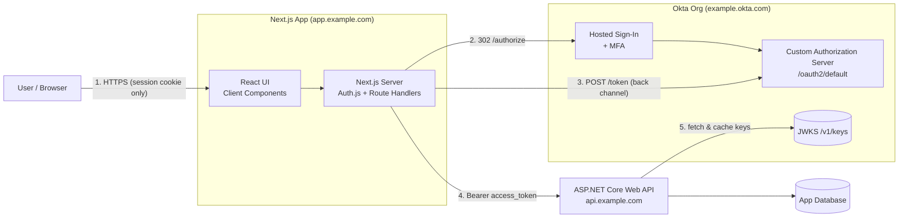
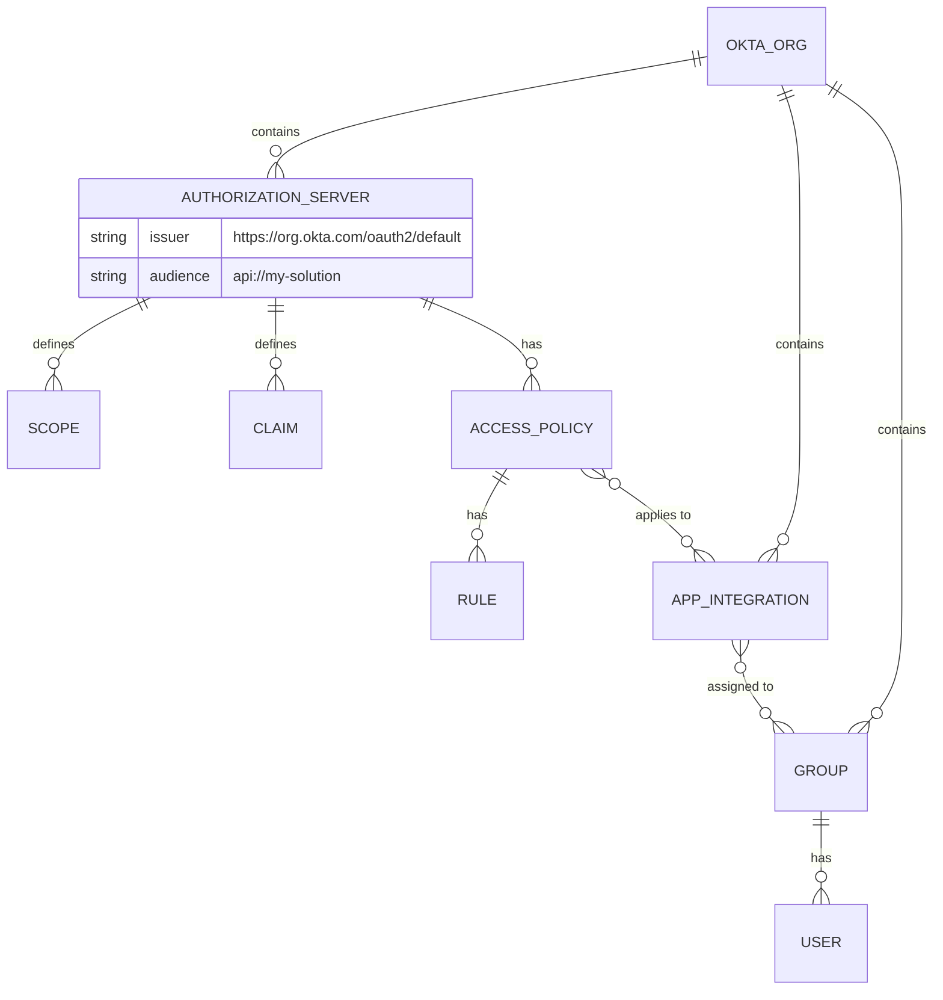
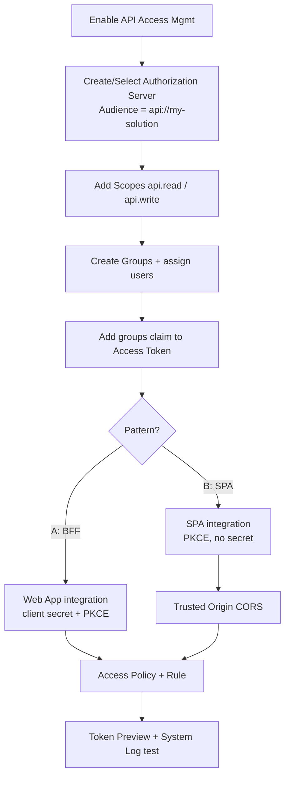
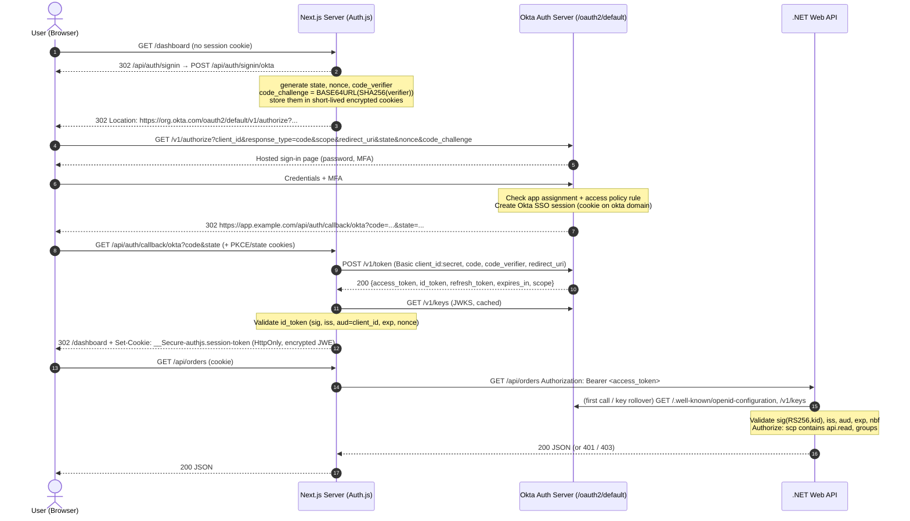
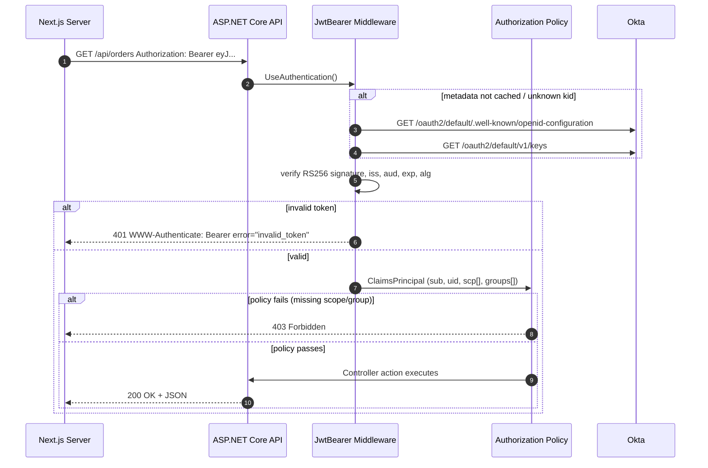
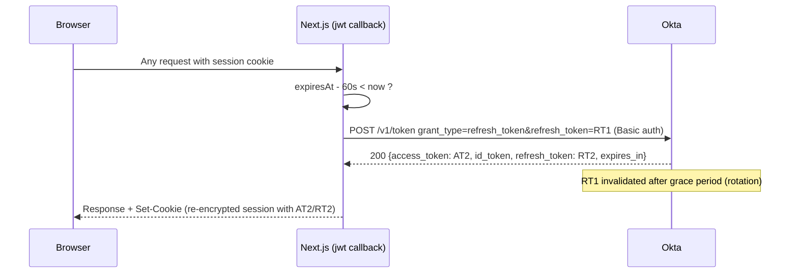
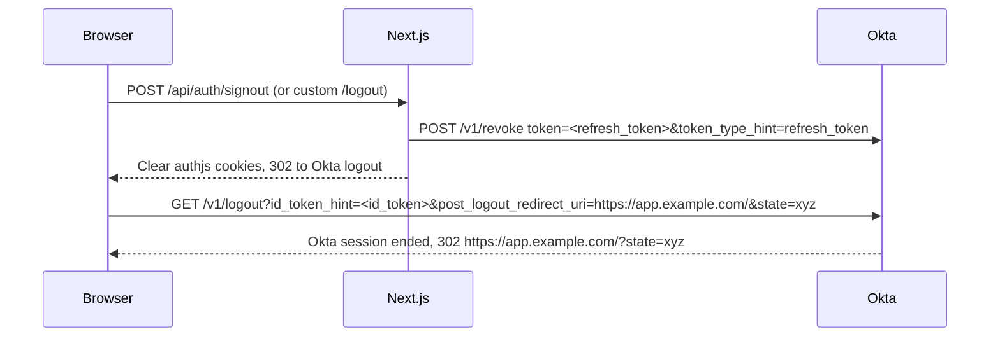
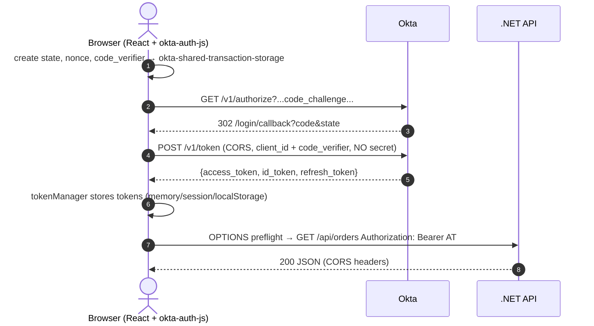

# Okta Authentication and Authorization for a Next.js and .NET Solution

**Technical design and implementation guide**
Version 1.0 · Audience: solution architects, frontend and backend developers, IAM administrators

---

## 1. Overview

This guide covers how a Next.js/React frontend and an ASP.NET Core (C#) Web API use Okta. Okta is the identity provider (IdP) and the OAuth 2.0 authorization server. The two standards involved are:

- **OpenID Connect (OIDC)** handles authentication: who the user is. Its output is the ID token.
- **OAuth 2.0** handles authorization: what the caller may do. Its output is the access token, carrying scopes and claims.

The .NET API is an OAuth **resource server**. It never sees passwords. It only accepts and validates access tokens issued by an Okta **custom authorization server**. That matters because Okta.AspNetCore does not support the Org Authorization Server for Web APIs: your own app can't validate access tokens issued by it ([Source](https://github.com/okta/okta-aspnet/blob/master/docs/aspnetcore-webapi.md)).

### 1.1 Two supported architecture patterns

| | **Pattern A: Next.js as a Backend-for-Frontend (recommended)** | **Pattern B: Pure SPA (React in the browser)** |
|---|---|---|
| Okta app type | Web Application (confidential client, has a client secret) | Single-Page Application (public client, no secret) |
| Flow | Authorization Code + PKCE + client secret, run by the Next.js server | Authorization Code + PKCE, run in the browser |
| Library | Auth.js (NextAuth v5) with the Okta provider | `@okta/okta-auth-js` + `@okta/okta-react` |
| Where tokens live | Server side, inside an encrypted HttpOnly session cookie | In browser storage (localStorage by default, memory or sessionStorage recommended) |
| Who calls the .NET API | The Next.js server (route handlers, server actions, RSC) | The browser, directly, with `Authorization: Bearer` |

The current browser-app best practice (RFC 10017, *OAuth 2.0 for Browser-Based Apps*) says to always use Authorization Code + PKCE and never the Implicit flow. It recommends keeping tokens in memory rather than localStorage, or better, using a BFF that holds tokens server side and talks to the browser through HttpOnly cookies ([Source](https://oauth.net/2/browser-based-apps/)). This guide therefore treats **Pattern A as the primary design** and covers Pattern B as an alternative.

### 1.2 High-level architecture (Pattern A)



### 1.3 Okta configuration objects and how they relate



---

## 2. Terminology

| Term | Meaning in this solution |
|---|---|
| Okta domain | `https://{yourOrg}.okta.com` (or a custom domain such as `https://login.example.com`) |
| Authorization server ID | `default`, or the ID of a server you create (for example `aus1abc...`) |
| Issuer | `https://{yourOktaDomain}/oauth2/{authServerId}`. The `iss` claim in every token. |
| Audience | The API identifier, for example `api://my-solution`. The `aud` claim in the access token. |
| Client ID | Public identifier of the Okta app integration (for example `0oa1b2c3...`) |
| Client secret | Only for the Web Application type (Pattern A). Never shipped to the browser. |
| Scope | A permission string requested by the client (`openid`, `api.read`, ...) |
| Claim | A key/value statement inside a token (`sub`, `groups`, `scp`, ...) |
| PKCE | Proof Key for Code Exchange. A `code_verifier`/`code_challenge` pair that binds the code to the client that requested it. |
| JWKS | JSON Web Key Set. The public keys used to verify token signatures. |

---

## 3. Okta Admin Console setup (step by step)

> **About screenshots:** I can't capture live screenshots of your Okta tenant. Each step below gives the exact Admin Console menu path. The `📷` markers show where your team should insert screenshots from your own org. Menu labels change over time. Recent docs use **Applications and Resources > Applications**; older orgs show **Applications > Applications**.

### 3.0 Prerequisites

1. An Okta org (an Integrator Free Plan org works for development) and an admin account.
2. **API Access Management** enabled. It is required for custom authorization servers and is an optional add-on in production ([Source](https://developer.okta.com/docs/guides/customize-authz-server/main/)). To check, go to **Security > API** and confirm an **Authorization Servers** tab exists ([Source](https://developer.okta.com/docs/guides/sign-into-spa-redirect/react/main/)).
3. The URLs of every environment, for example `http://localhost:3000` (dev), `https://app-staging.example.com`, `https://app.example.com`, and `https://api.example.com`.

### 3.1 Step 1: Create (or choose) the custom authorization server

Integrator Free Plan orgs already include a custom authorization server named `default`, with ID `default`. A dedicated server is worth creating if you need your own audience, scopes, or rules ([Source](https://developer.okta.com/docs/guides/customize-authz-server/main/)).

1. Go to **Security > API > Authorization Servers** 📷.
2. Click **Add Authorization Server**.
3. Fill in:
   - **Name**: `my-solution-as`
   - **Audience**: `api://my-solution`. This must exactly match what the .NET API validates as `aud`. Okta recommends an absolute URI for the resource server ([Source](https://developer.okta.com/docs/guides/customize-authz-server/main/)).
   - **Description**: "Issues access tokens for My Solution API"
4. Click **Save**. Copy the **Issuer URI** from the Settings tab, for example `https://example.okta.com/oauth2/aus1xyz` (or `/oauth2/default`).
5. Optional: leave **Signing Key Rotation** set to *Automatic* (recommended).

### 3.2 Step 2: Create custom scopes

1. Open the authorization server, then **Scopes > Add Scope** 📷.
2. Create these:

| Name | Display phrase | Consent | Default scope | Include in public metadata |
|---|---|---|---|---|
| `api.read` | Read your data | Not required (first-party app) | No | Yes |
| `api.write` | Modify your data | Not required | No | Yes |
| `api.admin` | Administer the solution | Not required | No | No |

The display phrase is what users see on the consent screen. "Set as a default scope" makes Okta grant the scope when the request specifies none ([Source](https://developer.okta.com/docs/guides/customize-authz-server/main/)). You don't need to define the OIDC scopes `openid`, `profile`, `email`, and `offline_access`. They are built in, but a policy and rule must still exist ([Source](https://developer.okta.com/docs/api/openapi/okta-oauth/guides/overview)).

### 3.3 Step 3: Create groups and assign users (for role-based authorization)

1. Go to **Directory > Groups > Add Group**.
2. Create, for example, `app-mysolution-users`, `app-mysolution-editors`, and `app-mysolution-admins`.
3. Open each group, choose **Assign people**, and add test users.

A shared prefix like `app-mysolution-` lets you filter the groups claim so tokens stay small.

### 3.4 Step 4: Create custom claims

Open the authorization server, then **Claims > Add Claim** 📷.

**Claim 1: `groups` in the access token (used by .NET for roles)**

| Field | Value |
|---|---|
| Name | `groups` |
| Include in token type | **Access Token** |
| Value type | **Groups** |
| Filter | *Starts with* `app-mysolution-` |
| Include in | Any scope (or only `api.read`) |

**Claim 2 (optional): `groups` in the ID token (used by the UI to show or hide menus)**: the same settings, with *Include in token type* = **ID Token**, *Always*.

**Claim 3 (optional): `email` in the access token**: Value type **Expression**, value `user.email`.

The Groups value type uses a group filter. The Expression type uses Okta Expression Language. Okta includes at most 100 groups in the claim, and the request fails if the filter matches more ([Source](https://developer.okta.com/docs/guides/customize-authz-server/main/)).

### 3.5 Step 5a: Create the app integration for Pattern A (Next.js BFF)

1. Go to **Applications and Resources > Applications > Create App Integration**. On non-free orgs, pick **Classic experience** if asked.
2. **Sign-in method**: `OIDC - OpenID Connect`. **Application type**: `Web Application`. Click **Next** 📷.
3. **General Settings**:
   - **App integration name**: `My Solution Web`
   - **Grant type**: ☑ Authorization Code, ☑ Refresh Token
   - **Sign-in redirect URIs**, which is the Auth.js callback format `/api/auth/callback/okta`:
     - `http://localhost:3000/api/auth/callback/okta`
     - `https://app.example.com/api/auth/callback/okta`
   - **Sign-out redirect URIs**: `http://localhost:3000/` and `https://app.example.com/`
4. **Assignments**: *Limit access to selected groups* and select the `app-mysolution-*` groups.
5. Click **Save**.
6. On the **General** tab, under **Client Credentials**:
   - Copy the **Client ID**.
   - Client authentication: **Client secret**. Copy the secret.
   - ☑ **Require PKCE as additional verification** (recommended, since Auth.js sends PKCE).
7. Under **General Settings > Edit > Refresh Token**, choose **Rotate token after every use** (grace period 30 s by default).
8. Under **Login > Login initiated by**, choose *App Only* (or *Either Okta or App* with an **Initiate login URI** such as `https://app.example.com/login`).

Okta's documented fields include the redirect URIs, which must be absolute and are matched exactly. Users get an error if they sign in through an unregistered URI. The documented fields also cover the client secret and the PKCE option for Web apps ([Source](https://help.okta.com/en-us/content/topics/apps/apps_app_integration_wizard_oidc.htm)). Web and mobile apps default to persistent refresh tokens, so you must turn on rotation explicitly. The grace period can be set from 0 to 60 seconds ([Source](https://developer.okta.com/docs/guides/refresh-tokens/main/)).

### 3.6 Step 5b: Create the app integration for Pattern B (pure SPA)

1. **Create App Integration > OIDC > Single-Page Application**.
2. **Grant type**: ☑ Authorization Code, ☑ Refresh Token.
3. **Sign-in redirect URI**: `http://localhost:3000/login/callback` and `https://app.example.com/login/callback`.
4. **Sign-out redirect URI**: `http://localhost:3000` and `https://app.example.com`.
5. **Assignments**: the groups above. Click **Save**.
6. Under **Client Credentials**, client authentication is **None**, and PKCE is required automatically.
7. Refresh token rotation is on by default for SPAs.

Choosing the wrong app type breaks sign-in, because a public client has no secret. The SPA guide uses the Authorization Code + Refresh Token grants, for which rotation is the default ([Source](https://developer.okta.com/docs/guides/sign-into-spa-redirect/react/main/)).

### 3.7 Step 6: Create the access policy and rule

1. Open the authorization server, then **Access Policies > Add Policy** 📷.
   - Name: `My Solution clients`
   - Assign to: **The following clients**, then select `My Solution Web` (and/or the SPA)
2. In the policy, click **Add Rule**:

| Field | Value |
|---|---|
| Rule name | `Users - auth code` |
| IF Grant type is | ☑ Authorization Code (☑ Client Credentials only if you have service apps) |
| AND User is | *Assigned the app and a member of one of the following*: `app-mysolution-*` |
| AND Scopes requested | `openid profile email offline_access api.read api.write` (avoid "Any scopes" in production) |
| Access token lifetime | 15–60 minutes |
| Refresh token lifetime | for example 8 hours (SPA) / 1 day (BFF) |
| ...expire if not used every | for example 1 hour to 7 days |

3. Optionally add a second, higher-priority rule that only `app-mysolution-admins` can match for the `api.admin` scope.

Policies and rules are evaluated in priority order, and the first match wins. Rules are allowlists. If no policy or rule matches, the request fails ([Source](https://developer.okta.com/docs/guides/customize-authz-server/main/)). On a custom authorization server, access tokens can live from 5 minutes to 24 hours, and ID tokens are fixed at 60 minutes ([Source](https://developer.okta.com/docs/api/openapi/okta-oauth/guides/overview)).

### 3.8 Step 7: Trusted Origins (CORS), required for Pattern B

1. Go to **Security > API > Trusted Origins > Add Origin**.
2. Name: `My Solution SPA`. Origin URL: `https://app.example.com` (and `http://localhost:3000` in dev).
3. Check **CORS** and **Redirect**. Save.

The SPA calls Okta's `/token` endpoint from JavaScript, so its origin must be trusted. Sign-out also needs the app listed as a trusted origin ([Source](https://developer.okta.com/docs/guides/sign-into-spa-redirect/react/main/)). Pattern A calls `/token` from the server, so CORS isn't needed for token calls.

### 3.9 Step 8: Verify the configuration

1. Open `https://{yourOktaDomain}/oauth2/{authServerId}/.well-known/openid-configuration` in a browser. It should return the `issuer`, `authorization_endpoint`, `token_endpoint`, `jwks_uri`, and so on ([Source](https://developer.okta.com/docs/guides/customize-authz-server/main/)).
2. In the authorization server, open the **Token Preview** tab. Pick the client, grant type, a test user, and scopes. Check that the access token contains `aud = api://my-solution`, `scp` with your scopes, and the `groups` claim.
3. Check **Reports > System Log** for any denied attempts.

### 3.10 Admin setup checklist



---

## 4. Configuration values: what goes where

### 4.1 Matrix

| Value | Example | Frontend Pattern A (Next.js server) | Frontend Pattern B (browser SPA) | Backend (.NET API) | Secret? |
|---|---|---|---|---|---|
| Okta domain | `https://example.okta.com` | ✓ (inside the issuer) | ✓ | ✓ (inside the issuer) | No |
| Issuer | `https://example.okta.com/oauth2/default` | ✓ `AUTH_OKTA_ISSUER` | ✓ `issuer` | ✓ `Okta:Issuer` | No |
| Client ID | `0oa1b2c3d4...` | ✓ `AUTH_OKTA_ID` | ✓ `clientId` | ✗ not needed | No |
| Client secret | `xYz...` | ✓ `AUTH_OKTA_SECRET` (server only) | ✗ never | ✗ | **Yes** |
| Redirect URI | `.../api/auth/callback/okta` | ✓ (derived by Auth.js) | ✓ `redirectUri` | ✗ | No |
| Post-logout redirect URI | `https://app.example.com/` | ✓ | ✓ | ✗ | No |
| Scopes | `openid profile email offline_access api.read` | ✓ | ✓ | ✓ (enforced as policies) | No |
| Audience | `api://my-solution` | Optional | Optional | ✓ `Okta:Audience` | No |
| Session encryption secret | 32+ random bytes | ✓ `AUTH_SECRET` | ✗ | ✗ | **Yes** |
| API base URL | `https://api.example.com` | ✓ (server env) | ✓ (public env) | ✗ | No |
| Allowed CORS origins | `https://app.example.com` | ✗ | ✗ | ✓ (Pattern B only) | No |

The backend needs only the **issuer** and the **audience**. It downloads everything else (signing keys, endpoints) from the discovery document. The Okta guide likewise lists just two frontend values, the Client ID from the app's General tab and the Issuer URI from Security > API ([Source](https://developer.okta.com/docs/guides/sign-into-spa-redirect/react/main/)).

### 4.2 Example configuration files

**Next.js `.env.local` (Pattern A)**
```bash
AUTH_SECRET="generate-with: npx auth secret"
AUTH_URL="https://app.example.com"            # optional on most hosts
AUTH_OKTA_ID="0oa1b2c3d4EXAMPLE"
AUTH_OKTA_SECRET="**********"                 # server-only, never NEXT_PUBLIC_
AUTH_OKTA_ISSUER="https://example.okta.com/oauth2/default"
API_BASE_URL="https://api.example.com"
```

**React SPA `.env` (Pattern B)**
```bash
NEXT_PUBLIC_OKTA_ISSUER="https://example.okta.com/oauth2/default"
NEXT_PUBLIC_OKTA_CLIENT_ID="0oa9z8y7EXAMPLE"
NEXT_PUBLIC_API_BASE_URL="https://api.example.com"
```

**.NET `appsettings.json`**
```json
{
  "Okta": {
    "Issuer": "https://example.okta.com/oauth2/default",
    "Audience": "api://my-solution"
  },
  "Cors": { "AllowedOrigins": [ "https://app.example.com", "http://localhost:3000" ] }
}
```

---

## 5. Implementation

### 5.1 Frontend, Pattern A: Next.js (App Router) with Auth.js v5

Install: `npm i next-auth@beta`

**`auth.ts`**
```ts
import NextAuth from "next-auth";
import Okta from "next-auth/providers/okta";

const issuer = process.env.AUTH_OKTA_ISSUER!;

export const { handlers, auth, signIn, signOut } = NextAuth({
  providers: [
    Okta({
      clientId: process.env.AUTH_OKTA_ID,
      clientSecret: process.env.AUTH_OKTA_SECRET,
      issuer,                                   // custom authorization server
      authorization: {
        params: { scope: "openid profile email offline_access api.read api.write" },
      },
      checks: ["pkce", "state", "nonce"],
    }),
  ],
  session: { strategy: "jwt", maxAge: 8 * 60 * 60 },  // 8h app session
  callbacks: {
    // Runs on sign-in and whenever the session is read
    async jwt({ token, account, profile }) {
      if (account) {
        // First sign-in: persist Okta tokens inside the ENCRYPTED session cookie
        return {
          ...token,
          accessToken: account.access_token,
          idToken: account.id_token,
          refreshToken: account.refresh_token,
          expiresAt: account.expires_at,            // epoch seconds
          groups: (profile as any)?.groups ?? [],
        };
      }
      if (Date.now() < (token.expiresAt as number) * 1000 - 60_000) return token;

      // Access token about to expire: refresh it (back channel)
      try {
        const res = await fetch(`${issuer}/v1/token`, {
          method: "POST",
          headers: {
            "Content-Type": "application/x-www-form-urlencoded",
            Authorization: "Basic " + Buffer.from(
              `${process.env.AUTH_OKTA_ID}:${process.env.AUTH_OKTA_SECRET}`).toString("base64"),
          },
          body: new URLSearchParams({
            grant_type: "refresh_token",
            refresh_token: token.refreshToken as string,
            scope: "openid profile email offline_access api.read api.write",
          }),
        });
        const t = await res.json();
        if (!res.ok) throw t;
        return {
          ...token,
          accessToken: t.access_token,
          idToken: t.id_token ?? token.idToken,
          refreshToken: t.refresh_token ?? token.refreshToken, // rotation returns a new one
          expiresAt: Math.floor(Date.now() / 1000) + t.expires_in,
        };
      } catch {
        return { ...token, error: "RefreshTokenError" };
      }
    },
    async session({ session, token }) {
      // Only expose NON-sensitive data to the browser
      session.user.groups = token.groups as string[];
      (session as any).error = token.error;
      return session;                          // accessToken intentionally NOT exposed
    },
  },
});
```

**`app/api/auth/[...nextauth]/route.ts`**
```ts
import { handlers } from "@/auth";
export const { GET, POST } = handlers;
```

**`middleware.ts`** protects pages:
```ts
export { auth as middleware } from "@/auth";
export const config = { matcher: ["/dashboard/:path*", "/admin/:path*"] };
```

**Calling the .NET API from the server (BFF proxy), `app/api/orders/route.ts`**
```ts
import { auth } from "@/auth";
import { getToken } from "next-auth/jwt";
import { NextRequest, NextResponse } from "next/server";

export async function GET(req: NextRequest) {
  const session = await auth();
  if (!session) return NextResponse.json({ error: "unauthenticated" }, { status: 401 });

  const jwt = await getToken({ req, secret: process.env.AUTH_SECRET });
  const apiRes = await fetch(`${process.env.API_BASE_URL}/api/orders`, {
    headers: { Authorization: `Bearer ${jwt?.accessToken}` },
    cache: "no-store",
  });
  return new NextResponse(apiRes.body, { status: apiRes.status });
}
```

**Sign-in and sign-out actions**
```tsx
import { signIn, signOut } from "@/auth";
export function LoginButton() {
  return <form action={async () => { "use server"; await signIn("okta", { redirectTo: "/dashboard" }); }}>
    <button>Sign in</button></form>;
}
```

For full Okta sign-out (ending the Okta SSO session too), add a route that clears the Auth.js session and then redirects to Okta's `/v1/logout` with `id_token_hint` (see §6.6).

The Auth.js Okta provider is configured with the `AUTH_OKTA_ID`, `AUTH_OKTA_SECRET`, and `AUTH_OKTA_ISSUER` environment variables. Its callback URL follows the `/api/auth/callback/okta` pattern ([Source](https://authjs.dev/getting-started/providers/okta)).

### 5.2 Frontend, Pattern B: React SPA with `@okta/okta-react`

```tsx
// oktaConfig.ts
import { OktaAuth } from "@okta/okta-auth-js";
export const oktaAuth = new OktaAuth({
  issuer: process.env.NEXT_PUBLIC_OKTA_ISSUER!,
  clientId: process.env.NEXT_PUBLIC_OKTA_CLIENT_ID!,
  redirectUri: window.location.origin + "/login/callback",
  postLogoutRedirectUri: window.location.origin,
  scopes: ["openid", "profile", "email", "offline_access", "api.read"],
  pkce: true,
  tokenManager: { storage: "memory", autoRenew: true },   // override localStorage default
});
```

```tsx
// App.tsx
<Security oktaAuth={oktaAuth} restoreOriginalUri={async (_a, uri) => navigate(uri || "/")}>
  <Routes>
    <Route path="/login/callback" element={<LoginCallback />} />
    <Route path="/dashboard" element={<SecureRoute><Dashboard /></SecureRoute>} />
  </Routes>
</Security>

// Calling the API
const token = oktaAuth.getAccessToken();
await fetch(`${API}/api/orders`, { headers: { Authorization: `Bearer ${token}` } });
```

Okta's React redirect guide covers this pattern: redirect to the hosted sign-in, let `LoginCallback` exchange the code, then send the access token in the `Authorization` header ([Source](https://developer.okta.com/docs/guides/sign-into-spa-redirect/react/main/)). With `storage: "memory"`, a page reload loses the tokens. The SDK then restores the session silently, using the Okta session cookie or a fresh redirect.

### 5.3 Backend: ASP.NET Core (.NET 8/9) Web API

**Option 1: Microsoft `JwtBearer` (vendor neutral, recommended)**

```bash
dotnet add package Microsoft.AspNetCore.Authentication.JwtBearer
```

```csharp
// Program.cs
using Microsoft.AspNetCore.Authentication.JwtBearer;
using Microsoft.IdentityModel.Tokens;

var builder = WebApplication.CreateBuilder(args);
var okta = builder.Configuration.GetSection("Okta");

builder.Services
    .AddAuthentication(JwtBearerDefaults.AuthenticationScheme)
    .AddJwtBearer(o =>
    {
        o.Authority = okta["Issuer"];            // downloads /.well-known/openid-configuration + JWKS
        o.Audience  = okta["Audience"];          // must equal 'aud' (api://my-solution)
        o.MapInboundClaims = false;              // keep Okta claim names: sub, scp, groups
        o.RequireHttpsMetadata = true;
        o.TokenValidationParameters = new TokenValidationParameters
        {
            ValidateIssuer = true,
            ValidIssuer = okta["Issuer"],
            ValidateAudience = true,
            ValidateLifetime = true,
            ValidateIssuerSigningKey = true,
            ValidAlgorithms = new[] { SecurityAlgorithms.RsaSha256 },
            ClockSkew = TimeSpan.FromMinutes(2),
            NameClaimType = "sub",
            RoleClaimType = "groups"             // enables [Authorize(Roles = "...")]
        };
        o.Events = new JwtBearerEvents
        {
            OnAuthenticationFailed = ctx =>
            {
                ctx.HttpContext.RequestServices.GetRequiredService<ILogger<Program>>()
                   .LogWarning(ctx.Exception, "JWT validation failed");
                return Task.CompletedTask;
            }
        };
    });

builder.Services.AddAuthorization(o =>
{
    // 'scp' is a JSON array -> one claim per scope when MapInboundClaims = false
    o.AddPolicy("ApiRead",  p => p.RequireAuthenticatedUser().RequireClaim("scp", "api.read"));
    o.AddPolicy("ApiWrite", p => p.RequireAuthenticatedUser().RequireClaim("scp", "api.write"));
    o.AddPolicy("Admin",    p => p.RequireRole("app-mysolution-admins"));
    o.FallbackPolicy = new Microsoft.AspNetCore.Authorization.AuthorizationPolicyBuilder()
        .RequireAuthenticatedUser().Build();     // deny by default
});

// Only needed for Pattern B (browser calls API directly)
builder.Services.AddCors(o => o.AddPolicy("spa", p => p
    .WithOrigins(builder.Configuration.GetSection("Cors:AllowedOrigins").Get<string[]>()!)
    .WithHeaders("Authorization", "Content-Type")
    .WithMethods("GET", "POST", "PUT", "DELETE")));

builder.Services.AddControllers();
var app = builder.Build();

app.UseHttpsRedirection();
app.UseCors("spa");
app.UseAuthentication();
app.UseAuthorization();
app.MapControllers();
app.Run();
```

**Controller**
```csharp
[ApiController]
[Route("api/[controller]")]
public class OrdersController : ControllerBase
{
    [HttpGet]
    [Authorize(Policy = "ApiRead")]
    public IActionResult Get()
    {
        var oktaUserId = User.FindFirst("uid")?.Value;   // Okta user id
        var subject    = User.FindFirst("sub")?.Value;   // login / email
        var clientId   = User.FindFirst("cid")?.Value;   // which app called
        return Ok(new { subject, oktaUserId, clientId, orders = Array.Empty<object>() });
    }

    [HttpPost]
    [Authorize(Policy = "ApiWrite")]
    public IActionResult Create(OrderDto dto) => Created("", dto);

    [HttpDelete("{id}")]
    [Authorize(Policy = "Admin")]
    public IActionResult Delete(int id) => NoContent();
}
```

**Option 2: Okta's `Okta.AspNetCore` package**

```csharp
builder.Services.AddAuthentication(o =>
{
    o.DefaultAuthenticateScheme = OktaDefaults.ApiAuthenticationScheme;
    o.DefaultChallengeScheme    = OktaDefaults.ApiAuthenticationScheme;
    o.DefaultSignInScheme       = OktaDefaults.ApiAuthenticationScheme;
})
.AddOktaWebApi(builder.Configuration);   // binds "Okta": { Issuer | OktaDomain+AuthorizationServerId, Audience }
```

From v5.0.0, the package binds settings from the `Okta` configuration section. You can supply either `OktaDomain` + `AuthorizationServerId` or a full `Issuer`. `Audience` defaults to `api://default` and `ClockSkew` to 2 minutes ([Source](https://github.com/okta/okta-aspnet/blob/master/docs/aspnetcore-webapi.md)).

---

## 6. End-to-end request and response flow (Pattern A)

### 6.1 Complete sequence diagram



### 6.2 Step by step: authentication

**Step 1: Start login (browser → Next.js).** The user visits a protected page. Middleware finds no session and redirects. Auth.js generates a random `state` (CSRF protection), a `nonce` (ID-token replay protection), and a PKCE `code_verifier` (43–128 random characters). It derives `code_challenge = BASE64URL(SHA-256(code_verifier))` and stores all three in short-lived, encrypted, HttpOnly cookies.

**Step 2: Authorization request (browser → Okta)**
```http
GET https://example.okta.com/oauth2/default/v1/authorize
    ?client_id=0oa1b2c3d4EXAMPLE
    &response_type=code
    &scope=openid%20profile%20email%20offline_access%20api.read%20api.write
    &redirect_uri=https%3A%2F%2Fapp.example.com%2Fapi%2Fauth%2Fcallback%2Fokta
    &state=Xk3r9...
    &nonce=n-0S6_WzA2Mj
    &code_challenge=E9Melhoa2OwvFrEMTJguCHaoeK1t8URWbuGJSstw-cM
    &code_challenge_method=S256
```
`offline_access` must be requested at `/authorize`, not at `/token`, for Okta to return a refresh token ([Source](https://developer.okta.com/docs/guides/refresh-tokens/main/)).

**Step 3: User authentication at Okta.** Okta shows its hosted sign-in widget, enforces the authentication policy (MFA, device, network), and then checks two things. First, is the user assigned to the app (directly or through a group)? Second, does a rule in the authorization server's access policy allow this client + user + grant + scope combination? Okta documents both as required, or the request fails ([Source](https://developer.okta.com/docs/api/openapi/okta-oauth/guides/overview)). Okta also sets its own SSO session cookie on the Okta domain.

**Step 4: Redirect back with the authorization code (Okta → browser → Next.js)**
```http
HTTP/1.1 302 Found
Location: https://app.example.com/api/auth/callback/okta?code=Kp9a7Yf...&state=Xk3r9...
```
On failure, the redirect looks like this instead:
```http
Location: https://app.example.com/api/auth/callback/okta?error=access_denied
          &error_description=User+is+not+assigned+to+the+client+application.&state=Xk3r9...
```
Auth.js compares the returned `state` with the value in its cookie.

**Step 5: Token exchange (Next.js server → Okta, back channel)**
```http
POST https://example.okta.com/oauth2/default/v1/token
Authorization: Basic base64(0oa1b2c3d4EXAMPLE:CLIENT_SECRET)
Content-Type: application/x-www-form-urlencoded
Accept: application/json

grant_type=authorization_code
&code=Kp9a7Yf...
&redirect_uri=https%3A%2F%2Fapp.example.com%2Fapi%2Fauth%2Fcallback%2Fokta
&code_verifier=dBjftJeZ4CVP-mB92K27uhbUJU1p1r_wW1gFWFOEjXk
```
In Pattern B, the browser sends this request itself with `client_id=...` in the body and **no** Authorization header. That is why the SPA's origin must be a Trusted Origin.

**Step 6: Token response**
```json
{
  "token_type": "Bearer",
  "expires_in": 3600,
  "access_token": "eyJraWQiOiI0NWpz...",
  "scope": "openid profile email offline_access api.read api.write",
  "refresh_token": "a9VpZDRCeFh3Nkk2VdY",
  "id_token": "eyJraWQiOiI0NWpz..."
}
```

**Step 7: ID token validation.** Auth.js fetches the JWKS from `jwks_uri` (`/oauth2/default/v1/keys`) and checks five things: the RS256 signature (by `kid`), `iss` = issuer, `aud` = client ID, `exp`/`iat`, and `nonce` = the cookie value.

**Step 8: Session established.** Auth.js deletes the temporary PKCE/state/nonce cookies and sets the session cookie:
```http
HTTP/1.1 302 Found
Location: /dashboard
Set-Cookie: __Secure-authjs.session-token=eyJhbGciOiJkaXIiLCJlbmMiOiJBMjU2Q0JDLUhTNTEyIn0..;
            Path=/; HttpOnly; Secure; SameSite=Lax; Expires=...
```
The cookie is a JWE (encrypted JWT) containing the Okta tokens from the `jwt` callback. JavaScript can't read it, and it's encrypted with a key only the server knows ([Source](https://authjs.dev/concepts/session-strategies)). The encryption is A256CBC-HS512, derived from `AUTH_SECRET` ([Source](https://authjs.dev/reference/core/jwt)).

### 6.3 Token anatomy

**Access token (decoded), consumed by the .NET API**
```json
// header
{ "kid": "45js03w0djwedsw", "alg": "RS256" }
// payload
{
  "ver": 1,
  "jti": "AT.0mP4JKAZX1iACIT4vbEDF7LpvDVjxypPMf0D7uX39RE",
  "iss": "https://example.okta.com/oauth2/default",
  "aud": "api://my-solution",
  "iat": 1762160000, "exp": 1762163600,
  "cid": "0oa1b2c3d4EXAMPLE",
  "uid": "00ujmkLgagxeRrAg20g3",
  "sub": "jane.doe@example.com",
  "scp": ["openid", "profile", "email", "offline_access", "api.read", "api.write"],
  "auth_time": 1762159990,
  "groups": ["app-mysolution-users", "app-mysolution-editors"]
}
```

**ID token (decoded), consumed only by the frontend**
```json
{
  "ver": 1, "sub": "00ujmkLgagxeRrAg20g3",
  "iss": "https://example.okta.com/oauth2/default",
  "aud": "0oa1b2c3d4EXAMPLE",
  "iat": 1762160000, "exp": 1762163600,
  "amr": ["pwd", "mfa"], "nonce": "n-0S6_WzA2Mj",
  "name": "Jane Doe", "email": "jane.doe@example.com",
  "preferred_username": "jane.doe@example.com"
}
```

| Claim | Meaning |
|---|---|
| `iss` | Issuer, the authorization server |
| `aud` | Audience: the API for access tokens, the client ID for ID tokens |
| `cid` | Client ID that requested the token |
| `uid` | Okta user ID |
| `scp` | Array of granted scopes |
| `jti` | Unique token ID |
| `exp` / `iat` | Expiry and issue time (Unix seconds) |

Signatures are always RS256, and `kid` points at the matching public key in the JWKS ([Source](https://developer.okta.com/docs/api/openapi/okta-oauth/guides/overview)). The refresh token is **opaque**, not a JWT. Never send the ID token to the API: the resource server should accept only access tokens ([Source](https://developer.okta.com/docs/guides/validate-access-tokens/dotnet/main/)).

### 6.4 Step by step: API call and authorization



**Request (Next.js server → API)**
```http
GET https://api.example.com/api/orders HTTP/1.1
Authorization: Bearer eyJraWQiOiI0NWpz...
Accept: application/json
X-Correlation-ID: 7d1c...
```

**Responses**
```http
HTTP/1.1 200 OK
Content-Type: application/json
{"subject":"jane.doe@example.com","oktaUserId":"00ujmkLgagxeRrAg20g3","orders":[]}
```
```http
HTTP/1.1 401 Unauthorized
WWW-Authenticate: Bearer error="invalid_token", error_description="The audience 'api://default' is invalid"
```
```http
HTTP/1.1 403 Forbidden          // token valid, but scp lacks api.write or user not in admins group
```

**What the middleware does internally.** It fetches and caches discovery and JWKS, refreshing them when an unknown `kid` appears. It validates locally on every request, with no Okta round trip, which is fast. Okta recommends fetching keys dynamically from the JWKS, caching them, and handling the rotation that happens automatically ([Source](https://developer.okta.com/docs/api/openapi/okta-oauth/guides/overview)). If you need revocation to take effect immediately, you can call `/v1/introspect` instead, at the cost of a network call on each request ([Source](https://developer.okta.com/docs/guides/validate-access-tokens/dotnet/main/)).

**The authorization layers**

| Layer | Where enforced | Example |
|---|---|---|
| App assignment | Okta | Only `app-mysolution-*` groups can sign in at all |
| Access policy rule | Okta | Only admins can obtain the `api.admin` scope |
| Scope check | .NET policy | `RequireClaim("scp","api.write")` on POST endpoints |
| Role/group check | .NET policy | `RequireRole("app-mysolution-admins")` on DELETE |
| Resource/data check | .NET business logic | User may edit only orders where `OwnerId == uid` |
| UI gating (cosmetic) | Next.js | Hide the Admin menu if `session.user.groups` lacks admins. This is never a security boundary. |

### 6.5 Token refresh



```http
POST /oauth2/default/v1/token
Authorization: Basic base64(client_id:client_secret)
Content-Type: application/x-www-form-urlencoded

grant_type=refresh_token&refresh_token=a9VpZDRCeFh3Nkk2VdY&scope=openid%20profile%20email%20offline_access%20api.read%20api.write
```

With rotation enabled, each use invalidates the old refresh token. If an old one is replayed, Okta revokes the latest refresh token and every access token issued since login, and logs `app.oauth2.as.token.detect_reuse` ([Source](https://developer.okta.com/docs/guides/refresh-tokens/main/)). If refresh fails (`invalid_grant`), clear the session and send the user back to sign-in.

### 6.6 Logout



The `/v1/logout` endpoint takes the ID token as `id_token_hint` and ends the Okta session if the subject matches. The `post_logout_redirect_uri` must be a registered sign-out redirect URI ([Source](https://developer.okta.com/docs/api/openapi/okta-oauth/oauth/orgas/logout)). If you only clear the Auth.js cookie, the Okta SSO session stays alive and the next sign-in completes silently.

### 6.7 How Pattern B (SPA) differs



The differences are: the token exchange happens in the browser without a secret, tokens sit in browser storage, the API must allow CORS from the SPA origin, and a cross-site scripting (XSS) bug can expose tokens. Okta states that long-lived refresh tokens aren't suitable for SPAs because a browser can't store them safely. That is why rotation and short lifetimes matter there ([Source](https://developer.okta.com/docs/guides/refresh-tokens/main/)).

---

## 7. What is stored on the client

### 7.1 Pattern A (Next.js + Auth.js): browser storage on the app domain

| Name (HTTPS prefix) | Type | Content | Attributes | Lifetime |
|---|---|---|---|---|
| `__Secure-authjs.session-token` (may be split into `.0`, `.1`, ...) | Cookie | **Encrypted JWE** holding user profile, access token, ID token, refresh token, `expiresAt`, groups | HttpOnly, Secure, SameSite=Lax, Path=/ | Session `maxAge` (for example 8h), sliding |
| `__Host-authjs.csrf-token` | Cookie | CSRF token + hash for Auth.js POST endpoints | HttpOnly, Secure, SameSite=Lax | Session |
| `__Secure-authjs.callback-url` | Cookie | URL to return to after login | HttpOnly, Secure | Session |
| `__Secure-authjs.pkce.code_verifier` | Cookie | Encrypted PKCE verifier | HttpOnly, Secure, ~15 min | Deleted after callback |
| `__Secure-authjs.state` / `__Secure-authjs.nonce` | Cookie | Encrypted state / nonce | HttpOnly, Secure, ~15 min | Deleted after callback |
| localStorage / sessionStorage | none | **Nothing auth-related** (Auth.js may use a localStorage event to sync tabs, with no tokens) | | |

JavaScript in the browser can't read any token. `useSession()` returns only what your `session` callback exposes (name, email, groups). Cookies hold about 4 KB each, and Auth.js splits larger sessions into chunks. Keep the payload small, for example by storing the ID token server side or trimming claims ([Source](https://authjs.dev/concepts/session-strategies)). If you need server-side revocation ("sign out everywhere"), use the database session strategy. The cookie then holds only an opaque session ID.

### 7.2 Pattern B (SPA with okta-auth-js): browser storage on the app domain

| Key | Default storage | Content |
|---|---|---|
| `okta-token-storage` | **localStorage** | JSON with `accessToken`, `idToken`, `refreshToken` objects (raw JWT, claims, `expiresAt`, scopes) |
| `okta-shared-transaction-storage` | localStorage | In-flight login transaction: `codeVerifier`, `state`, `nonce`, redirect URI |
| `okta-original-uri-storage` | localStorage | Page to return to after login |
| `okta-cache-storage` | localStorage | Cached `.well-known` and JWKS responses |

The SDK stores all tokens under `okta-token-storage` in localStorage by default ([Source](https://github.com/okta/okta-auth-js/blob/master/README.md)). This default has been questioned against OWASP guidance on sensitive data in localStorage ([Source](https://github.com/okta/okta-auth-js/issues/1565)). The recommendation is `tokenManager.storage: "memory"` (most secure, lost on reload) or `"sessionStorage"` (per tab), plus a strict Content Security Policy.

### 7.3 Cookies on the Okta domain (both patterns)

When the user signs in, Okta sets its own first-party cookies on `example.okta.com`, such as session cookies and a device token cookie. Their exact names vary by Okta engine. Your app can't read them. They give you single sign-on, and they let a new `/authorize` call complete without a password prompt. Browser tracking prevention (ITP/ETP) blocks them in third-party iframe contexts. This is why SPAs now rely on refresh-token rotation rather than silent iframe renewal ([Source](https://developer.okta.com/docs/guides/refresh-tokens/main/)). A custom domain (for example `login.example.com`) puts Okta in the same site as your app.

### 7.4 Backend storage

The .NET API is **stateless**: it stores no tokens. It caches only the discovery document and JWKS in memory. It should log `jti`, `uid`, and `cid` for auditing, never the raw tokens.

---

## 8. Security checklist

| Area | Recommendation |
|---|---|
| Flow | Authorization Code + PKCE only. Disable Implicit in the Okta app. |
| Secrets | Client secret and `AUTH_SECRET` live in a vault or host secrets. Never use a `NEXT_PUBLIC_` variable. Rotate them periodically (Okta supports a second client secret). |
| Token validation | Validate `iss`, `aud`, `exp`, signature, and `alg=RS256`. Turn off `MapInboundClaims` so claim names are predictable. |
| Least privilege | Request only the scopes you need. Write rules for specific scopes rather than "Any scopes". |
| Lifetimes | Access token 15–60 min. Short refresh token lifetime with rotation. Session `maxAge` matched to business needs. |
| Transport | HTTPS everywhere, plus HSTS. Cookies `Secure`, `HttpOnly`, `SameSite=Lax`. |
| XSS / CSP | Strict CSP and no `dangerouslySetInnerHTML`. Especially important in Pattern B. |
| CORS | API allows only exact app origins (Pattern B). Pattern A needs no CORS on the API. |
| Logout | Revoke the refresh token, clear cookies, and call Okta `/v1/logout`. |
| Monitoring | Okta System Log (denied policies, reuse detection) plus API auth-failure logs. |

---

## 9. Troubleshooting

| Symptom | Likely cause | Fix |
|---|---|---|
| `400 redirect_uri must be a Login redirect URI` | Callback URL not registered, or a mismatch (http/https, trailing slash, port) | Add the exact URI in the app's General settings |
| `access_denied: User is not assigned to the client application` | User or group not assigned | App > Assignments |
| `access_denied: Policy evaluation failed` / `no matching policy` | No access policy or rule matches the client/grant/scope | Add or adjust the policy rule (§3.7) |
| `invalid_scope` | Scope not defined on this authorization server, or not allowed by the rule | Create the scope, update the rule |
| No `refresh_token` returned | `offline_access` not requested, or Refresh Token grant not enabled | Add the scope at `/authorize` and enable the grant |
| API 401 "audience invalid" | Token from the Org AS (`iss` without `/oauth2/...`) or a wrong `Audience` | Use the custom AS issuer, align the audience |
| API 401 "issuer invalid" | Trailing slash, custom domain vs org domain | Use exactly the `iss` value from the token |
| API 403 | Scope/group missing from the token | Check Token Preview and the claim filter |
| CORS error on `/v1/token` (SPA) | Origin not trusted | Security > API > Trusted Origins |
| `groups` claim missing | Claim added to the ID token only, or filter doesn't match | Add the claim to the Access Token, check the filter |

---

## 10. References

1. Okta: Create OpenID Connect app integrations (Admin Console fields): https://help.okta.com/en-us/content/topics/apps/apps_app_integration_wizard_oidc.htm
2. Okta: Create an authorization server (scopes, claims, policies, rules, testing): https://developer.okta.com/docs/guides/customize-authz-server/main/
3. Okta: Configure an access policy: https://developer.okta.com/docs/guides/configure-access-policy/main/
4. Okta: OpenID Connect & OAuth 2.0 API overview (tokens, claims, lifetimes, JWKS): https://developer.okta.com/docs/api/openapi/okta-oauth/guides/overview
5. Okta: Implement Authorization Code with PKCE: https://developer.okta.com/docs/guides/implement-grant-type/authcodepkce/main/
6. Okta: Refresh tokens and rotation: https://developer.okta.com/docs/guides/refresh-tokens/main/
7. Okta: Sign users in to your SPA (React redirect model): https://developer.okta.com/docs/guides/sign-into-spa-redirect/react/main/
8. Okta: Validate access tokens (.NET): https://developer.okta.com/docs/guides/validate-access-tokens/dotnet/main/
9. Okta: Protect your API endpoints: https://developer.okta.com/docs/guides/protect-your-api/main/
10. Okta: `/logout` endpoint: https://developer.okta.com/docs/api/openapi/okta-oauth/oauth/orgas/logout
11. Okta: Enable CORS / Trusted Origins: https://developer.okta.com/docs/guides/enable-cors/main/
12. Okta.AspNetCore Web API docs: https://github.com/okta/okta-aspnet/blob/master/docs/aspnetcore-webapi.md
13. okta-auth-js README (token storage): https://github.com/okta/okta-auth-js/blob/master/README.md
14. Auth.js: Okta provider: https://authjs.dev/getting-started/providers/okta
15. Auth.js: Session strategies: https://authjs.dev/concepts/session-strategies
16. Auth.js: JWT reference (encryption): https://authjs.dev/reference/core/jwt
17. Microsoft: Configure JWT bearer authentication in ASP.NET Core: https://learn.microsoft.com/en-us/aspnet/core/security/authentication/configure-jwt-bearer-authentication
18. OAuth.net: OAuth 2.0 for Browser-Based Apps (RFC 10017): https://oauth.net/2/browser-based-apps/
19. IETF draft (BFF pattern details): https://datatracker.ietf.org/doc/html/draft-ietf-oauth-browser-based-apps

---

**Notes on this document:**

- **Diagrams:** they are written in Mermaid. They render directly on GitHub, GitLab, Azure DevOps wikis, Notion, VS Code, and Confluence (with a Mermaid plugin), or you can export them to PNG/SVG at mermaid.live.
- **Screenshots:** the `📷` markers show where to add Admin Console screenshots from your own tenant.
- **Example values:** IDs, domains, timestamps, and token strings are placeholders. Check Auth.js cookie names and Okta menu labels against the versions you deploy, because both change between releases.