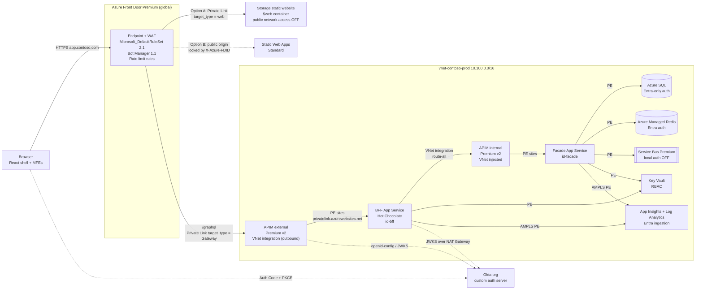
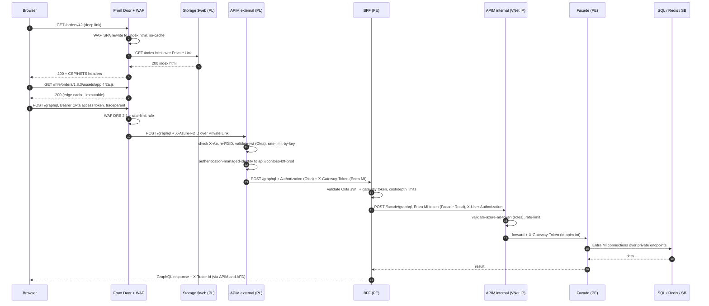
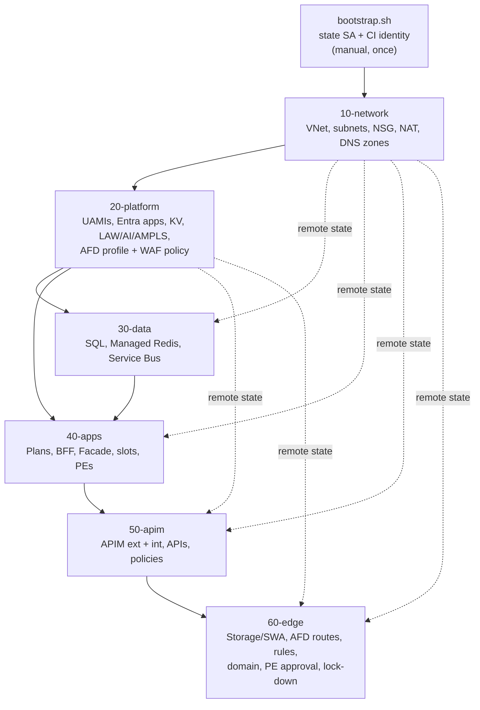
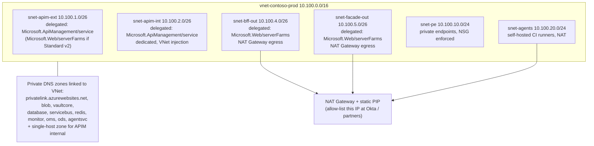
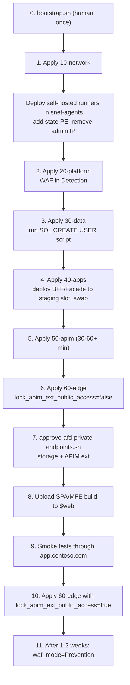

# Terraform Infrastructure Guide: Front Door, static frontend, GraphQL BFF and Facade on Azure

**Document 3 of the solution set** (follows the Okta auth guide and the GraphQL BFF/Facade API design guide)
**Toolchain:** Terraform 1.15+, AzureRM provider 5.x, AzAPI 2.x, AzureAD 3.x, GitHub Actions with OIDC

---

## 0. How to read this document, and an honest caveat

This guide sets up the whole platform from the previous two documents as layered Terraform stacks. That covers the static microfrontend shell (on Storage static website or Static Web Apps) behind Azure Front Door Premium with WAF, the external APIM, the BFF App Service, the internal APIM, the Facade App Service, and the data, identity, observability and network layers they rely on.

I wrote the code against the provider docs I could check today. I can't run `terraform plan` against your tenant, so treat this code as a reviewed starting point, not a guaranteed first-try apply. No infrastructure code should go to production without a reviewed plan in a lower environment first. The pipeline in Section 12 enforces that: PR plan, then non-prod apply, then a prod apply gated by approval and using the exact saved plan. I've marked lines with `# VERIFY:` where provider or API behaviour changed recently or the docs were thin. Check those first during your non-prod run.

### 0.1 Versions this guide targets

AzureRM 5.12.0 is the latest release, published October 29, 2026 [Source](https://registry.terraform.io/providers/hashicorp/azurerm/latest). Terraform 1.17.1 is on HashiCorp's install page [Source](https://developer.hashicorp.com/terraform/install). AzureRM 5.0 was a major release. It removed deprecated resources, stopped registering resource providers by default, and added opt-in Azure preflight validation at plan time [Source](https://www.hashicorp.com/en/blog/terraform-azurerm-provider-50-now-generally-available). Several 5.0 changes affect this architecture directly, and the code below already accounts for them:

| 5.0 change | Impact here |
|---|---|
| No resource providers registered by default; list them in `resource_providers_to_register` | The provider block lists exactly the RPs we use |
| `azurerm_storage_account.static_website` block removed; use `azurerm_storage_account_static_website` | Frontend Option A uses the new resource [Source](https://www.lindbergtech.com/whats-new-in-azurerm-5-0-upgrading-4-x-without-breaking-prod/) |
| `azurerm_key_vault.rbac_authorization_enabled` is now required | Set to `true` |
| Private DNS records and VNet links take `private_dns_zone_id` instead of zone name + RG | Used throughout |
| `azurerm_cdn_frontdoor_rule` schema rewritten (`url_rewrite`, `route_configuration_override`, `modify_response_header`, `request_file_extension`…) | All Front Door rules use the new names |
| `azurerm_cdn_frontdoor_custom_domain.tls.minimum_tls_version` replaced by `tls.minimum_version` | Used |
| App Insights / Log Analytics `local_authentication_disabled` replaced by `local_authentication_enabled`; diagnostic `metric` replaced by `enabled_metric` | Used |
| `azurerm_redis_enterprise_*` removed in favour of `azurerm_managed_redis` | Used (Azure Cache for Redis Basic/Standard/Premium is retiring) |

All rows except the static-website row come from the official 5.0 upgrade guide [Source](https://registry.terraform.io/providers/hashicorp/azurerm/latest/docs/guides/5.0-upgrade-guide). Azure Cache for Redis Basic/Standard/Premium is on a retirement path, and new instance creation is blocked [Source](https://learn.microsoft.com/en-us/azure/azure-cache-for-redis/retirement-faq), so the data layer uses Azure Managed Redis.

---

## 1. Target architecture

### 1.1 Key design decisions

**One Front Door Premium profile, one public hostname.** The SPA shell, the microfrontends and the GraphQL API all sit behind `app.contoso.com`. `/*` routes to static hosting and `/graphql` routes to the external APIM. This makes the browser's API calls same-origin. You need no CORS preflight, the Okta SPA token is never sent cross-origin, and Dynatrace/App Insights attach `traceparent` to same-origin calls by default (see Document 2, Section 18). The previous document used `api.contoso.com`. Keep its CORS policy only while you migrate.

**Every origin is private except where Azure doesn't allow it.** Front Door Premium can reach App Service, Blob Storage, Storage static website, internal load balancers, API Management, Application Gateway and Container Apps over Private Link. Private Link isn't supported for App Service slots or Static Web Apps [Source](https://learn.microsoft.com/en-us/azure/frontdoor/private-link). So Option A (Storage static website) is fully private. Option B (SWA) has to be locked down at the application layer instead (Section 9.2).

**External APIM is Premium v2 (or Standard v2) with outbound VNet integration plus an inbound private endpoint from Front Door.** Microsoft documents this pairing as end-to-end isolation: inbound private endpoint plus outbound VNet integration. Private endpoints on v2 tiers work with any VNet configuration when the instance is fronted by Front Door Premium [Source](https://learn.microsoft.com/en-us/azure/api-management/private-endpoint).

**Internal APIM is Premium v2 with VNet injection.** That gives it a private gateway IP, reachable only inside the VNet. Injection must be configured when the instance is created. The subnet must be dedicated to that one instance, delegated to `Microsoft.ApiManagement/service`, at least /27 (/24 recommended), and its NSG must allow outbound to `AzureKeyVault:443` [Source](https://learn.microsoft.com/en-us/azure/api-management/inject-vnet-v2).

**Identity-only auth everywhere.** No storage keys, no SQL passwords, no Redis access keys, no Service Bus SAS, no App Insights instrumentation-key auth on the server side. The one exception is the browser App Insights resource, because the JS SDK can't do Entra auth (Section 6.3).

### 1.2 Architecture diagram



### 1.3 Request path end-to-end



---

## 2. Repository layout and state strategy

Split the platform into stacks by rate of change and blast radius. Each stack has its own state file, and later stacks read earlier ones through `terraform_remote_state`. A mistake in the edge stack then can't plan a destroy on your SQL server, and the network stack, which rarely changes, isn't re-planned on every frontend tweak.

```
infra/
├── bootstrap/
│   └── bootstrap.sh                 # state storage + CI identity (run once, by a human)
├── modules/
│   ├── private-endpoint/
│   └── diagnostics/
├── stacks/
│   ├── 10-network/                  # VNet, subnets, NSGs, NAT, private DNS zones
│   ├── 20-platform/                 # identities, Entra apps, Key Vault, monitoring, AFD profile + WAF
│   ├── 30-data/                     # SQL, Managed Redis, Service Bus
│   ├── 40-apps/                     # App Service plans, BFF, Facade, slots, autoscale
│   ├── 50-apim/                     # APIM external + internal, APIs, policies
│   └── 60-edge/                     # static hosting, AFD endpoint/origins/routes/rules/domains, PE approvals
├── policies/
│   ├── apim-ext-bff-graphql.xml.tftpl
│   └── apim-int-facade-graphql.xml.tftpl
├── scripts/
│   └── approve-afd-private-endpoints.sh
└── env/
    ├── prod.tfvars
    └── nonprod.tfvars
.github/workflows/infra.yml
```



The AFD profile lives in `20-platform`, not `60-edge`, to break a circular dependency. The external APIM policy has to check the Front Door ID (`X-Azure-FDID`), and the Front Door origin has to point at that APIM. Creating the profile early makes its `resource_guid` available to `50-apim`.

---

## 3. Bootstrap: remote state and CI identity (run once)

The `azurerm` backend supports Entra ID auth to the storage data plane. HashiCorp recommends OIDC / workload identity federation, ideally with a user-assigned managed identity holding federated credentials, and least-privilege `Storage Blob Data Contributor` on the state container [Source](https://developer.hashicorp.com/terraform/language/backend/azurerm). The bootstrap script builds exactly that, with no access keys anywhere.

```bash
#!/usr/bin/env bash
# infra/bootstrap/bootstrap.sh — run by a platform admin, once per environment
set -euo pipefail

ENV="${ENV:-prod}"
LOCATION="${LOCATION:-westeurope}"
PREFIX="${PREFIX:-contoso}"
GH_REPO="${GH_REPO:-contoso/platform-infra}"
ADMIN_IP="$(curl -s https://api.ipify.org)"

RG="rg-${PREFIX}-tfstate-${ENV}"
SA="st${PREFIX}tfstate${ENV}"          # 3-24 lowercase alphanumerics
UAMI="id-${PREFIX}-cicd-${ENV}"
SUB_ID="$(az account show --query id -o tsv)"
TENANT_ID="$(az account show --query tenantId -o tsv)"

az group create -n "$RG" -l "$LOCATION" --tags env="$ENV" managed_by=bootstrap

az storage account create -n "$SA" -g "$RG" -l "$LOCATION" \
  --sku Standard_ZRS --kind StorageV2 --min-tls-version TLS1_2 \
  --allow-blob-public-access false --allow-shared-key-access false \
  --https-only true --default-action Deny --bypass AzureServices

# Temporary admin IP so the bootstrap and first network apply can reach the data plane.
az storage account network-rule add -g "$RG" --account-name "$SA" --ip-address "$ADMIN_IP"

az storage account blob-service-properties update -g "$RG" --account-name "$SA" \
  --enable-versioning true \
  --enable-delete-retention true --delete-retention-days 30 \
  --enable-container-delete-retention true --container-delete-retention-days 30

ME="$(az ad signed-in-user show --query id -o tsv)"
SA_ID="$(az storage account show -n "$SA" -g "$RG" --query id -o tsv)"
az role assignment create --assignee-object-id "$ME" --assignee-principal-type User \
  --role "Storage Blob Data Contributor" --scope "$SA_ID"
sleep 60   # RBAC propagation
az storage container create --account-name "$SA" -n tfstate --auth-mode login

az lock create -n lock-tfstate -g "$RG" --lock-type CanNotDelete

# CI identity with GitHub OIDC federation (environment-scoped subject)
az identity create -n "$UAMI" -g "$RG" -l "$LOCATION"
CI_PRINCIPAL="$(az identity show -n "$UAMI" -g "$RG" --query principalId -o tsv)"
CI_CLIENT="$(az identity show -n "$UAMI" -g "$RG" --query clientId -o tsv)"

az identity federated-credential create -g "$RG" --identity-name "$UAMI" \
  --name "gh-${ENV}" \
  --issuer "https://token.actions.githubusercontent.com" \
  --subject "repo:${GH_REPO}:environment:${ENV}" \
  --audiences "api://AzureADTokenExchange"

# Plan-only identity for pull requests (read-only) is recommended; omitted for brevity.
az role assignment create --assignee-object-id "$CI_PRINCIPAL" --assignee-principal-type ServicePrincipal \
  --role "Contributor" --scope "/subscriptions/${SUB_ID}"
az role assignment create --assignee-object-id "$CI_PRINCIPAL" --assignee-principal-type ServicePrincipal \
  --role "Storage Blob Data Contributor" --scope "${SA_ID}/blobServices/default/containers/tfstate"
# Needed to create role assignments for app identities. Constrain with an ABAC condition
# in the portal so it can only assign the specific data-plane roles this platform uses.
az role assignment create --assignee-object-id "$CI_PRINCIPAL" --assignee-principal-type ServicePrincipal \
  --role "Role Based Access Control Administrator" --scope "/subscriptions/${SUB_ID}"

echo "ARM_TENANT_ID=${TENANT_ID}"
echo "ARM_SUBSCRIPTION_ID=${SUB_ID}"
echo "ARM_CLIENT_ID=${CI_CLIENT}"
echo "TF_STATE_SA=${SA}"
echo "Grant the CI identity Microsoft Graph application permissions:"
echo "  Application.ReadWrite.OwnedBy and AppRoleAssignment.ReadWrite.All (admin consent required)"
```

Once `10-network` has created `snet-agents` and your self-hosted runners are up, add a private endpoint for the state account in `snet-pe` (zone `privatelink.blob.core.windows.net`) and remove the admin IP rule. From then on, state is reachable only from inside the VNet. GitHub-hosted runners with Azure private networking (runner NICs injected into your subnet) also work if you're on GitHub Enterprise Cloud.

Runners have to be inside the VNet. Several data planes in this design are private: the Storage `$web` upload, setting static-website properties on a public-disabled account, Key Vault secrets, and the SQL user-creation script. A hosted runner on the public internet can't reach them.

---

## 4. Shared Terraform configuration (copy into every stack)

### 4.1 `versions.tf` and `providers.tf`

```hcl
terraform {
  required_version = ">= 1.15.0, < 2.0.0"

  required_providers {
    azurerm = { source = "hashicorp/azurerm", version = "~> 5.12" }
    azapi   = { source = "Azure/azapi",       version = "~> 2.0" }
    azuread = { source = "hashicorp/azuread", version = "~> 3.0" }
    random  = { source = "hashicorp/random",  version = "~> 3.6" }
  }

  # Partial configuration; values supplied by -backend-config and ARM_* env vars.
  backend "azurerm" {}
}

provider "azurerm" {
  subscription_id     = var.subscription_id
  storage_use_azuread = true   # no shared keys anywhere

  # 5.0: nothing is auto-registered. Register only what this platform uses.
  resource_providers_to_register = [
    "Microsoft.ApiManagement",
    "Microsoft.Cache",
    "Microsoft.Cdn",
    "Microsoft.Insights",
    "Microsoft.KeyVault",
    "Microsoft.ManagedIdentity",
    "Microsoft.Network",
    "Microsoft.OperationalInsights",
    "Microsoft.ServiceBus",
    "Microsoft.Sql",
    "Microsoft.Storage",
    "Microsoft.Web",
  ]

  features {
    resource_group {
      prevent_deletion_if_contains_resources = true
    }
    key_vault {
      purge_soft_delete_on_destroy    = false
      recover_soft_deleted_key_vaults = true
    }
    api_management {
      purge_soft_delete_on_destroy = false
      recover_soft_deleted         = true
    }
    enhanced_validation {
      locations          = true
      resource_providers = true
      preflight_enabled  = true   # opt-in plan-time Azure validation (subset of resources)
    }
  }
}

provider "azapi" {}
provider "azuread" {}
```

Preflight validation currently covers only a small set of resources, including `azurerm_service_plan` and `azurerm_managed_redis` [Source](https://registry.terraform.io/providers/hashicorp/azurerm/latest/docs/guides/5.0-upgrade-guide). Unsupported resources are skipped silently, so a clean plan doesn't prove the apply will succeed [Source](https://www.lindbergtech.com/whats-new-in-azurerm-5-0-upgrading-4-x-without-breaking-prod/).

### 4.2 `variables.tf` (common)

```hcl
variable "subscription_id"  { type = string }
variable "tenant_id"        { type = string }
variable "prefix"           { type = string  default = "contoso" }
variable "env"              { type = string }
variable "location"         { type = string  default = "westeurope" }
variable "state_storage_account" { type = string }
variable "tags" {
  type    = map(string)
  default = { owner = "platform-team", cost_center = "cc-1234", data_classification = "confidential" }
}

locals {
  name = "${var.prefix}-${var.env}"
  tags = merge(var.tags, { env = var.env, managed_by = "terraform", stack = basename(abspath(path.root)) })
}
```

### 4.3 Remote-state reader (used by stacks 30–60)

```hcl
data "terraform_remote_state" "network" {
  backend = "azurerm"
  config = {
    use_azuread_auth     = true
    storage_account_name = var.state_storage_account
    container_name       = "tfstate"
    key                  = "${var.env}/10-network.tfstate"
    # tenant_id, client_id, use_oidc are picked up from ARM_* environment variables
  }
}
# Repeat for "platform" (20), "data" (30), "apps" (40), "apim" (50) as needed.
```

### 4.4 `modules/private-endpoint`

```hcl
# modules/private-endpoint/main.tf
variable "name"                { type = string }
variable "location"            { type = string }
variable "resource_group_name" { type = string }
variable "subnet_id"           { type = string }
variable "resource_id"         { type = string }
variable "subresource"         { type = string }
variable "dns_zone_ids"        { type = list(string) }
variable "tags"                { type = map(string) default = {} }

resource "azurerm_private_endpoint" "this" {
  name                          = "pe-${var.name}"
  location                      = var.location
  resource_group_name           = var.resource_group_name
  subnet_id                     = var.subnet_id
  custom_network_interface_name = "nic-pe-${var.name}"
  tags                          = var.tags

  private_service_connection {
    name                           = "psc-${var.name}"
    private_connection_resource_id = var.resource_id
    subresource_names              = [var.subresource]
    is_manual_connection           = false
  }

  private_dns_zone_group {
    name                 = "default"
    private_dns_zone_ids = var.dns_zone_ids
  }
}

output "id"         { value = azurerm_private_endpoint.this.id }
output "private_ip" { value = azurerm_private_endpoint.this.private_service_connection[0].private_ip_address }
```

### 4.5 `modules/diagnostics`

```hcl
variable "name"         { type = string }
variable "target_id"    { type = string }
variable "workspace_id" { type = string }

resource "azurerm_monitor_diagnostic_setting" "this" {
  name                       = "diag-${var.name}"
  target_resource_id         = var.target_id
  log_analytics_workspace_id = var.workspace_id
  log_analytics_destination_type = "Dedicated"

  enabled_log    { category_group = "allLogs" }
  enabled_metric { category       = "AllMetrics" }   # 5.0: 'metric' block removed
}
```

---

## 5. Stack 10-network

### 5.1 Topology



The APIM subnets use /26 here, which gives up to 28 Premium v2 scale units. Microsoft recommends /24 for headroom, and you can't easily resize later [Source](https://learn.microsoft.com/en-us/azure/api-management/inject-vnet-v2). If address space allows, use /24.

### 5.2 `stacks/10-network/main.tf`

```hcl
variable "vnet_cidr"    { type = string default = "10.100.0.0/16" }
variable "apim_ext_sku" { type = string default = "PremiumV2" }   # or "StandardV2"

locals {
  apim_ext_delegation = var.apim_ext_sku == "StandardV2" ? "Microsoft.Web/serverFarms" : "Microsoft.ApiManagement/service"

  subnets = {
    "apim-ext"   = { cidr = "10.100.1.0/26",  delegation = local.apim_ext_delegation,      nat = false, private = false }
    "apim-int"   = { cidr = "10.100.2.0/26",  delegation = "Microsoft.ApiManagement/service", nat = false, private = false }
    "bff-out"    = { cidr = "10.100.4.0/26",  delegation = "Microsoft.Web/serverFarms",    nat = true,  private = true }
    "facade-out" = { cidr = "10.100.5.0/26",  delegation = "Microsoft.Web/serverFarms",    nat = true,  private = true }
    "pe"         = { cidr = "10.100.10.0/24", delegation = null,                           nat = false, private = true }
    "agents"     = { cidr = "10.100.20.0/24", delegation = null,                           nat = true,  private = true }
  }

  private_dns_zones = [
    "privatelink.azurewebsites.net",
    "privatelink.blob.core.windows.net",
    "privatelink.web.core.windows.net",
    "privatelink.vaultcore.azure.net",
    "privatelink.database.windows.net",
    "privatelink.servicebus.windows.net",
    "privatelink.redis.azure.net",            # VERIFY: Azure Managed Redis private DNS zone in your cloud
    "privatelink.monitor.azure.com",
    "privatelink.oms.opinsights.azure.com",
    "privatelink.ods.opinsights.azure.com",
    "privatelink.agentsvc.azure-automation.net",
    "privatelink.azure-api.net",
  ]
}

resource "azurerm_resource_group" "net" {
  name     = "rg-${local.name}-network"
  location = var.location
  tags     = local.tags
}

resource "azurerm_virtual_network" "this" {
  name                = "vnet-${local.name}"
  location            = azurerm_resource_group.net.location
  resource_group_name = azurerm_resource_group.net.name
  address_space       = [var.vnet_cidr]
  tags                = local.tags
}

resource "azurerm_subnet" "this" {
  for_each                          = local.subnets
  name                              = "snet-${each.key}"
  resource_group_name               = azurerm_resource_group.net.name
  virtual_network_name              = azurerm_virtual_network.this.name
  address_prefixes                  = [each.value.cidr]
  private_endpoint_network_policies = each.key == "pe" ? "Enabled" : "Disabled"
  # Private subnets get no implicit internet egress; they egress via NAT where nat = true.
  default_outbound_access_enabled   = !each.value.private

  dynamic "delegation" {
    for_each = each.value.delegation == null ? [] : [each.value.delegation]
    content {
      name = "delegation"
      service_delegation { name = delegation.value }
    }
  }

  # Azure back-fills delegation actions; ignore to avoid perpetual diffs.
  lifecycle { ignore_changes = [delegation[0].service_delegation[0].actions] }
}

# ---------- NSGs ----------
resource "azurerm_network_security_group" "this" {
  for_each            = local.subnets
  name                = "nsg-${local.name}-${each.key}"
  location            = azurerm_resource_group.net.location
  resource_group_name = azurerm_resource_group.net.name
  tags                = local.tags
}

resource "azurerm_subnet_network_security_group_association" "this" {
  for_each                  = local.subnets
  subnet_id                 = azurerm_subnet.this[each.key].id
  network_security_group_id = azurerm_network_security_group.this[each.key].id
}

# Required by APIM v2 injection/integration: outbound to Key Vault.
resource "azurerm_network_security_rule" "apim_keyvault" {
  for_each                    = toset(["apim-ext", "apim-int"])
  name                        = "Allow-Out-AzureKeyVault-443"
  priority                    = 100
  direction                   = "Outbound"
  access                      = "Allow"
  protocol                    = "Tcp"
  source_port_range           = "*"
  destination_port_range      = "443"
  source_address_prefix       = "VirtualNetwork"
  destination_address_prefix  = "AzureKeyVault"
  resource_group_name         = azurerm_resource_group.net.name
  network_security_group_name = azurerm_network_security_group.this[each.key].name
}

# Private endpoint subnet: only VNet clients, only the ports our PaaS uses.
resource "azurerm_network_security_rule" "pe_allow_vnet" {
  name                        = "Allow-In-VNet-PaaS"
  priority                    = 100
  direction                   = "Inbound"
  access                      = "Allow"
  protocol                    = "Tcp"
  source_port_range           = "*"
  destination_port_ranges     = ["443", "1433", "5671", "5672", "10000"]
  source_address_prefix       = "VirtualNetwork"
  destination_address_prefix  = var.vnet_cidr
  resource_group_name         = azurerm_resource_group.net.name
  network_security_group_name = azurerm_network_security_group.this["pe"].name
}

resource "azurerm_network_security_rule" "pe_deny_all" {
  name                        = "Deny-In-All"
  priority                    = 4000
  direction                   = "Inbound"
  access                      = "Deny"
  protocol                    = "*"
  source_port_range           = "*"
  destination_port_range      = "*"
  source_address_prefix       = "*"
  destination_address_prefix  = "*"
  resource_group_name         = azurerm_resource_group.net.name
  network_security_group_name = azurerm_network_security_group.this["pe"].name
}

# ---------- NAT Gateway (deterministic egress IP) ----------
resource "azurerm_public_ip" "nat" {
  name                = "pip-${local.name}-nat"
  location            = azurerm_resource_group.net.location
  resource_group_name = azurerm_resource_group.net.name
  allocation_method   = "Static"
  sku                 = "Standard"
  tags                = local.tags
}

resource "azurerm_nat_gateway" "this" {
  name                    = "ng-${local.name}"
  location                = azurerm_resource_group.net.location
  resource_group_name     = azurerm_resource_group.net.name
  sku_name                = "Standard"
  idle_timeout_in_minutes = 10
  tags                    = local.tags
}

resource "azurerm_nat_gateway_public_ip_association" "this" {
  nat_gateway_id       = azurerm_nat_gateway.this.id
  public_ip_address_id = azurerm_public_ip.nat.id
}

resource "azurerm_subnet_nat_gateway_association" "this" {
  for_each       = { for k, v in local.subnets : k => v if v.nat }
  subnet_id      = azurerm_subnet.this[each.key].id
  nat_gateway_id = azurerm_nat_gateway.this.id
}

# ---------- Private DNS ----------
resource "azurerm_private_dns_zone" "this" {
  for_each            = toset(local.private_dns_zones)
  name                = each.value
  resource_group_name = azurerm_resource_group.net.name
  tags                = local.tags
}

resource "azurerm_private_dns_zone_virtual_network_link" "this" {
  for_each             = azurerm_private_dns_zone.this
  name                 = "link-${replace(each.key, ".", "-")}"
  private_dns_zone_id  = each.value.id          # 5.0: replaces zone name + RG
  virtual_network_id   = azurerm_virtual_network.this.id
  registration_enabled = false
  tags                 = local.tags
}

# ---------- Outputs ----------
output "resource_group_name" { value = azurerm_resource_group.net.name }
output "vnet_id"             { value = azurerm_virtual_network.this.id }
output "subnet_ids"          { value = { for k, s in azurerm_subnet.this : k => s.id } }
output "dns_zone_ids"        { value = { for k, z in azurerm_private_dns_zone.this : k => z.id } }
output "nat_public_ip"       { value = azurerm_public_ip.nat.ip_address }
```

The APIM subnets keep default outbound because Premium v2 injection "automatically manages network connectivity to most service dependencies" [Source](https://learn.microsoft.com/en-us/azure/api-management/inject-vnet-v2), and the external APIM has to reach Okta's discovery and JWKS endpoints for `validate-jwt`. If your landing-zone policy forces private subnets everywhere, give the APIM subnets an explicit egress path and test `validate-jwt` before cut-over.

Hub-and-spoke is common in enterprises. If you run one, peer this VNet to the hub, link the zones to the hub's DNS resolver instead, and route `0.0.0.0/0` from `bff-out`/`facade-out` through Azure Firewall rather than NAT. Everything else in this guide stays the same.

---

## 6. Stack 20-platform

This stack creates the long-lived shared services: workload identities, Entra API registrations with app roles, Key Vault, the monitoring plane, and the Front Door profile with its WAF policy.

### 6.1 Identities and Entra API registrations

These match the trust model in Document 2. `id-apim-ext` gets `BFF.Gateway` on the BFF API. `id-bff` gets `Facade.Read`/`Facade.Write` on the Facade API. `id-apim-int` gets `Facade.Gateway`.

```hcl
locals {
  identities = toset(["bff", "facade", "apim-ext", "apim-int"])

  entra_apis = {
    bff = {
      uri   = "api://${var.prefix}-bff-${var.env}"
      roles = { "BFF.Gateway" = ["apim-ext"] }
    }
    facade = {
      uri   = "api://${var.prefix}-facade-${var.env}"
      roles = {
        "Facade.Read"    = ["bff"]
        "Facade.Write"   = ["bff"]
        "Facade.Gateway" = ["apim-int"]
      }
    }
  }

  role_keys = toset(flatten([for api, cfg in local.entra_apis : [for r, _ in cfg.roles : "${api}|${r}"]]))

  role_assignments = merge([
    for api, cfg in local.entra_apis : {
      for pair in flatten([for r, ids in cfg.roles : [for id in ids : { api = api, role = r, identity = id }]]) :
      "${pair.api}|${pair.role}|${pair.identity}" => pair
    }
  ]...)
}

variable "entra_app_owner_object_ids" { type = list(string) }

resource "azurerm_resource_group" "platform" {
  name     = "rg-${local.name}-platform"
  location = var.location
  tags     = local.tags
}

resource "azurerm_user_assigned_identity" "this" {
  for_each            = local.identities
  name                = "id-${local.name}-${each.key}"
  location            = azurerm_resource_group.platform.location
  resource_group_name = azurerm_resource_group.platform.name
  tags                = local.tags
}

resource "random_uuid" "role" {
  for_each = local.role_keys
}

resource "azuread_application" "api" {
  for_each         = local.entra_apis
  display_name     = "${var.prefix}-${each.key}-api-${var.env}"
  identifier_uris  = [each.value.uri]
  sign_in_audience = "AzureADMyOrg"
  owners           = var.entra_app_owner_object_ids

  api { requested_access_token_version = 2 }

  dynamic "app_role" {
    for_each = each.value.roles
    content {
      allowed_member_types = ["Application"]
      description          = "${app_role.key} (workload identities only)"
      display_name         = app_role.key
      enabled              = true
      id                   = random_uuid.role["${each.key}|${app_role.key}"].result
      value                = app_role.key
    }
  }
}

resource "azuread_service_principal" "api" {
  for_each                     = azuread_application.api
  client_id                    = each.value.client_id
  app_role_assignment_required = true      # tokens only for explicitly assigned callers
  owners                       = var.entra_app_owner_object_ids
}

resource "azuread_app_role_assignment" "this" {
  for_each            = local.role_assignments
  app_role_id         = azuread_service_principal.api[each.value.api].app_role_ids[each.value.role]
  principal_object_id = azurerm_user_assigned_identity.this[each.value.identity].principal_id
  resource_object_id  = azuread_service_principal.api[each.value.api].object_id
}
```

With `requested_access_token_version = 2`, the `aud` claim is the application's client ID (a GUID), not the `api://` URI. Configure the BFF, the Facade and `validate-azure-ad-token` to accept both values (the outputs below expose both). That avoids a classic 401 on day one.

### 6.2 Key Vault

```hcl
data "terraform_remote_state" "network" { /* see 4.3 */ }

resource "azurerm_key_vault" "this" {
  name                          = "kv-${var.prefix}-${var.env}-01"
  location                      = azurerm_resource_group.platform.location
  resource_group_name           = azurerm_resource_group.platform.name
  tenant_id                     = var.tenant_id
  sku_name                      = "standard"
  rbac_authorization_enabled    = true      # 5.0: required
  purge_protection_enabled      = true
  soft_delete_retention_days    = 90
  public_network_access_enabled = false
  network_acls {
    default_action = "Deny"
    bypass         = "AzureServices"
  }
  tags = local.tags
}

module "pe_kv" {
  source              = "../../modules/private-endpoint"
  name                = "kv-${local.name}"
  location            = var.location
  resource_group_name = azurerm_resource_group.platform.name
  subnet_id           = data.terraform_remote_state.network.outputs.subnet_ids["pe"]
  resource_id         = azurerm_key_vault.this.id
  subresource         = "vault"
  dns_zone_ids        = [data.terraform_remote_state.network.outputs.dns_zone_ids["privatelink.vaultcore.azure.net"]]
  tags                = local.tags
}

resource "azurerm_role_assignment" "kv_secrets_user" {
  for_each             = local.identities
  scope                = azurerm_key_vault.this.id
  role_definition_name = "Key Vault Secrets User"
  principal_id         = azurerm_user_assigned_identity.this[each.key].principal_id
  principal_type       = "ServicePrincipal"
}
```

### 6.3 Monitoring plane (server side private, browser side separate)

This matches Document 2, Section 18. Server telemetry goes to a workspace and an App Insights resource that accept ingestion only through Azure Monitor Private Link Scope (AMPLS) and only with Entra auth. Browser telemetry needs public ingestion with a connection string, so it gets a separate App Insights resource and workspace. That keeps the private ingestion boundary intact.

```hcl
resource "azurerm_log_analytics_workspace" "core" {
  name                           = "law-${local.name}-core"
  location                       = azurerm_resource_group.platform.location
  resource_group_name            = azurerm_resource_group.platform.name
  sku                            = "PerGB2018"
  retention_in_days              = 90
  local_authentication_enabled   = false        # 5.0 naming
  internet_ingestion_access_type = "Disabled"   # VERIFY: 5.0 replacement for internet_ingestion_enabled
  internet_query_access_type     = "Enabled"
  tags                           = local.tags
}

resource "azurerm_log_analytics_workspace" "web" {
  name                           = "law-${local.name}-web"
  location                       = azurerm_resource_group.platform.location
  resource_group_name            = azurerm_resource_group.platform.name
  sku                            = "PerGB2018"
  retention_in_days              = 30
  internet_ingestion_access_type = "Enabled"
  internet_query_access_type     = "Enabled"
  tags                           = local.tags
}

resource "azurerm_application_insights" "core" {
  name                         = "appi-${local.name}-core"
  location                     = azurerm_resource_group.platform.location
  resource_group_name          = azurerm_resource_group.platform.name
  workspace_id                 = azurerm_log_analytics_workspace.core.id
  application_type             = "web"
  local_authentication_enabled = false   # Entra-only ingestion from OTel exporters
  internet_ingestion_enabled   = false
  internet_query_enabled       = true
  ip_masking_enabled           = true
  tags                         = local.tags
}

resource "azurerm_application_insights" "web" {
  name                         = "appi-${local.name}-web"
  location                     = azurerm_resource_group.platform.location
  resource_group_name          = azurerm_resource_group.platform.name
  workspace_id                 = azurerm_log_analytics_workspace.web.id
  application_type             = "web"
  local_authentication_enabled = true    # browser SDK cannot use Entra auth
  internet_ingestion_enabled   = true
  ip_masking_enabled           = true
  daily_data_cap_in_gb         = 10      # protects against a client-side logging storm
  tags                         = local.tags
}

resource "azurerm_monitor_private_link_scope" "this" {
  name                  = "ampls-${local.name}"
  resource_group_name   = azurerm_resource_group.platform.name
  ingestion_access_mode = "PrivateOnly"
  query_access_mode     = "Open"
  tags                  = local.tags
}

resource "azurerm_monitor_private_link_scoped_service" "core" {
  for_each = {
    law  = azurerm_log_analytics_workspace.core.id
    appi = azurerm_application_insights.core.id
  }
  name                = "amplsvc-${each.key}"
  resource_group_name = azurerm_resource_group.platform.name
  scope_name          = azurerm_monitor_private_link_scope.this.name
  linked_resource_id  = each.value
}

module "pe_ampls" {
  source              = "../../modules/private-endpoint"
  name                = "ampls-${local.name}"
  location            = var.location
  resource_group_name = azurerm_resource_group.platform.name
  subnet_id           = data.terraform_remote_state.network.outputs.subnet_ids["pe"]
  resource_id         = azurerm_monitor_private_link_scope.this.id
  subresource         = "azuremonitor"
  dns_zone_ids = [for z in [
    "privatelink.monitor.azure.com",
    "privatelink.oms.opinsights.azure.com",
    "privatelink.ods.opinsights.azure.com",
    "privatelink.agentsvc.azure-automation.net",
    "privatelink.blob.core.windows.net",
  ] : data.terraform_remote_state.network.outputs.dns_zone_ids[z]]
  tags = local.tags
}

resource "azurerm_role_assignment" "metrics_publisher" {
  for_each             = toset(["bff", "facade"])
  scope                = azurerm_application_insights.core.id
  role_definition_name = "Monitoring Metrics Publisher"
  principal_id         = azurerm_user_assigned_identity.this[each.key].principal_id
  principal_type       = "ServicePrincipal"
}
```

An AMPLS private endpoint rewrites Azure Monitor DNS for the whole VNet. With `PrivateOnly` ingestion, any resource in this VNet that sends to an Azure Monitor resource *not* in the scope will fail. Put every workspace and App Insights resource that this VNet's workloads use into the scope.

### 6.4 Front Door profile and WAF policy

The WAF policy uses Microsoft's default rule set 2.1 and Bot Manager 1.1. Only the Premium SKU supports managed rules [Source](https://raw.githubusercontent.com/hashicorp/terraform-provider-azurerm/main/website/docs/r/cdn_frontdoor_firewall_policy.html.markdown).

```hcl
variable "waf_mode" { type = string default = "Detection" }  # switch to "Prevention" after tuning

resource "azurerm_cdn_frontdoor_profile" "this" {
  name                     = "afd-${local.name}"
  resource_group_name      = azurerm_resource_group.platform.name
  sku_name                 = "Premium_AzureFrontDoor"
  response_timeout_seconds = 60
  tags                     = local.tags
}

resource "azurerm_cdn_frontdoor_firewall_policy" "this" {
  name                              = "waf${var.prefix}${var.env}"   # alphanumerics only
  resource_group_name               = azurerm_resource_group.platform.name
  sku_name                          = azurerm_cdn_frontdoor_profile.this.sku_name
  enabled                           = true
  mode                              = var.waf_mode
  request_body_check_enabled        = true
  custom_block_response_status_code = 403

  custom_rule {
    name                           = "RateLimitGraphQLPerIp"
    enabled                        = true
    priority                       = 10
    type                           = "RateLimitRule"
    action                         = "Block"
    rate_limit_duration_in_minutes = 1
    rate_limit_threshold           = 600
    match_condition {
      match_variable = "RequestUri"
      operator       = "Contains"
      match_values   = ["/graphql"]
    }
  }

  custom_rule {
    name     = "BlockNonGetPostOnGraphQL"
    enabled  = true
    priority = 20
    type     = "MatchRule"
    action   = "Block"
    match_condition {
      match_variable = "RequestUri"
      operator       = "Contains"
      match_values   = ["/graphql"]
    }
    match_condition {
      match_variable     = "RequestMethod"
      operator           = "Equal"
      negation_condition = true
      match_values       = ["POST", "GET", "OPTIONS"]
    }
  }

  managed_rule {
    type    = "Microsoft_DefaultRuleSet"
    version = "2.1"
    action  = "Block"
  }

  managed_rule {
    type    = "Microsoft_BotManagerRuleSet"
    version = "1.1"
    action  = "Block"
  }

  tags = local.tags
}

module "diag_afd" {
  source       = "../../modules/diagnostics"
  name         = "afd"
  target_id    = azurerm_cdn_frontdoor_profile.this.id
  workspace_id = azurerm_log_analytics_workspace.core.id
}
```

GraphQL bodies regularly trip SQLi/XSS signatures in DRS. Start in `Detection` for one to two weeks of real traffic, query `AzureDiagnostics | where Category == "FrontDoorWebApplicationFirewallLog"`, add narrow `exclusion` or `override` blocks for confirmed false positives, then switch `waf_mode` to `Prevention`. Persisted operations (Document 2, Section 9) send an operation ID instead of query text, which removes most false positives.

### 6.5 Outputs

```hcl
output "resource_group_name"   { value = azurerm_resource_group.platform.name }
output "identities" {
  value = { for k, v in azurerm_user_assigned_identity.this : k => { id = v.id, client_id = v.client_id, principal_id = v.principal_id } }
}
output "entra_apis" {
  value = { for k, v in azuread_application.api : k => { client_id = v.client_id, uri = local.entra_apis[k].uri } }
}
output "key_vault_id"              { value = azurerm_key_vault.this.id }
output "key_vault_uri"             { value = azurerm_key_vault.this.vault_uri }
output "law_core_id"               { value = azurerm_log_analytics_workspace.core.id }
output "appi_core_connection"      { value = azurerm_application_insights.core.connection_string  sensitive = true }
output "appi_web_connection"       { value = azurerm_application_insights.web.connection_string   sensitive = true }
output "afd_profile_id"            { value = azurerm_cdn_frontdoor_profile.this.id }
output "afd_profile_name"          { value = azurerm_cdn_frontdoor_profile.this.name }
output "afd_fdid"                  { value = azurerm_cdn_frontdoor_profile.this.resource_guid }
output "waf_policy_id"             { value = azurerm_cdn_frontdoor_firewall_policy.this.id }
```

---

## 7. Stack 30-data

```hcl
variable "sql_admin_group_name"      { type = string }
variable "sql_admin_group_object_id" { type = string }

data "terraform_remote_state" "network"  { /* 4.3 */ }
data "terraform_remote_state" "platform" { /* 4.3 */ }

locals {
  net = data.terraform_remote_state.network.outputs
  plt = data.terraform_remote_state.platform.outputs
}

resource "azurerm_resource_group" "data" {
  name     = "rg-${local.name}-data"
  location = var.location
  tags     = local.tags
}

resource "azurerm_management_lock" "data" {
  name       = "lock-data"
  scope      = azurerm_resource_group.data.id
  lock_level = "CanNotDelete"
  notes      = "Stateful data. Remove only via change request."
}

# ---------- Azure SQL (Entra-only) ----------
resource "azurerm_mssql_server" "this" {
  name                          = "sql-${local.name}"
  resource_group_name           = azurerm_resource_group.data.name
  location                      = azurerm_resource_group.data.location
  version                       = "12.0"
  minimum_tls_version           = "1.2"
  public_network_access_enabled = false

  azuread_administrator {
    login_username              = var.sql_admin_group_name
    object_id                   = var.sql_admin_group_object_id
    azuread_authentication_only = true
  }
  tags = local.tags
}

resource "azurerm_mssql_database" "facade" {
  name                 = "sqldb-facade"
  server_id            = azurerm_mssql_server.this.id
  sku_name             = "GP_Gen5_2"
  max_size_gb          = 64
  zone_redundant       = true
  storage_account_type = "GeoZone"

  short_term_retention_policy { retention_days = 14 }
  long_term_retention_policy {                 # 5.0 defaults these to PT0S; set explicitly
    weekly_retention  = "P8W"
    monthly_retention = "P12M"
    yearly_retention  = "P5Y"
    week_of_year      = 1
  }

  lifecycle { prevent_destroy = true }
  tags = local.tags
}

module "pe_sql" {
  source              = "../../modules/private-endpoint"
  name                = "sql-${local.name}"
  location            = var.location
  resource_group_name = azurerm_resource_group.data.name
  subnet_id           = local.net.subnet_ids["pe"]
  resource_id         = azurerm_mssql_server.this.id
  subresource         = "sqlServer"
  dns_zone_ids        = [local.net.dns_zone_ids["privatelink.database.windows.net"]]
  tags                = local.tags
}

# ---------- Azure Managed Redis (Entra auth, no keys) ----------
resource "azurerm_managed_redis" "this" {
  name                      = "amr-${local.name}"
  resource_group_name       = azurerm_resource_group.data.name
  location                  = azurerm_resource_group.data.location
  sku_name                  = "Balanced_B1"
  high_availability_enabled = true
  public_network_access     = "Disabled"

  default_database {
    access_keys_authentication_enabled = false
    client_protocol                    = "Encrypted"
    clustering_policy                  = "OSSCluster"
    eviction_policy                    = "VolatileLRU"
  }

  lifecycle { prevent_destroy = true }
  tags = local.tags
}

module "pe_redis" {
  source              = "../../modules/private-endpoint"
  name                = "amr-${local.name}"
  location            = var.location
  resource_group_name = azurerm_resource_group.data.name
  subnet_id           = local.net.subnet_ids["pe"]
  resource_id         = azurerm_managed_redis.this.id
  subresource         = "redisEnterprise"                     # VERIFY
  dns_zone_ids        = [local.net.dns_zone_ids["privatelink.redis.azure.net"]]
  tags                = local.tags
}

# Grant the Facade identity data access via the built-in "default" access policy.
resource "azapi_resource" "redis_access_facade" {
  type      = "Microsoft.Cache/redisEnterprise/databases/accessPolicyAssignments@2025-07-01"  # VERIFY
  name      = "facade"
  parent_id = azurerm_managed_redis.this.default_database[0].id
  body = {
    properties = {
      accessPolicyName = "default"
      user             = { objectId = local.plt.identities["facade"].principal_id }
    }
  }
}

# ---------- Service Bus Premium (PE requires Premium) ----------
resource "azurerm_servicebus_namespace" "this" {
  name                          = "sb-${local.name}"
  resource_group_name           = azurerm_resource_group.data.name
  location                      = azurerm_resource_group.data.location
  sku                           = "Premium"
  capacity                      = 1
  premium_messaging_partitions  = 1
  local_auth_enabled            = false
  public_network_access_enabled = false
  minimum_tls_version           = "1.2"
  tags                          = local.tags
}

resource "azurerm_servicebus_queue" "outbox" {
  name                                 = "orders-outbox"
  namespace_id                         = azurerm_servicebus_namespace.this.id
  requires_duplicate_detection         = true
  duplicate_detection_history_time_window = "PT1H"
  max_delivery_count                   = 10
  dead_lettering_on_message_expiration = true
  lock_duration                        = "PT1M"
}

module "pe_sb" {
  source              = "../../modules/private-endpoint"
  name                = "sb-${local.name}"
  location            = var.location
  resource_group_name = azurerm_resource_group.data.name
  subnet_id           = local.net.subnet_ids["pe"]
  resource_id         = azurerm_servicebus_namespace.this.id
  subresource         = "namespace"
  dns_zone_ids        = [local.net.dns_zone_ids["privatelink.servicebus.windows.net"]]
  tags                = local.tags
}

resource "azurerm_role_assignment" "sb_facade" {
  for_each             = toset(["Azure Service Bus Data Sender", "Azure Service Bus Data Receiver"])
  scope                = azurerm_servicebus_namespace.this.id
  role_definition_name = each.value
  principal_id         = local.plt.identities["facade"].principal_id
  principal_type       = "ServicePrincipal"
}

module "diag" {
  for_each = {
    sqldb = azurerm_mssql_database.facade.id
    sb    = azurerm_servicebus_namespace.this.id
  }
  source       = "../../modules/diagnostics"
  name         = each.key
  target_id    = each.value
  workspace_id = local.plt.law_core_id
}

output "sql_fqdn"      { value = azurerm_mssql_server.this.fully_qualified_domain_name }
output "sql_db_name"   { value = azurerm_mssql_database.facade.name }
output "redis_host"    { value = azurerm_managed_redis.this.hostname }
output "redis_port"    { value = azurerm_managed_redis.this.default_database[0].port }
output "sb_fqdn"       { value = "${azurerm_servicebus_namespace.this.name}.servicebus.windows.net" }
```

Several Managed Redis `default_database` properties (`clustering_policy`, `geo_replication_group_name`, `module`) force database recreation and data loss if changed [Source](https://raw.githubusercontent.com/hashicorp/terraform-provider-azurerm/main/website/docs/r/managed_redis.html.markdown). That's why the resource carries `prevent_destroy`. Review any plan touching it line by line.

Terraform doesn't create the SQL database user for the managed identity. After the first apply, a pipeline step running in `snet-agents` as the SQL admin group executes this:

```sql
CREATE USER [id-contoso-prod-facade] FROM EXTERNAL PROVIDER;
ALTER ROLE db_datareader ADD MEMBER [id-contoso-prod-facade];
ALTER ROLE db_datawriter ADD MEMBER [id-contoso-prod-facade];
-- Migrations run as a separate migration identity with db_ddladmin; never give the app DDL rights.
```

---

## 8. Stack 40-apps (BFF and Facade on App Service)

There are two App Service plans so a Facade incident can't starve the BFF of CPU. That's the bulkhead principle from Document 2, applied at the infrastructure level.

```hcl
variable "app_service_sku" { type = string default = "P1v3" }
variable "dotnet_version"  { type = string default = "10.0" }   # VERIFY: supported value in your provider version
variable "okta_issuer"     { type = string }                     # https://example.okta.com/oauth2/aus...
variable "okta_audience"   { type = string }                     # api://my-solution

data "terraform_remote_state" "network"  { /* 4.3 */ }
data "terraform_remote_state" "platform" { /* 4.3 */ }
data "terraform_remote_state" "data"     { /* 4.3 */ }

locals {
  net  = data.terraform_remote_state.network.outputs
  plt  = data.terraform_remote_state.platform.outputs
  dat  = data.terraform_remote_state.data.outputs

  # Deterministic APIM hostnames (created in 50-apim) break the apps<->APIM cycle.
  apim_int_host = "apim-${local.name}-int.azure-api.net"

  apps = {
    bff = {
      subnet_id = local.net.subnet_ids["bff-out"]
      settings = {
        OTEL_SERVICE_NAME            = "bff"
        Okta__Issuer                 = var.okta_issuer
        Okta__Audience               = var.okta_audience
        Gateway__AllowedAudiences    = "${local.plt.entra_apis["bff"].client_id},${local.plt.entra_apis["bff"].uri}"
        Gateway__AllowedCallerAppId  = local.plt.identities["apim-ext"].client_id
        Facade__BaseUrl              = "https://${local.apim_int_host}/facade/graphql"
        Facade__Scope                = "${local.plt.entra_apis["facade"].uri}/.default"
      }
    }
    facade = {
      subnet_id = local.net.subnet_ids["facade-out"]
      settings = {
        OTEL_SERVICE_NAME            = "facade"
        Auth__AllowedAudiences       = "${local.plt.entra_apis["facade"].client_id},${local.plt.entra_apis["facade"].uri}"
        Gateway__AllowedCallerAppId  = local.plt.identities["apim-int"].client_id
        Sql__ConnectionString        = "Server=tcp:${local.dat.sql_fqdn},1433;Database=${local.dat.sql_db_name};Authentication=Active Directory Managed Identity;User Id=${local.plt.identities["facade"].client_id};Encrypt=True;TrustServerCertificate=False;Connection Timeout=15;"
        Redis__Host                  = "${local.dat.redis_host}:${local.dat.redis_port}"
        ServiceBus__FullyQualifiedNamespace = local.dat.sb_fqdn
      }
    }
  }

  common_settings = {
    ASPNETCORE_ENVIRONMENT                     = "Production"
    WEBSITE_RUN_FROM_PACKAGE                   = "1"
    APPLICATIONINSIGHTS_CONNECTION_STRING      = local.plt.appi_core_connection
  }
}

resource "azurerm_resource_group" "apps" {
  name     = "rg-${local.name}-apps"
  location = var.location
  tags     = local.tags
}

resource "azurerm_service_plan" "this" {
  for_each               = local.apps
  name                   = "asp-${local.name}-${each.key}"
  resource_group_name    = azurerm_resource_group.apps.name
  location               = azurerm_resource_group.apps.location
  os_type                = "Linux"
  sku_name               = var.app_service_sku
  worker_count           = 3          # zone balancing needs >= 3
  zone_balancing_enabled = true
  tags                   = local.tags
}

resource "azurerm_linux_web_app" "this" {
  for_each                                       = local.apps
  name                                           = "app-${local.name}-${each.key}"
  resource_group_name                            = azurerm_resource_group.apps.name
  location                                       = azurerm_resource_group.apps.location
  service_plan_id                                = azurerm_service_plan.this[each.key].id
  https_only                                     = true
  public_network_access_enabled                  = false
  virtual_network_subnet_id                      = each.value.subnet_id
  client_affinity_enabled                        = false
  ftp_publish_basic_authentication_enabled       = false
  webdeploy_publish_basic_authentication_enabled = false
  key_vault_reference_identity_id                = local.plt.identities[each.key].id

  identity {
    type         = "UserAssigned"
    identity_ids = [local.plt.identities[each.key].id]
  }

  site_config {
    always_on                         = true
    http2_enabled                     = true
    minimum_tls_version               = "1.2"
    scm_minimum_tls_version           = "1.2"
    ftps_state                        = "Disabled"
    vnet_route_all_enabled            = true
    health_check_path                 = "/healthz/ready"
    health_check_eviction_time_in_min = 5
    ip_restriction_default_action     = "Deny"
    scm_ip_restriction_default_action = "Deny"
    use_32_bit_worker                 = false
    application_stack { dotnet_version = var.dotnet_version }
  }

  app_settings = merge(local.common_settings, each.value.settings, {
    AZURE_CLIENT_ID = local.plt.identities[each.key].client_id
  })

  sticky_settings {
    app_setting_names = ["SLOT_NAME"]
  }

  tags = local.tags
}

resource "azurerm_linux_web_app_slot" "staging" {
  for_each                                       = local.apps
  name                                           = "staging"
  app_service_id                                 = azurerm_linux_web_app.this[each.key].id
  https_only                                     = true
  public_network_access_enabled                  = false
  virtual_network_subnet_id                      = each.value.subnet_id
  client_affinity_enabled                        = false
  ftp_publish_basic_authentication_enabled       = false
  webdeploy_publish_basic_authentication_enabled = false
  key_vault_reference_identity_id                = local.plt.identities[each.key].id

  identity {
    type         = "UserAssigned"
    identity_ids = [local.plt.identities[each.key].id]
  }

  site_config {
    always_on                         = true
    http2_enabled                     = true
    minimum_tls_version               = "1.2"
    scm_minimum_tls_version           = "1.2"
    ftps_state                        = "Disabled"
    vnet_route_all_enabled            = true
    health_check_path                 = "/healthz/ready"
    health_check_eviction_time_in_min = 5
    ip_restriction_default_action     = "Deny"
    scm_ip_restriction_default_action = "Deny"
    use_32_bit_worker                 = false
    application_stack { dotnet_version = var.dotnet_version }
  }

  app_settings = merge(local.common_settings, each.value.settings, {
    AZURE_CLIENT_ID = local.plt.identities[each.key].client_id
    SLOT_NAME       = "staging"
  })

  tags = local.tags
}

module "pe_app" {
  for_each            = local.apps
  source              = "../../modules/private-endpoint"
  name                = "app-${local.name}-${each.key}"
  location            = var.location
  resource_group_name = azurerm_resource_group.apps.name
  subnet_id           = local.net.subnet_ids["pe"]
  resource_id         = azurerm_linux_web_app.this[each.key].id
  subresource         = "sites"
  dns_zone_ids        = [local.net.dns_zone_ids["privatelink.azurewebsites.net"]]
  tags                = local.tags
}

module "pe_slot" {
  for_each            = local.apps
  source              = "../../modules/private-endpoint"
  name                = "app-${local.name}-${each.key}-staging"
  location            = var.location
  resource_group_name = azurerm_resource_group.apps.name
  subnet_id           = local.net.subnet_ids["pe"]
  resource_id         = azurerm_linux_web_app.this[each.key].id
  subresource         = "sites-staging"
  dns_zone_ids        = [local.net.dns_zone_ids["privatelink.azurewebsites.net"]]
  tags                = local.tags
}

resource "azurerm_monitor_autoscale_setting" "this" {
  for_each            = local.apps
  name                = "autoscale-${local.name}-${each.key}"
  resource_group_name = azurerm_resource_group.apps.name
  location            = azurerm_resource_group.apps.location
  target_resource_id  = azurerm_service_plan.this[each.key].id

  profile {
    name = "default"
    capacity {
      default = 3
      minimum = 3
      maximum = 12
    }
    rule {
      metric_trigger {
        metric_name        = "CpuPercentage"
        metric_resource_id = azurerm_service_plan.this[each.key].id
        time_grain         = "PT1M"
        statistic          = "Average"
        time_window        = "PT5M"
        time_aggregation   = "Average"
        operator           = "GreaterThan"
        threshold          = 65
      }
      scale_action {
        direction = "Increase"
        type      = "ChangeCount"
        value     = "2"
        cooldown  = "PT5M"
      }
    }
    rule {
      metric_trigger {
        metric_name        = "CpuPercentage"
        metric_resource_id = azurerm_service_plan.this[each.key].id
        time_grain         = "PT1M"
        statistic          = "Average"
        time_window        = "PT15M"
        time_aggregation   = "Average"
        operator           = "LessThan"
        threshold          = 30
      }
      scale_action {
        direction = "Decrease"
        type      = "ChangeCount"
        value     = "1"
        cooldown  = "PT15M"
      }
    }
  }
}

module "diag_app" {
  for_each     = local.apps
  source       = "../../modules/diagnostics"
  name         = "app-${each.key}"
  target_id    = azurerm_linux_web_app.this[each.key].id
  workspace_id = local.plt.law_core_id
}

output "app_hostnames" { value = { for k, a in azurerm_linux_web_app.this : k => a.default_hostname } }
output "app_ids"       { value = { for k, a in azurerm_linux_web_app.this : k => a.id } }
```

Scaling out to the upper limit fails if the subnet runs out of IPs. A /26 integration subnet has 59 usable addresses, and App Service needs one per instance plus headroom during slot swaps and platform upgrades. That covers `maximum = 12` comfortably.

The BFF validates Okta tokens itself (defence in depth on top of APIM), so it reaches Okta's JWKS over the NAT gateway. Okta has no Azure service tag. If you lock egress down with Azure Firewall, allow your Okta org FQDN explicitly.

---

## 9. Stack 50-apim

### 9.1 APIM instances via AzAPI

I use AzAPI here so the Premium v2 networking mode is stated explicitly in the ARM body (`virtualNetworkType` plus `virtualNetworkConfiguration.subnetResourceId`, and `zoneRedundant` for v2 SKUs) [Source](https://learn.microsoft.com/en-us/azure/templates/microsoft.apimanagement/service). It also works around a known AzureRM limitation: v2 SKUs reject `publicNetworkAccess = Disabled` at creation and must be created open, then patched [Source](https://github.com/hashicorp/terraform-provider-azurerm/issues/31788).

```hcl
variable "apim_ext_sku"      { type = string default = "PremiumV2" }
variable "apim_ext_capacity" { type = number default = 2 }
variable "apim_int_capacity" { type = number default = 2 }
variable "publisher_email"   { type = string }
variable "publisher_name"    { type = string default = "Contoso Platform" }
variable "okta_issuer"       { type = string }
variable "okta_audience"     { type = string }

data "terraform_remote_state" "network"  { /* 4.3 */ }
data "terraform_remote_state" "platform" { /* 4.3 */ }
data "terraform_remote_state" "apps"     { /* 4.3 */ }

locals {
  net  = data.terraform_remote_state.network.outputs
  plt  = data.terraform_remote_state.platform.outputs
  apps = data.terraform_remote_state.apps.outputs

  apim = {
    ext = {
      sku       = var.apim_ext_sku
      capacity  = var.apim_ext_capacity
      subnet_id = local.net.subnet_ids["apim-ext"]
      vnet_type = "External"   # v2 "VNet integration" (outbound only); VERIFY for your API version
      identity  = local.plt.identities["apim-ext"]
    }
    int = {
      sku       = "PremiumV2"
      capacity  = var.apim_int_capacity
      subnet_id = local.net.subnet_ids["apim-int"]
      vnet_type = "Internal"   # v2 "VNet injection": private gateway IP only
      identity  = local.plt.identities["apim-int"]
    }
  }

  tls_hardening = {
    "Microsoft.WindowsAzure.ApiManagement.Gateway.Security.Protocols.Tls10"         = "false"
    "Microsoft.WindowsAzure.ApiManagement.Gateway.Security.Protocols.Tls11"         = "false"
    "Microsoft.WindowsAzure.ApiManagement.Gateway.Security.Backend.Protocols.Tls10" = "false"
    "Microsoft.WindowsAzure.ApiManagement.Gateway.Security.Backend.Protocols.Tls11" = "false"
    "Microsoft.WindowsAzure.ApiManagement.Gateway.Security.Protocols.Ssl30"         = "false"
    "Microsoft.WindowsAzure.ApiManagement.Gateway.Security.Backend.Protocols.Ssl30" = "false"
    "Microsoft.WindowsAzure.ApiManagement.Gateway.Security.Ciphers.TripleDes168"    = "false"
    "Microsoft.WindowsAzure.ApiManagement.Gateway.Protocols.Server.Http2"           = "true"
  }
}

data "azurerm_resource_group" "platform" {
  name = local.plt.resource_group_name
}

resource "azapi_resource" "apim" {
  for_each  = local.apim
  type      = "Microsoft.ApiManagement/service@2024-05-01"   # VERIFY: use a version that accepts PremiumV2 + zoneRedundant
  name      = "apim-${local.name}-${each.key}"
  parent_id = data.azurerm_resource_group.platform.id
  location  = var.location

  identity {
    type         = "UserAssigned"
    identity_ids = [each.value.identity.id]
  }

  body = {
    sku = { name = each.value.sku, capacity = each.value.capacity }
    properties = {
      publisherEmail      = var.publisher_email
      publisherName       = var.publisher_name
      virtualNetworkType  = each.value.vnet_type
      virtualNetworkConfiguration = { subnetResourceId = each.value.subnet_id }
      publicNetworkAccess = "Enabled"     # v2 cannot be created Disabled; ext is locked in 60-edge
      zoneRedundant       = true
      customProperties    = local.tls_hardening
      developerPortalStatus = "Disabled"
    }
  }

  schema_validation_enabled = false
  response_export_values    = ["properties.gatewayUrl", "properties.privateIPAddresses"]

  timeouts {
    create = "3h"
    update = "3h"
    delete = "3h"
  }

  lifecycle {
    ignore_changes = [body.properties.publicNetworkAccess]
    prevent_destroy = true
  }
  tags = local.tags
}

locals {
  apim_name     = { for k, v in azapi_resource.apim : k => v.name }
  apim_int_ip   = azapi_resource.apim["int"].output.properties.privateIPAddresses[0]
  apim_int_host = "apim-${local.name}-int.azure-api.net"
  apim_ext_host = "apim-${local.name}-ext.azure-api.net"
}
```

### 9.2 DNS for the injected internal APIM (single-host zone)

When a Premium v2 instance is VNet-injected, you manage DNS yourself and map the gateway hostname to the private VIP [Source](https://learn.microsoft.com/en-us/azure/api-management/inject-vnet-v2). Don't create a private zone for the whole `azure-api.net` apex. That would break name resolution for every other APIM instance from this VNet, including your external one. Create a zone named exactly after the one gateway hostname and put an apex A record in it:

```hcl
resource "azurerm_private_dns_zone" "apim_int" {
  name                = local.apim_int_host
  resource_group_name = local.net.resource_group_name
  tags                = local.tags
}

resource "azurerm_private_dns_zone_virtual_network_link" "apim_int" {
  name                 = "link-apim-int"
  private_dns_zone_id  = azurerm_private_dns_zone.apim_int.id
  virtual_network_id   = local.net.vnet_id
  registration_enabled = false
}

resource "azurerm_private_dns_a_record" "apim_int" {
  name                = "@"
  private_dns_zone_id = azurerm_private_dns_zone.apim_int.id   # 5.0 schema
  ttl                 = 300
  records             = [local.apim_int_ip]
}
```

The private IP of an injected instance is assigned dynamically and can change if you move subnets [Source](https://learn.microsoft.com/en-us/azure/api-management/inject-vnet-v2). Because the record reads from the APIM output, the next apply corrects it automatically.

### 9.3 Named value, APIs and policies

```hcl
resource "azurerm_api_management_named_value" "afd_fdid" {
  name                = "afd-fdid"
  resource_group_name = local.plt.resource_group_name
  api_management_name = local.apim_name["ext"]
  display_name        = "afd-fdid"
  value               = local.plt.afd_fdid
  secret              = false
  depends_on          = [azapi_resource.apim]
}

resource "azurerm_api_management_api" "bff_graphql" {
  name                  = "bff-graphql"
  resource_group_name   = local.plt.resource_group_name
  api_management_name   = local.apim_name["ext"]
  revision              = "1"
  display_name          = "BFF GraphQL"
  path                  = "graphql"
  protocols             = ["https"]
  api_type              = "graphql"
  service_url           = "https://${local.apps.app_hostnames["bff"]}/graphql"
  subscription_required = false
  depends_on            = [azapi_resource.apim]
}

resource "azurerm_api_management_api_policy" "bff_graphql" {
  api_name            = azurerm_api_management_api.bff_graphql.name
  api_management_name = local.apim_name["ext"]
  resource_group_name = local.plt.resource_group_name
  xml_content = templatefile("${path.root}/../../policies/apim-ext-bff-graphql.xml.tftpl", {
    okta_issuer      = var.okta_issuer
    okta_audience    = var.okta_audience
    bff_resource     = local.plt.entra_apis["bff"].uri
    apim_client_id   = local.plt.identities["apim-ext"].client_id
  })
  depends_on = [azurerm_api_management_named_value.afd_fdid]
}

resource "azurerm_api_management_api" "facade_graphql" {
  name                  = "facade-graphql"
  resource_group_name   = local.plt.resource_group_name
  api_management_name   = local.apim_name["int"]
  revision              = "1"
  display_name          = "Facade GraphQL"
  path                  = "facade/graphql"
  protocols             = ["https"]
  api_type              = "graphql"
  service_url           = "https://${local.apps.app_hostnames["facade"]}/graphql"
  subscription_required = false
  depends_on            = [azapi_resource.apim]
}

resource "azurerm_api_management_api_policy" "facade_graphql" {
  api_name            = azurerm_api_management_api.facade_graphql.name
  api_management_name = local.apim_name["int"]
  resource_group_name = local.plt.resource_group_name
  xml_content = templatefile("${path.root}/../../policies/apim-int-facade-graphql.xml.tftpl", {
    tenant_id             = var.tenant_id
    bff_mi_client_id      = local.plt.identities["bff"].client_id
    facade_app_client_id  = local.plt.entra_apis["facade"].client_id
    facade_app_uri        = local.plt.entra_apis["facade"].uri
    apim_int_client_id    = local.plt.identities["apim-int"].client_id
  })
}

module "diag_apim" {
  for_each     = azapi_resource.apim
  source       = "../../modules/diagnostics"
  name         = "apim-${each.key}"
  target_id    = each.value.id
  workspace_id = local.plt.law_core_id
}

output "apim_ext_id"   { value = azapi_resource.apim["ext"].id }
output "apim_ext_host" { value = local.apim_ext_host }
output "apim_int_host" { value = local.apim_int_host }
output "apim_ext_name" { value = local.apim_name["ext"] }
```

`policies/apim-ext-bff-graphql.xml.tftpl` is a condensed version of Document 2's policy. It adds the Front Door ID check, so the gateway rejects anything that didn't come through *your* Front Door profile:

```xml
<policies>
  <inbound>
    <base />
    <check-header name="X-Azure-FDID" failed-check-httpcode="403"
                  failed-check-error-message="Forbidden" ignore-case="true">
      <value>{{afd-fdid}}</value>
    </check-header>
    <validate-jwt header-name="Authorization" require-scheme="Bearer"
                  failed-validation-httpcode="401" output-token-variable-name="okta">
      <openid-config url="${okta_issuer}/.well-known/openid-configuration" />
      <audiences><audience>${okta_audience}</audience></audiences>
      <issuers><issuer>${okta_issuer}</issuer></issuers>
    </validate-jwt>
    <rate-limit-by-key calls="120" renewal-period="60"
      counter-key="@(context.Variables.GetValueOrDefault<Jwt>("okta")?.Subject ?? "anon")" />
    <rate-limit-by-key calls="600" renewal-period="60"
      counter-key="@(context.Request.Headers.GetValueOrDefault("X-Azure-ClientIP", context.Request.IpAddress))" />
    <authentication-managed-identity resource="${bff_resource}" client-id="${apim_client_id}"
                                     output-token-variable-name="gw" ignore-error="false" />
    <set-header name="X-Gateway-Token" exists-action="override">
      <value>@((string)context.Variables["gw"])</value>
    </set-header>
  </inbound>
  <backend><forward-request timeout="25" /></backend>
  <outbound>
    <base />
    <set-header name="X-Powered-By" exists-action="delete" />
    <set-header name="X-AspNet-Version" exists-action="delete" />
  </outbound>
  <on-error><base /></on-error>
</policies>
```

`policies/apim-int-facade-graphql.xml.tftpl`:

```xml
<policies>
  <inbound>
    <base />
    <validate-azure-ad-token tenant-id="${tenant_id}" header-name="Authorization"
                             failed-validation-httpcode="401">
      <client-application-ids>
        <application-id>${bff_mi_client_id}</application-id>
      </client-application-ids>
      <audiences>
        <audience>${facade_app_client_id}</audience>
        <audience>${facade_app_uri}</audience>
      </audiences>
      <required-claims>
        <claim name="roles" match="any">
          <value>Facade.Read</value>
          <value>Facade.Write</value>
        </claim>
      </required-claims>
    </validate-azure-ad-token>
    <rate-limit-by-key calls="3000" renewal-period="60" counter-key="@(context.Request.IpAddress)" />
    <authentication-managed-identity resource="${facade_app_uri}" client-id="${apim_int_client_id}"
                                     output-token-variable-name="gw" ignore-error="false" />
    <set-header name="X-Gateway-Token" exists-action="override">
      <value>@((string)context.Variables["gw"])</value>
    </set-header>
  </inbound>
  <backend><forward-request timeout="15" /></backend>
  <outbound><base /></outbound>
  <on-error><base /></on-error>
</policies>
```

In v2 tiers, a custom gateway domain must be publicly resolvable [Source](https://learn.microsoft.com/en-us/azure/api-management/private-endpoint). This design keeps the default `*.azure-api.net` hostnames on both gateways. The only custom domain is `app.contoso.com` on Front Door.

---

## 10. Stack 60-edge: static hosting and Front Door

### 10.1 Choosing the frontend host

| | Option A: Storage static website (recommended) | Option B: Static Web Apps Standard |
|---|---|---|
| Front Door to origin | Private Link (`target_type = "web"`); origin unreachable from the internet | Public origin; SWA restricted to `AzureFrontDoor.Backend` + your `X-Azure-FDID` |
| Origin public access | Disabled | Must remain enabled for AFD to re

ach it |
| SPA deep-link fallback | AFD rule rewrites extensionless paths to `/index.html` | `navigationFallback` in `staticwebapp.config.json` |
| Per-MFE versioned paths | Blob prefixes `/mfe/<name>/<version>/` | Supported, but deployments are all-or-nothing per app |
| Built-in auth / API functions | None (not needed; Okta + BFF) | Available, unused here |
| Enterprise-grade edge | n/a | Don't use it with a manual Front Door, and it can't be combined with private endpoints [Source](https://learn.microsoft.com/en-us/azure/static-web-apps/enterprise-edge) |

Option A is the security-first default because Private Link isn't supported for Static Web Apps [Source](https://learn.microsoft.com/en-us/azure/frontdoor/private-link).

### 10.2 Option A: Storage static website

```hcl
variable "frontend_host"   { type = string  default = "storage" }  # "storage" | "swa"
variable "custom_domain"   { type = string  default = "app.contoso.com" }
variable "dns_zone_id"     { type = string }                         # public azurerm_dns_zone id
variable "deployer_principal_id" { type = string }                   # CI identity object id

data "terraform_remote_state" "network"  { /* 4.3 */ }
data "terraform_remote_state" "platform" { /* 4.3 */ }
data "terraform_remote_state" "apim"     { /* 4.3 */ }

locals {
  net  = data.terraform_remote_state.network.outputs
  plt  = data.terraform_remote_state.platform.outputs
  apim = data.terraform_remote_state.apim.outputs
  use_storage = var.frontend_host == "storage"
}

resource "azurerm_resource_group" "edge" {
  name     = "rg-${local.name}-edge"
  location = var.location
  tags     = local.tags
}

resource "azurerm_storage_account" "web" {
  count                           = local.use_storage ? 1 : 0
  name                            = "st${var.prefix}web${var.env}"
  resource_group_name             = azurerm_resource_group.edge.name
  location                        = azurerm_resource_group.edge.location
  account_tier                    = "Standard"
  account_replication_type        = "ZRS"
  account_kind                    = "StorageV2"
  min_tls_version                 = "TLS1_2"
  https_traffic_only_enabled      = true
  allow_nested_items_to_be_public = false
  shared_access_key_enabled       = false
  public_network_access_enabled   = false
  default_to_oauth_authentication = true

  network_rules {
    default_action = "Deny"
    bypass         = ["AzureServices"]
  }

  blob_properties {
    versioning_enabled = true
    delete_retention_policy           { days = 30 }
    container_delete_retention_policy { days = 30 }
  }
  tags = local.tags
}

# 5.0: static website is its own resource. Data-plane call -> run from a VNet runner.
resource "azurerm_storage_account_static_website" "web" {
  count              = local.use_storage ? 1 : 0
  storage_account_id = azurerm_storage_account.web[0].id
  index_document     = "index.html"
  error_404_document = "index.html"
}

resource "azurerm_role_assignment" "web_deployer" {
  count                = local.use_storage ? 1 : 0
  scope                = azurerm_storage_account.web[0].id
  role_definition_name = "Storage Blob Data Contributor"
  principal_id         = var.deployer_principal_id
  principal_type       = "ServicePrincipal"
}

# Private endpoint for CI uploads from snet-agents (AFD uses its own managed PE).
module "pe_web_blob" {
  count               = local.use_storage ? 1 : 0
  source              = "../../modules/private-endpoint"
  name                = "stweb-blob-${local.name}"
  location            = var.location
  resource_group_name = azurerm_resource_group.edge.name
  subnet_id           = local.net.subnet_ids["pe"]
  resource_id         = azurerm_storage_account.web[0].id
  subresource         = "blob"
  dns_zone_ids        = [local.net.dns_zone_ids["privatelink.blob.core.windows.net"]]
  tags                = local.tags
}
```

### 10.3 Option B: Static Web Apps

```hcl
resource "azurerm_static_web_app" "web" {
  count               = local.use_storage ? 0 : 1
  name                = "swa-${local.name}"
  resource_group_name = azurerm_resource_group.edge.name
  location            = var.location
  sku_tier            = "Standard"
  sku_size            = "Standard"
  configuration_file_changes_enabled = false
  preview_environments_enabled       = false
  tags                = local.tags
}
```

The lock-down for Option B lives in the app's `staticwebapp.config.json`, which your frontend repo deploys. It allows only `AzureFrontDoor.Backend`, requires your Front Door ID header, and lists the allowed forwarded hosts. Once applied, the default `*.azurestaticapps.net` hostname stops serving the site [Source](https://learn.microsoft.com/en-us/azure/static-web-apps/front-door-manual):

```json
{
  "navigationFallback": { "rewrite": "/index.html", "exclude": ["/mfe/*", "/assets/*", "*.{js,css,map,png,svg,woff2}"] },
  "networking": { "allowedIpRanges": ["AzureFrontDoor.Backend"] },
  "forwardingGateway": {
    "requiredHeaders": { "X-Azure-FDID": "<terraform output afd_fdid>" },
    "allowedForwardedHosts": ["app.contoso.com", "<endpoint>.azurefd.net"]
  },
  "globalHeaders": { "Cache-Control": "no-cache" },
  "routes": [{ "route": "/mfe/*", "headers": { "Cache-Control": "public, max-age=31536000, immutable" } }]
}
```

Generate the FDID value in the frontend pipeline from `terraform output -raw afd_fdid`. Don't hand-edit it.

### 10.4 Front Door endpoint, origin groups and origins

```hcl
resource "azurerm_cdn_frontdoor_endpoint" "app" {
  name                     = "ep-${local.name}"
  cdn_frontdoor_profile_id = local.plt.afd_profile_id
  tags                     = local.tags
}

resource "azurerm_cdn_frontdoor_origin_group" "web" {
  name                     = "og-web"
  cdn_frontdoor_profile_id = local.plt.afd_profile_id
  session_affinity_enabled = false
  restore_traffic_time_to_healed_or_new_endpoint_in_minutes = 5

  health_probe {
    interval_in_seconds = 60
    path                = "/index.html"
    protocol            = "Https"
    request_type        = "HEAD"
  }
  load_balancing {
    sample_size                 = 4
    successful_samples_required = 3
  }
}

resource "azurerm_cdn_frontdoor_origin_group" "api" {
  name                     = "og-api"
  cdn_frontdoor_profile_id = local.plt.afd_profile_id
  session_affinity_enabled = false

  health_probe {
    interval_in_seconds = 30
    path                = "/status-0123456789abcdef"   # APIM built-in health endpoint
    protocol            = "Https"
    request_type        = "GET"
  }
  load_balancing {
    sample_size                 = 4
    successful_samples_required = 3
  }
}

locals {
  web_origin_host = local.use_storage ? azurerm_storage_account.web[0].primary_web_host : azurerm_static_web_app.web[0].default_host_name
}

resource "azurerm_cdn_frontdoor_origin" "web" {
  name                           = "origin-web"
  cdn_frontdoor_origin_group_id  = azurerm_cdn_frontdoor_origin_group.web.id
  enabled                        = true
  certificate_name_check_enabled = true
  host_name                      = local.web_origin_host
  origin_host_header             = local.web_origin_host
  https_port                     = 443
  http_port                      = 80
  priority                       = 1
  weight                         = 1000

  dynamic "private_link" {
    for_each = local.use_storage ? [1] : []
    content {
      request_message        = "AFD ${local.name} -> static website"
      target_type            = "web"
      location               = var.location
      private_link_target_id = azurerm_storage_account.web[0].id
    }
  }
}

resource "azurerm_cdn_frontdoor_origin" "api" {
  name                           = "origin-apim-ext"
  cdn_frontdoor_origin_group_id  = azurerm_cdn_frontdoor_origin_group.api.id
  enabled                        = true
  certificate_name_check_enabled = true
  host_name                      = local.apim.apim_ext_host
  origin_host_header             = local.apim.apim_ext_host
  priority                       = 1
  weight                         = 1000

  private_link {
    request_message        = "AFD ${local.name} -> APIM external"
    target_type            = "Gateway"
    location               = var.location
    private_link_target_id = local.apim.apim_ext_id
  }
}
```

The `target_type` values come from the provider docs (`blob`, `web`, `Gateway`, `sites`, and so on) [Source](https://search.opentofu.org/provider/hashicorp/azurerm/latest/docs/resources/cdn_frontdoor_origin). Microsoft documents `web` for static websites and `Gateway` for API Management [Source](https://learn.microsoft.com/en-us/azure/frontdoor/how-to-enable-private-link-storage-static-website) [Source](https://learn.microsoft.com/en-us/azure/frontdoor/standard-premium/how-to-enable-private-link-apim). Never mix private and public origins in one origin group, because Front Door rejects it [Source](https://learn.microsoft.com/en-us/azure/frontdoor/private-link).

### 10.5 Rule sets: SPA fallback, caching, security headers

```hcl
resource "azurerm_cdn_frontdoor_rule_set" "web" {
  name                     = "rsweb"
  cdn_frontdoor_profile_id = local.plt.afd_profile_id
}

resource "azurerm_cdn_frontdoor_rule_set" "api" {
  name                     = "rsapi"
  cdn_frontdoor_profile_id = local.plt.afd_profile_id
}

# 1. Deep links: any path without a file extension -> /index.html (never cached)
resource "azurerm_cdn_frontdoor_rule" "spa_fallback" {
  depends_on                = [azurerm_cdn_frontdoor_origin_group.web, azurerm_cdn_frontdoor_origin.web]
  name                      = "SpaFallback"
  cdn_frontdoor_rule_set_id = azurerm_cdn_frontdoor_rule_set.web.id
  order                     = 1
  behaviour_on_match        = "Continue"

  conditions {
    request_file_extension {
      operator = "Any"
      # negate: no extension at all
    }
  }
  actions {
    url_rewrite {
      source_pattern                  = "/"
      destination_path                = "/index.html"
      preserve_unmatched_path_enabled = false
    }
    route_configuration_override {
      caching { behaviour = "Disabled" }
    }
  }
}
```

The provider treats `NotAny` as the negated operator. The fallback condition should be `operator = "NotAny"` (meaning "has no extension"), so replace `"Any"` above with `"NotAny"`. I kept the comment so the intent is clear in review.

```hcl
# 2. index.html and remote entry manifests: always revalidate
resource "azurerm_cdn_frontdoor_rule" "no_cache_shell" {
  depends_on                = [azurerm_cdn_frontdoor_origin_group.web, azurerm_cdn_frontdoor_origin.web]
  name                      = "NoCacheShell"
  cdn_frontdoor_rule_set_id = azurerm_cdn_frontdoor_rule_set.web.id
  order                     = 2
  behaviour_on_match        = "Continue"
  conditions {
    request_filename {
      operator   = "Equal"
      values     = ["index.html", "remoteEntry.js", "mf-manifest.json", "import-map.json"]
      transforms = ["Lowercase"]
    }
  }
  actions {
    route_configuration_override {
      caching { behaviour = "Disabled" }
    }
    modify_response_header {
      header_name  = "Cache-Control"
      operator     = "Overwrite"
      header_value = "no-cache, must-revalidate"
    }
  }
}

# 3. Versioned MFE assets: cache 1 year, immutable
resource "azurerm_cdn_frontdoor_rule" "immutable_assets" {
  depends_on                = [azurerm_cdn_frontdoor_origin_group.web, azurerm_cdn_frontdoor_origin.web]
  name                      = "ImmutableAssets"
  cdn_frontdoor_rule_set_id = azurerm_cdn_frontdoor_rule_set.web.id
  order                     = 3
  behaviour_on_match        = "Continue"
  conditions {
    request_path {
      operator = "BeginsWith"
      values   = ["mfe/", "assets/"]
    }
  }
  actions {
    route_configuration_override {
      caching {
        behaviour              = "OverrideAlways"
        duration               = "365.00:00:00"
        compression_enabled    = true
        query_string_behaviour = "IgnoreQueryString"
      }
    }
    modify_response_header {
      header_name  = "Cache-Control"
      operator     = "Overwrite"
      header_value = "public, max-age=31536000, immutable"
    }
  }
}

# 4. Security headers on all web responses
resource "azurerm_cdn_frontdoor_rule" "security_headers" {
  depends_on                = [azurerm_cdn_frontdoor_origin_group.web, azurerm_cdn_frontdoor_origin.web]
  name                      = "SecurityHeaders"
  cdn_frontdoor_rule_set_id = azurerm_cdn_frontdoor_rule_set.web.id
  order                     = 4
  behaviour_on_match        = "Continue"

  actions {
    modify_response_header {
      header_name  = "Strict-Transport-Security"
      operator     = "Overwrite"
      header_value = "max-age=63072000; includeSubDomains; preload"
    }
    modify_response_header {
      header_name  = "Content-Security-Policy"
      operator     = "Overwrite"
      header_value = "default-src 'self'; script-src 'self' https://js-cdn.dynatrace.com; connect-src 'self' https://*.okta.com https://*.in.applicationinsights.azure.com https://*.live.dynatrace.com; img-src 'self' data:; style-src 'self' 'unsafe-inline'; frame-ancestors 'none'; base-uri 'self'; form-action 'self' https://*.okta.com"
    }
    modify_response_header {
      header_name  = "X-Content-Type-Options"
      operator     = "Overwrite"
      header_value = "nosniff"
    }
    modify_response_header {
      header_name  = "Referrer-Policy"
      operator     = "Overwrite"
      header_value = "strict-origin-when-cross-origin"
    }
    modify_response_header {
      header_name  = "Permissions-Policy"
      operator     = "Overwrite"
      header_value = "camera=(), microphone=(), geolocation=()"
    }
  }
}

# 5. API: strip platform headers, never cache
resource "azurerm_cdn_frontdoor_rule" "api_no_cache" {
  depends_on                = [azurerm_cdn_frontdoor_origin_group.api, azurerm_cdn_frontdoor_origin.api]
  name                      = "ApiNoCache"
  cdn_frontdoor_rule_set_id = azurerm_cdn_frontdoor_rule_set.api.id
  order                     = 1
  actions {
    route_configuration_override {
      caching { behaviour = "Disabled" }
    }
    modify_response_header {
      header_name = "X-Powered-By"
      operator    = "Delete"
    }
  }
}
```

An `actions` block allows up to 5 actions, and a rule with `order = 0` needs no conditions [Source](https://raw.githubusercontent.com/hashicorp/terraform-provider-azurerm/main/website/docs/r/cdn_frontdoor_rule.html.markdown). The security-header rule uses exactly 5, so add further headers in a second rule. Tune the CSP to your real Okta org, Dynatrace tenant and App Insights region before switching to enforce. Ship it as `Content-Security-Policy-Report-Only` for the first release.

### 10.6 Custom domain, routes and WAF association

```hcl
resource "azurerm_cdn_frontdoor_custom_domain" "app" {
  name                     = replace(var.custom_domain, ".", "-")
  cdn_frontdoor_profile_id = local.plt.afd_profile_id
  dns_zone_id              = var.dns_zone_id
  host_name                = var.custom_domain
  tls {
    certificate_type = "ManagedCertificate"
    minimum_version  = "TLS12"   # 5.0 name
  }
}

resource "azurerm_dns_txt_record" "afd_validation" {
  name                = "_dnsauth.${split(".", var.custom_domain)[0]}"
  zone_name           = join(".", slice(split(".", var.custom_domain), 1, length(split(".", var.custom_domain))))
  resource_group_name = var.dns_zone_resource_group
  ttl                 = 3600
  record { value = azurerm_cdn_frontdoor_custom_domain.app.validation_token }
}

resource "azurerm_dns_cname_record" "app" {
  depends_on          = [azurerm_cdn_frontdoor_route.web, azurerm_cdn_frontdoor_route.api]
  name                = split(".", var.custom_domain)[0]
  zone_name           = azurerm_dns_txt_record.afd_validation.zone_name
  resource_group_name = var.dns_zone_resource_group
  ttl                 = 3600
  record              = azurerm_cdn_frontdoor_endpoint.app.host_name
}

variable "dns_zone_resource_group" { type = string }

resource "azurerm_cdn_frontdoor_route" "web" {
  name                            = "route-web"
  cdn_frontdoor_endpoint_id       = azurerm_cdn_frontdoor_endpoint.app.id
  cdn_frontdoor_origin_group_id   = azurerm_cdn_frontdoor_origin_group.web.id
  cdn_frontdoor_origin_ids        = [azurerm_cdn_frontdoor_origin.web.id]
  cdn_frontdoor_rule_set_ids      = [azurerm_cdn_frontdoor_rule_set.web.id]
  cdn_frontdoor_custom_domain_ids = [azurerm_cdn_frontdoor_custom_domain.app.id]
  link_to_default_domain          = false
  enabled                         = true
  patterns_to_match               = ["/*"]
  supported_protocols             = ["Http", "Https"]
  https_redirect_enabled          = true
  forwarding_protocol             = "HttpsOnly"

  cache {
    query_string_caching_behavior = "IgnoreQueryString"
    compression_enabled           = true
    content_types_to_compress     = ["text/html", "text/css", "application/javascript", "application/json", "image/svg+xml"]
  }
}

resource "azurerm_cdn_frontdoor_route" "api" {
  name                            = "route-api"
  cdn_frontdoor_endpoint_id       = azurerm_cdn_frontdoor_endpoint.app.id
  cdn_frontdoor_origin_group_id   = azurerm_cdn_frontdoor_origin_group.api.id
  cdn_frontdoor_origin_ids        = [azurerm_cdn_frontdoor_origin.api.id]
  cdn_frontdoor_rule_set_ids      = [azurerm_cdn_frontdoor_rule_set.api.id]
  cdn_frontdoor_custom_domain_ids = [azurerm_cdn_frontdoor_custom_domain.app.id]
  link_to_default_domain          = false
  enabled                         = true
  patterns_to_match               = ["/graphql", "/graphql/*"]
  supported_protocols             = ["Https"]
  https_redirect_enabled          = false
  forwarding_protocol             = "HttpsOnly"
  # no cache block => caching disabled for this route
}

resource "azurerm_cdn_frontdoor_custom_domain_association" "app" {
  cdn_frontdoor_custom_domain_id = azurerm_cdn_frontdoor_custom_domain.app.id
  cdn_frontdoor_route_ids        = [azurerm_cdn_frontdoor_route.web.id, azurerm_cdn_frontdoor_route.api.id]
}

resource "azurerm_cdn_frontdoor_security_policy" "waf" {
  name                     = "secpol-${local.name}"
  cdn_frontdoor_profile_id = local.plt.afd_profile_id
  security_policies {
    firewall {
      cdn_frontdoor_firewall_policy_id = local.plt.waf_policy_id
      association {
        patterns_to_match = ["/*"]
        domain { cdn_frontdoor_domain_id = azurerm_cdn_frontdoor_custom_domain.app.id }
        domain { cdn_frontdoor_domain_id = azurerm_cdn_frontdoor_endpoint.app.id }
      }
    }
  }
}
```

Front Door picks the most specific pattern, so `/graphql` wins over `/*`. Note that `link_to_default_domain = false` means the `*.azurefd.net` hostname doesn't serve traffic. That's deliberate: only `app.contoso.com` is live, and the WAF is still bound to the endpoint as a safety net.

### 10.7 Approving Front Door private endpoint connections (automated)

Front Door creates its private endpoints in a Microsoft-managed subscription. They arrive at your storage account and APIM as **Pending**, and traffic fails until someone approves them [Source](https://learn.microsoft.com/en-us/azure/frontdoor/private-link). AzureRM has no approval resource, so the pipeline runs an idempotent script after the edge apply:

```bash
#!/usr/bin/env bash
# scripts/approve-afd-private-endpoints.sh <resource-id> <type>
# type: Microsoft.Storage/storageAccounts | Microsoft.ApiManagement/service
set -euo pipefail
RID="$1"; TYPE="$2"
for i in $(seq 1 30); do
  IDS=$(az network private-endpoint-connection list --id "$RID" \
        --query "[?properties.privateLinkServiceConnectionState.status=='Pending' && contains(properties.privateLinkServiceConnectionState.description, 'AFD')].id" -o tsv)
  if [[ -n "$IDS" ]]; then
    for ID in $IDS; do
      az network private-endpoint-connection approve --id "$ID" --description "Approved by pipeline ${GITHUB_RUN_ID:-manual}"
    done
    exit 0
  fi
  APPROVED=$(az network private-endpoint-connection list --id "$RID" \
        --query "length([?properties.privateLinkServiceConnectionState.status=='Approved'])" -o tsv)
  [[ "$APPROVED" -gt 0 ]] && { echo "Already approved"; exit 0; }
  sleep 20
done
echo "No AFD private endpoint request appeared within 10 minutes" >&2; exit 1
```

The filter matches the `request_message` you set on the origin ("AFD …"), so the script never approves an unrelated request. After approval, allow a few minutes before the origin serves traffic [Source](https://learn.microsoft.com/en-us/azure/frontdoor/private-link).

### 10.8 Final lock-down of the external APIM

Disable public access on the external APIM only after its Front Door private endpoint is approved. Microsoft states you can only disable public network access after a private endpoint exists [Source](https://learn.microsoft.com/en-us/azure/api-management/private-endpoint). Run this as a second apply of `60-edge`, gated by a variable:

```hcl
variable "lock_apim_ext_public_access" { type = bool default = false }

resource "azapi_update_resource" "apim_ext_private" {
  count       = var.lock_apim_ext_public_access ? 1 : 0
  type        = "Microsoft.ApiManagement/service@2024-05-01"   # VERIFY same version as 50-apim
  resource_id = local.apim.apim_ext_id
  body        = { properties = { publicNetworkAccess = "Disabled" } }
}

output "afd_endpoint_host" { value = azurerm_cdn_frontdoor_endpoint.app.host_name }
output "web_storage_name"  { value = local.use_storage ? azurerm_storage_account.web[0].name : null }
```

The internal APIM doesn't need this step. VNet injection already makes its gateway private-IP only.

---

## 11. First-time production rollout runbook



Smoke tests, all of which must pass before step 10:

```bash
H=app.contoso.com
curl -sI https://$H/ | grep -Ei 'HTTP/2 200|strict-transport|content-security'
curl -sI https://$H/orders/42 | grep -E 'HTTP/2 200'                   # SPA fallback
curl -s -o /dev/null -w '%{http_code}\n' -X POST https://$H/graphql \
  -H 'content-type: application/json' -d '{"query":"{__typename}"}'    # expect 401 (no token)
curl -s -o /dev/null -w '%{http_code}\n' https://$(terraform -chdir=stacks/50-apim output -raw apim_ext_host)/graphql  # expect 403 (no FDID)
curl -s -o /dev/null -w '%{http_code}\n' https://st${PREFIX}webprod.z6.web.core.windows.net/   # expect failure/403
# From inside the VNet:
nslookup apim-contoso-prod-int.azure-api.net    # private IP
nslookup app-contoso-prod-bff.azurewebsites.net # privatelink CNAME -> 10.100.10.x
```

Finish with an authenticated end-to-end call using a real Okta test user. Confirm the same `trace-id` shows up in App Insights (and Dynatrace) across AFD, both APIMs, the BFF and the Facade.

---

## 12. CI/CD pipeline (GitHub Actions, OIDC, saved plans)

```yaml
# .github/workflows/infra.yml
name: infra
on:
  pull_request:
    paths: ["infra/**"]
  push:
    branches: [main]
    paths: ["infra/**"]

permissions:
  id-token: write
  contents: read
  pull-requests: write

concurrency:
  group: infra-${{ github.ref }}
  cancel-in-progress: false   # never cancel a running apply

env:
  ARM_USE_OIDC: "true"
  ARM_USE_AZUREAD: "true"
  ARM_TENANT_ID: ${{ vars.ARM_TENANT_ID }}
  ARM_SUBSCRIPTION_ID: ${{ vars.ARM_SUBSCRIPTION_ID }}
  ARM_CLIENT_ID: ${{ vars.ARM_CLIENT_ID }}
  TF_IN_AUTOMATION: "true"
  TF_INPUT: "false"

jobs:
  validate:
    runs-on: [self-hosted, linux, vnet]
    steps:
      - uses: actions/checkout@v4
      - uses: hashicorp/setup-terraform@v3
        with: { terraform_version: "1.15.8" }
      - run: terraform fmt -check -recursive infra
      - name: tflint + checkov
        run: |
          tflint --recursive --chdir infra
          checkov -d infra --quiet --compact --skip-check CKV_TF_1

  plan:
    needs: validate
    runs-on: [self-hosted, linux, vnet]
    environment: prod-plan          # read-only identity federated to this environment
    strategy:
      max-parallel: 1
      matrix:
        stack: [10-network, 20-platform, 30-data, 40-apps, 50-apim, 60-edge]
    steps:
      - uses: actions/checkout@v4
      - uses: hashicorp/setup-terraform@v3
        with: { terraform_version: "1.15.8" }
      - name: init
        working-directory: infra/stacks/${{ matrix.stack }}
        run: |
          terraform init -lockfile=readonly \
            -backend-config="storage_account_name=${{ vars.TF_STATE_SA }}" \
            -backend-config="container_name=tfstate" \
            -backend-config="key=prod/${{ matrix.stack }}.tfstate"
      - name: plan
        working-directory: infra/stacks/${{ matrix.stack }}
        run: |
          terraform plan -var-file=../../env/prod.tfvars -out=tfplan -detailed-exitcode || ec=$?
          [[ "${ec:-0}" == "1" ]] && exit 1
          terraform show -no-color tfplan > plan.txt
          # Hard stop on destroys of stateful resources
          if terraform show -json tfplan | jq -e '.resource_changes[] | select(.change.actions|index("delete")) | select(.type|test("mssql_database|managed_redis|servicebus_namespace|key_vault$|storage_account$|api_management|azapi_resource"))' >/dev/null; then
            echo "::error::Plan deletes a stateful resource in ${{ matrix.stack }}"; exit 1
          fi
      - uses: actions/upload-artifact@v4
        with:
          name: plan-${{ matrix.stack }}
          path: infra/stacks/${{ matrix.stack }}/tfplan
          retention-days: 5

  apply:
    if: github.ref == 'refs/heads/main' && github.event_name == 'push'
    needs: plan
    runs-on: [self-hosted, linux, vnet]
    environment: prod              # required reviewers; federated credential subject = environment:prod
    strategy:
      max-parallel: 1
      matrix:
        stack: [10-network, 20-platform, 30-data, 40-apps, 50-apim, 60-edge]
    steps:
      - uses: actions/checkout@v4
      - uses: hashicorp/setup-terraform@v3
        with: { terraform_version: "1.15.8" }
      - uses: actions/download-artifact@v4
        with:
          name: plan-${{ matrix.stack }}
          path: infra/stacks/${{ matrix.stack }}
      - name: apply exact reviewed plan
        working-directory: infra/stacks/${{ matrix.stack }}
        run: |
          terraform init -lockfile=readonly \
            -backend-config="storage_account_name=${{ vars.TF_STATE_SA }}" \
            -backend-config="container_name=tfstate" \
            -backend-config="key=prod/${{ matrix.stack }}.tfstate"
          terraform apply -auto-approve tfplan
      - uses: azure/login@v2
        if: matrix.stack == '60-edge'
        with:
          client-id: ${{ vars.ARM_CLIENT_ID }}
          tenant-id: ${{ vars.ARM_TENANT_ID }}
          subscription-id: ${{ vars.ARM_SUBSCRIPTION_ID }}
      - name: approve AFD private endpoints
        if: matrix.stack == '60-edge'
        run: |
          ./infra/scripts/approve-afd-private-endpoints.sh "$(terraform -chdir=infra/stacks/50-apim output -raw apim_ext_id)" Microsoft.ApiManagement/service
          SA_ID=$(az storage account show -n "$(terraform -chdir=infra/stacks/60-edge output -raw web_storage_name)" --query id -o tsv)
          ./infra/scripts/approve-afd-private-endpoints.sh "$SA_ID" Microsoft.Storage/storageAccounts
```

Commit `.terraform.lock.hcl` and use `-lockfile=readonly`, so CI can never silently pick up a new provider build. A plan that depends on outputs from an earlier stack in the same run can be stale. When a change spans stacks, merge and apply them in separate PRs, in dependency order.

Frontend deployment is a separate workflow on the same VNet runners. It runs `az storage blob upload-batch --auth-mode login -d '$web'`, uploading versioned `/mfe/<name>/<version>/` assets first and `index.html`/manifests last. That way a user never loads a shell pointing at assets that don't exist yet. Then it runs `az afd endpoint purge --content-paths '/index.html' '/remoteEntry.js'` (or the import map) for the non-immutable files only.

---

## 13. Day-2 operations

**Drift detection.** Schedule a nightly `terraform plan -detailed-exitcode` per stack, and alert on exit code 2. Portal changes to WAF, APIM policies or NSGs are the usual sources of drift.

**Provider upgrades.** Bump one provider minor version per PR. Read the CHANGELOG, run the plan in non-prod, and require a zero-change plan in prod before merging. A major upgrade (6.x someday) follows the same playbook as the 4.x to 5.0 upgrade: pin, read the upgrade guide, use `import`/`moved` blocks for split-out resources, and test non-prod first [Source](https://www.hashicorp.com/en/blog/terraform-azurerm-provider-50-now-generally-available).

**Refactoring without destroy.** Use `moved {}` blocks for renames and `import {}` blocks for adopting portal-created resources. Never use `terraform state rm` followed by recreate on stateful resources.

**Secrets rotation.** There are no secrets in state for app-to-service auth, since everything uses managed identities. The remaining sensitive values are the browser App Insights connection string (public by design) and the Okta issuer (not secret). State is still sensitive because it contains resource IDs and connection strings, so keep the state account private, versioned, and readable only by the CI identity and break-glass admins.

**DR.** Every stateful resource is zone-redundant. For regional DR, deploy the same stacks with `env = prod-dr` and `location = northeurope`, add the second APIM ext as another private origin in `og-api` (priority 2, a different Private Link region, which Microsoft also recommends for Front Door regional-cluster redundancy [Source](https://learn.microsoft.com/en-us/azure/frontdoor/private-link)), and use SQL failover groups plus Managed Redis active geo-replication.

**Capacity limits to watch.** Each Front Door regional cluster rate-limits Private Link traffic at 7,200 RPS per profile and returns 429 above that. Above that level, spread origins across Private Link regions [Source](https://learn.microsoft.com/en-us/azure/frontdoor/private-link).

---

## 14. Production checklist

| Area | Check |
|---|---|
| State | Private PE, versioning + soft delete, no shared keys, CanNotDelete lock, OIDC only |
| Providers | Versions pinned, lock file committed, RPs explicitly listed, preflight on |
| Network | No public IPs except NAT + AFD; every PaaS has `public_network_access = false`; private DNS zones linked; no `azure-api.net` apex zone |
| Identity | Four UAMIs; app roles with `app_role_assignment_required = true`; no local auth on SQL/SB/Redis/Storage/core AI |
| Edge | AFD Premium, WAF DRS 2.1 + Bot Manager, Prevention after tuning; only custom domain linked; TLS 1.2 minimum |
| Origins | Storage `web` and APIM `Gateway` private links Approved; SWA (if used) locked by FDID + service tag |
| APIM | Ext checks `X-Azure-FDID`, validates Okta JWT, public access Disabled; int injected, validates Entra roles |
| Apps | Public access off, VNet route-all, health check, ≥3 zone-balanced instances, staging slot with own PE, basic-auth publishing off |
| Data | `prevent_destroy`, LTR configured explicitly, RG lock, MI DB users created |
| Observability | Diagnostics to LAW on every resource, AMPLS PrivateOnly, separate browser AI with daily cap |
| Pipeline | Plan on PR, stateful-delete guard, prod environment approval, saved-plan apply, PE auto-approval, nightly drift |

---

## 15. Troubleshooting

| Symptom | Likely cause | Fix |
|---|---|---|
| AFD returns 502/"origin unreachable" right after apply | Private endpoint still Pending or just approved | Run the approval script; wait a few minutes |
| `Origin Group can only have origins with private links or origins without` | Mixed public/private origins | Separate origin groups [Source](https://learn.microsoft.com/en-us/azure/frontdoor/private-link) |
| `ActivateServiceWithPrivateEndpointAccessNotAllowed` creating APIM | v2 SKU created with public access Disabled | Create Enabled, then patch (Section 10.8) [Source](https://github.com/hashicorp/terraform-provider-azurerm/issues/31788) |
| Plan errors on `skip_provider_registration` or unregistered RP | AzureRM 5.0 changes | Remove the argument; add the RP to `resource_providers_to_register` |
| 403 from storage data plane in CI | Runner outside VNet, or RBAC not propagated | Use VNet runners; wait for RBAC, then retry |
| BFF 401 on gateway token | `aud` is the client ID GUID (v2 tokens), not the `api://` URI | Accept both (Section 6.1) |
| Telemetry missing from core App Insights | AMPLS PrivateOnly plus a resource outside the scope, or missing Metrics Publisher role | Add to scope; grant role |
| Deep links return 404 | Fallback rule operator not `NotAny`, or the rule set isn't attached to the route | Fix the condition; check `cdn_frontdoor_rule_set_ids` |
| Users get an old shell after a deploy | `index.html` cached | Check the NoCacheShell rule; purge `/index.html` |
| WAF blocks legitimate GraphQL | DRS SQLi/XSS false positive | Use persisted queries; add a narrow exclusion; tune in Detection |
| APIM int hostname resolves to a public IP | Single-host private zone not linked, or VNet uses custom DNS | Link the zone; forward from the custom DNS server |

---

## 16. References

These are the sources I checked and cited above. AzureRM 5.0 upgrade guide [Source](https://registry.terraform.io/providers/hashicorp/azurerm/latest/docs/guides/5.0-upgrade-guide). AzureRM 5.0 GA announcement [Source](https://www.hashicorp.com/en/blog/terraform-azurerm-provider-50-now-generally-available). A 4.x to 5.0 upgrade walkthrough [Source](https://www.lindbergtech.com/whats-new-in-azurerm-5-0-upgrading-4-x-without-breaking-prod/). azurerm backend with Entra/OIDC [Source](https://developer.hashicorp.com/terraform/language/backend/azurerm). Front Door Private Link [Source](https://learn.microsoft.com/en-us/azure/frontdoor/private-link). Front Door to static website over Private Link [Source](https://learn.microsoft.com/en-us/azure/frontdoor/how-to-enable-private-link-storage-static-website). Front Door to APIM over Private Link [Source](https://learn.microsoft.com/en-us/azure/frontdoor/standard-premium/how-to-enable-private-link-apim). Static Web Apps behind Front Door [Source](https://learn.microsoft.com/en-us/azure/static-web-apps/front-door-manual). SWA enterprise-grade edge [Source](https://learn.microsoft.com/en-us/azure/static-web-apps/enterprise-edge). APIM networking options [Source](https://learn.microsoft.com/en-us/azure/api-management/virtual-network-concepts). APIM Premium v2 VNet injection [Source](https://learn.microsoft.com/en-us/azure/api-management/inject-vnet-v2). APIM outbound VNet integration [Source](https://learn.microsoft.com/en-us/azure/api-management/integrate-vnet-outbound). APIM inbound private endpoint [Source](https://learn.microsoft.com/en-us/azure/api-management/private-endpoint). APIM ARM schema [Source](https://learn.microsoft.com/en-us/azure/templates/microsoft.apimanagement/service). Front Door origin resource [Source](https://search.opentofu.org/provider/hashicorp/azurerm/latest/docs/resources/cdn_frontdoor_origin). Front Door rule resource [Source](https://raw.githubusercontent.com/hashicorp/terraform-provider-azurerm/main/website/docs/r/cdn_frontdoor_rule.html.markdown). Front Door WAF policy resource [Source](https://raw.githubusercontent.com/hashicorp/terraform-provider-azurerm/main/website/docs/r/cdn_frontdoor_firewall_policy.html.markdown). Managed Redis resource [Source](https://raw.githubusercontent.com/hashicorp/terraform-provider-azurerm/main/website/docs/r/managed_redis.html.markdown). Storage static website resource [Source](https://raw.githubusercontent.com/hashicorp/terraform-provider-azurerm/main/website/docs/r/storage_account_static_website.html.markdown). Azure Cache for Redis retirement [Source](https://learn.microsoft.com/en-us/azure/azure-cache-for-redis/retirement-faq). If you later add an Application Gateway in front of APIM, read the private-only Application Gateway notes first, including the Private Link limitation [Source](https://learn.microsoft.com/en-us/azure/application-gateway/application-gateway-private-deployment).

That covers all six stacks plus the bootstrap, rollout runbook, pipeline, operations, checklist and troubleshooting. Before your first non-prod apply, search the code for `# VERIFY:` and confirm each one against your provider version and region: the Managed Redis private endpoint subresource and access-policy API version, the APIM API version and v2 `virtualNetworkType` value, the 5.0 Log Analytics ingestion property, and the .NET stack value. Those are the places most likely to need a one-line fix. Also apply the `NotAny` correction from Section 10.5 to the SPA fallback rule.